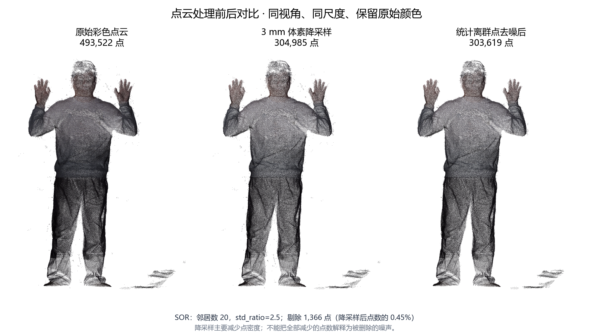
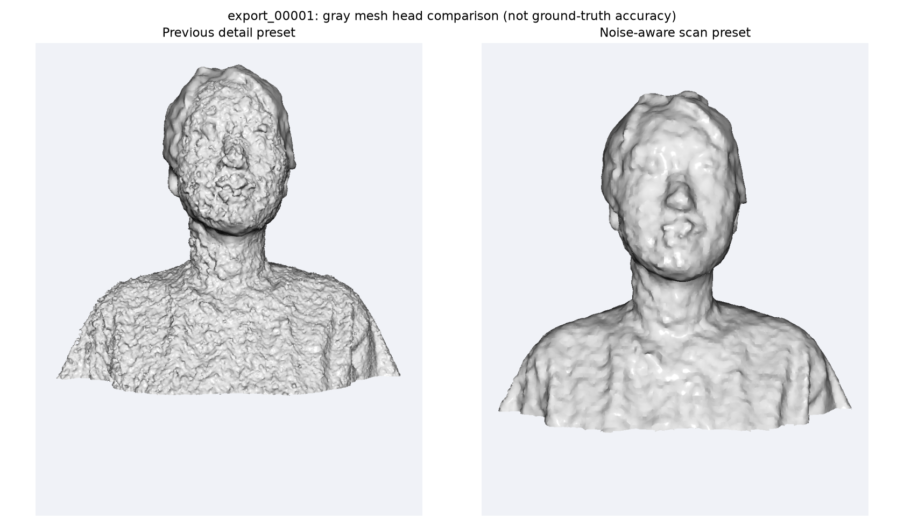
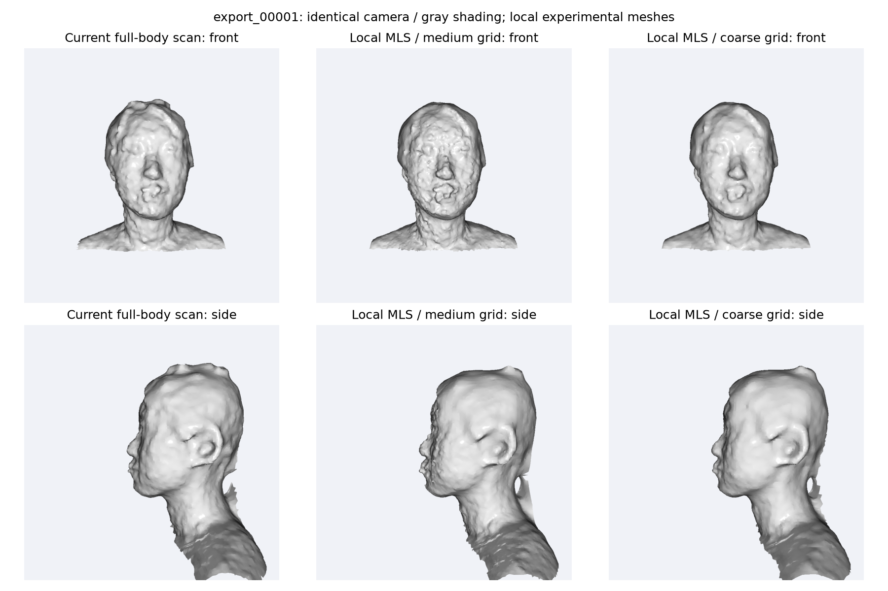
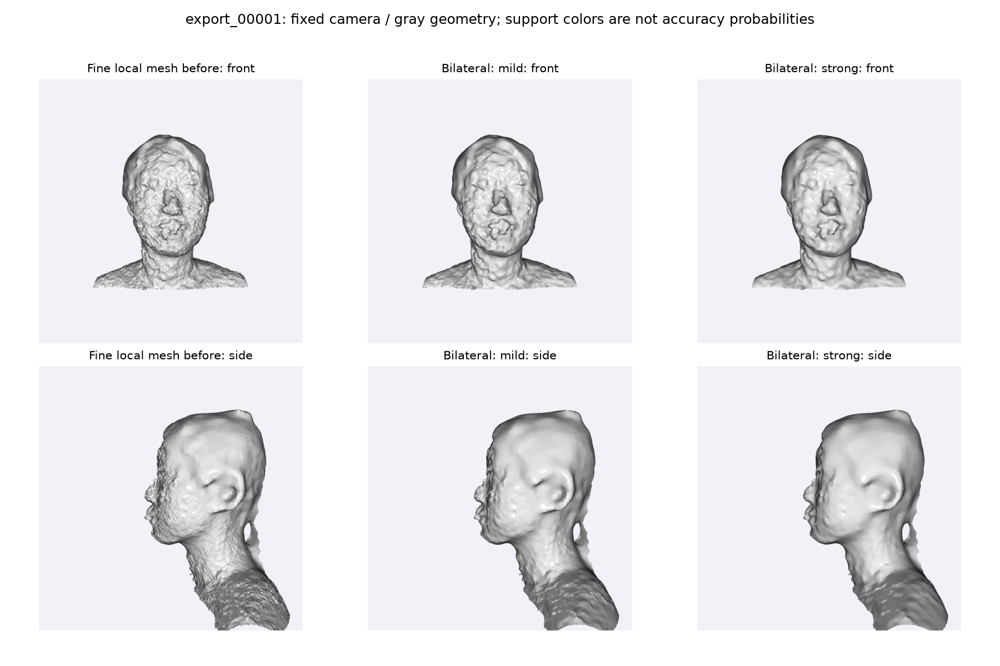
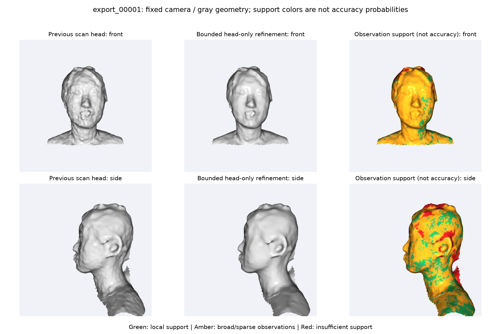
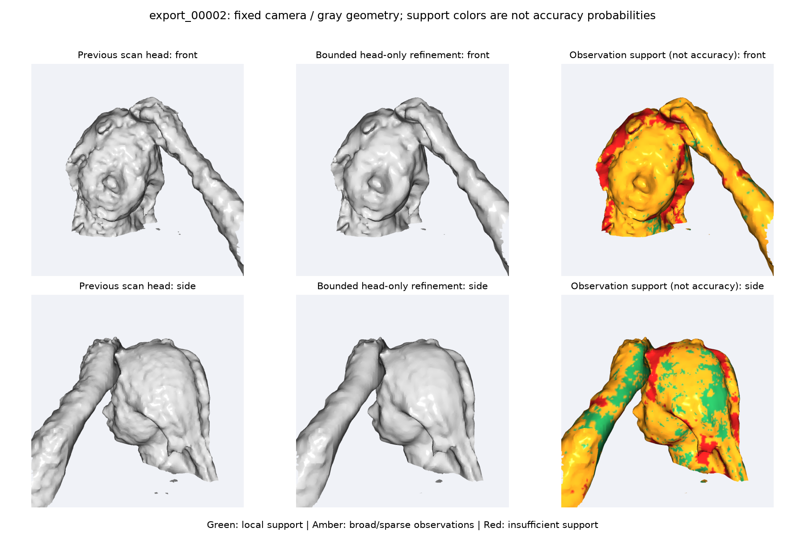

# 人体点云去噪与三维重建中期说明

我们目前完成了从设备合成 PLY 点云到人体三角网格的处理流程，并围绕面部粗糙问题进行了多种传统方法对比。当前保留的方案是：先清理和去噪点云，再进行完整人体重建，最后对头部所在的上部区域做限定位移的轻度网格去噪。

阶段性结果是表面颗粒有所减少，处理范围和变形程度更可控；面部五官仍有模糊，尚不能认定几何精度得到了提高。整个过程不使用深度学习。

## 一 我们拿到的是什么数据

输入是摄影设备已经合成好的 PLY 文件。其中 `export_00000.ply` 是最初的数据，后续增加了 `export_00001.ply` 和 `export_00002.ply`，三份原始文件均保留在 `data` 文件夹。

可以把点云理解为“许多带有位置和颜色的空间小点”。它记录了人体的外形，但这些点本身不一定连接成表面。重建的目标就是根据这些点生成由三角形连接起来的网格，也就是能在建模软件里查看和使用的三维模型。

我们只有设备合成后的文件，没有逐帧深度图、相机位姿和原始采集工程。因此，本阶段工作从接收 PLY 开始，不包括设备内部的采集与多帧合成，也无法重新进行逐帧配准。

## 二 从点云到模型具体做了什么

整体顺序为：读取原始点云 → 清理与降采样 → 去除离群点和背景 → 局部去噪 → 估计表面方向 → Poisson 重建 → 网格整理与颜色映射 → 局部网格优化 → 检查与导出。

### 第一步 检查并清理原始点云

读取 PLY 中的位置、颜色等信息，清除无效坐标和重复点，统一计算单位。原始文件不改动，后续处理结果另外保存。

这一步主要避免坏数据和单位错误影响后面的计算，并不是恢复缺失的形状。

### 第二步 降采样并去除明显离群点

使用**体素降采样**：把空间分成小格子，每个格子用代表点描述，减少过密、重复的信息，降低计算量。当前新扫描方案使用 2 mm 格子。

随后使用**统计离群点去噪 SOR**：检查每个点与周围点的距离，排除明显孤立的点。它适合清理散落噪点，但很难单独消除贴在人体表面上的粗糙起伏。

图 1　早期数据的基础清理示例，从左到右为原始点云、3 mm 降采样、统计离群点去噪。点数由 493522 降至 304985，再降至 303619。前一次主要是降低密度；后一次删除了 1366 个离群点，约占降采样后点数的 0.45%。不能把所有减少的点都算成噪声，也不能把早期 3 mm 配置当作当前 2 mm 配置。

### 第三步 分离人体主体并做温和的表面去噪

只靠统计离群点过滤，仍可能留下成片的背景。因此，我们加入了**基于密度的聚类 DBSCAN**，把相互连接的点分成几组，优先保留最大的人体主体。

接着使用**稳健局部平面拟合**：参考一个点周围较可靠的点，估计附近表面大致应在哪里，再对符合条件的点做小幅调整。对邻域不足或不适合平面拟合的位置尽量少动，避免为了平滑而破坏形状。当前方案做两轮调整，点的位置相对原始观测累计移动不超过 1 mm。

主体筛选默认假设只有一个相互连接的主体；若存在断开的有效部位或多个人体，需要检查是否误删，不能无条件套用。

### 第四步 估计方向并重建表面

先重新估计并统一点的**法线**，可以把它理解为“这个位置的表面朝哪个方向”。方向信息越稳定，后续生成表面就越有依据。

随后使用 **Poisson 重建**，根据点的位置和方向拟合一个连续表面，将离散点转换为三角网格。当前新扫描方案采用深度 9，且不额外压缩面数。

重建精细度更高，并不一定意味着结果更真实。如果输入本来有噪声，更精细的设置也可能把噪声重建成密集的小凸起。

### 第五步 整理网格并保留颜色

清理重复或无效三角面、去掉非主体碎片，并做少量网格平滑。再从原始点云映射颜色，让模型保留采集时的外观。

判断几何时同时查看灰色模型。彩色看起来相似，不一定说明表面的形状也准确；灰色更容易暴露颗粒、凹凸和轮廓问题。

### 第六步 对上部区域做保守的网格去噪

使用**双边面法线过滤**：让相连且方向相近的三角面适度协调，再调整顶点位置，减少细碎起伏，并尽量保留明显转折。

当前保留方案对这一阶段再设置累计移动不超过 1 mm，固定边界及异常连接处的顶点，并加入局部三角面翻转保护。这里的 1 mm 是相对进入后处理的网格，不是整个重建流程相对原始点云的误差上限。

处理范围按当前扫描的高度坐标限定，上下有渐变过渡，避免全身都被反复平滑。这不是自动人脸识别；第二份数据同高度的抬起手臂也会被处理，完全非活动区域则保留原有位置与颜色。

### 第七步 检查并导出

检查边界、异常面连接，以及模型与观测点的距离，输出模型和检查记录。同时生成观测支撑着色图，帮助发现附近观测较少或分布较厚的区域。

最终模型可保存为 PLY，也可以通过新增的格式转换脚本导出 OBJ。格式转换只改变保存方式，不会提高模型精度。

## 三 为了改善面部我们比较了哪些方案

### 对比一 提高精细度还是先抑制噪声

图 2　同一份 `export_00001`，左侧为此前偏重细节的重建配置，右侧为加入噪声处理的 `scan` 配置。右侧脸部和颈部的碎颗粒减少，但鼻口等部位仍有变形和模糊。

结论：对这批数据，优先处理噪声，比单纯追求更精细的重建更适合作为完整模型的基础。这个对比同时改变了多项配置，不能把全部改善归功于某一个参数。

### 对比二 单独裁出头部再重建是否更好

我们还尝试裁出头部，使用局部曲面拟合 MLS，并比较不同重建粒度。可以把 MLS 理解为“用附近的点拟合一小块弯曲表面”，希望比局部平面更好地保留曲率。

图 3　从左到右为完整人体方案中的头部、局部 MLS 中等粒度重建、局部 MLS 较粗粒度重建。上排正面，下排侧面。中间方案仍有较多颗粒，右侧更平顺，但没有显示出明确的五官恢复优势。

结论：裁出头部、使用更复杂的拟合，并没有自然得到更准确的人脸。局部试验保留为对比依据，不作为当前完整人体输出的主方案。

### 对比三 网格过滤越强是不是越好

图 4　同一个细局部网格，从左到右为未过滤、轻度过滤、较强过滤。较强过滤让皮肤表面更平顺，但鼻口等大尺度问题仍然存在。此图用于比较过滤强弱，不是当前完整模型的最终效果。

结论：强过滤更容易获得平滑外观，但也有抹掉真实细节的风险。因此，当前完整模型选择限定位移的轻度后处理，而不是把“越光滑”直接当作“越准确”。

## 四 当前保留方案的效果

图 5　`export_00001` 当前方案。从左到右为 `scan` 重建、上部限定的保守优化、观测支撑着色；上排正面，下排侧面。中间图的细碎起伏减少，脸部整体轮廓基本延续输入网格。

图 6　`export_00002` 相同方案的对比。局部更平顺，但头部和鼻口的较大起伏仍可见，没有被这一步完全修复。图中只展示上部裁切视图，实际处理对象是完整人体网格。

支撑图中，绿色表示当前规则下附近观测支持较充分，黄色表示较稀疏或分布较厚，红色表示点不足或离原始点较远。这些颜色不是准确率，绿色也不能证明形状正确。

### 用少量数据说明改动程度

| 检查内容 | export_00001 | export_00002 |
| --- | --- | --- |
| 后处理头部顶点移动 P95 | 0.574 mm | 0.701 mm |
| 原始头部观测到模型的距离 P95 | 6.321 → 6.414 mm | 7.647 → 7.912 mm |
| 相邻面法线夹角中位数 | 5.437° → 3.574° | 7.675° → 5.256° |

P95 可以理解为“按数值从小到大排列后，95% 的样本不超过的值”。第一行说明大部分顶点移动较小；第三行说明局部表面方向变化减小、表面更平顺。

第二行的距离反而略有增加，分别约 0.09 mm 和 0.27 mm，说明平滑与贴近观测之间存在取舍。原始点云本身也不是无噪声真值，所以这些数值只能说明与输入观测的贴合程度，不能当作真实精度或精度提升率。以上为前期两份数据的实验记录，不是本次重新运行的结果。

### 哪个方案更适合保留

| 方案 | 本批数据上的主要表现 | 当前选择 |
| --- | --- | --- |
| 偏重精细度的重建 | 能生成较细网格，也保留较多小颗粒 | 用于对照 |
| 加入噪声处理的完整重建 | 颗粒减少，完整人体处理流程清晰 | 保留为基础 |
| 头部局部 MLS 重建 | 能改变局部外观，五官恢复优势不明确 | 不作为主方案 |
| 较强网格过滤 | 更平顺，但可能损失真实细节 | 用于对照 |
| 完整重建加有界轻度后处理 | 在减少颗粒与控制变形之间折中 | 当前保留方案 |

这里的“更适合”指当前两份新扫描上的外观和处理可控性，不表示已证明它对所有数据最优，也不表示它的真实几何精度最高。

## 五 目前完成的工作与后续问题

目前已完成点云清理、传统去噪、法线估计、完整人体重建、局部网格后处理、对比图整理和 OBJ 导出。代码还配有 18 项回归测试，用于检查位移限制、边界固定、区域外不动和格式转换等行为；这些测试不代替真实扫描精度评估。

仍需解决的是面部大尺度形状不够自然，以及局部孔洞和异常连接。历史两个完整候选仍有 32 和 30 条边界边，第二份仍有 13 条非流形边，说明模型并未自动达到完全封闭、可直接打印的状态。完整自交检查也未在这轮候选中执行。

后续优先检查和修复现有网格的孔洞与连接问题，再结合原始点云评估鼻口等重点区域。若之后能够获得更高质量扫描或逐帧数据，再进一步研究从采集和配准阶段改善细节；当前阶段不承诺仅靠平滑恢复缺失的五官。

## 六 答辩时可以这样概括

我们接收的是设备已经合成好的彩色 PLY 点云。在原有重建代码基础上，我们先进行降采样、离群点去除和人体主体筛选，再通过局部拟合减轻表面噪声、稳定法线，随后使用 Poisson 方法生成三角网格。

针对面部粗糙，我们比较了精细重建、头部局部重建，以及不同强度的网格过滤。结果表明，提高精细度会同时保留噪声，强平滑也不能直接恢复五官。因此，我们目前保留完整人体重建，并增加限定位移的轻度上部网格去噪。阶段性改善主要体现在颗粒减少和处理更可控，面部真实性及拓扑修复仍是后续重点。

## 附 图文材料位置

基础清理图位于 `outputs/comparisons/denoise`，重建配置对比位于 `outputs/comparisons/scan`，头部专项试验位于 `outputs/comparisons/head`，网格过滤及当前方案对比位于 `outputs/comparisons/refine`。历史实验模型和逐项报告已按项目整理要求清理，对比图仍保留。

当前流程的运行方法见 [使用说明](使用说明.md)。实现对应 `reconstruct_human.py`、`surface_detail.py`、`mesh_refine.py` 和 `ply_to_obj.py`。
