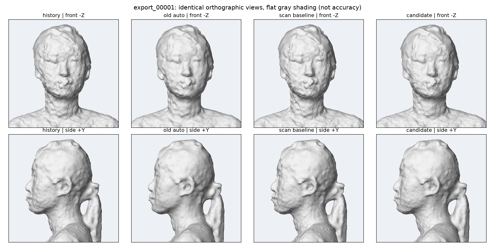
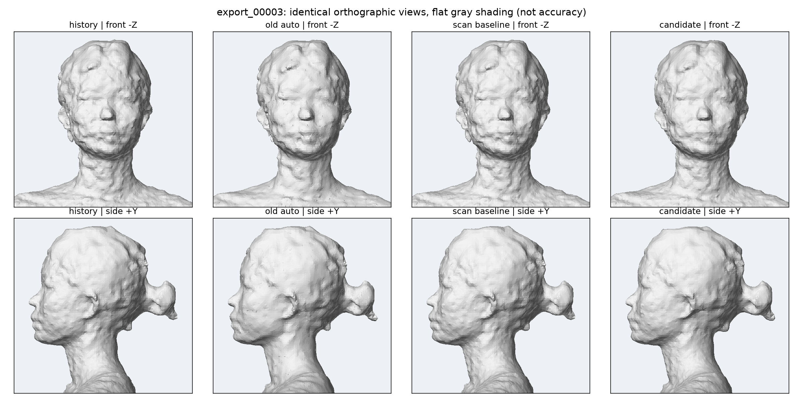

# 自动流程回归检查与修正

2026 年 10 月 29 日，针对 export_00001 和 export_00003 实际重建并对比。结论是此前自动配置组合出现回归，不能只归因于鞋底删面。当前默认恢复 history 所用的稳定 scan 基线，不宣称已经优于 history 或恢复了新的真实细节。

## 做了哪些实际对比

| 方案 | 采样格 | 法线邻域 | Taubin 平滑 | 鞋底删面 | 用途 |
| --- | --- | --- | --- | --- | --- |
| history 基线复现 | 2 mm | 12 mm 64 邻点 | 2 轮 | 关闭 | 两份数据均重跑 |
| 旧自动流程 | 约 1.75 或 1.84 mm | 约 11 mm 64 邻点 | 0 轮 | 开启 | 对照用户已有结果，另外含双边过滤 |
| 扩大邻域候选 | 2 mm | 14 mm 96 邻点 | 2 轮 | 关闭 | 两份数据均重跑 |
| 旧自动参数关闭鞋底 | 1.747 mm | 10.961 mm 64 邻点 | 0 轮 | 关闭 | 单独重跑 0001，隔离鞋底影响 |

最后再通过修正后的 run.py 对两份数据完整重建，另存 PLY、OBJ 及报告。未覆盖或删除原始数据、history 或用户生成的旧模型。

## 确认的问题

0001 的旧自动结果有 757 条边界边、6 条非流形边，面朝向统一失败。仅关闭鞋底删面后仍有 5 条非流形边，朝向仍失败，说明自动参数组合本身有问题。基线复现为 32 条边界边、0 条非流形边、朝向统一成功。

旧自动流程同时改变了采样、法线半径、平滑和后处理，原始观测到模型的单向距离无法排除多余表面、非流形连接和面方向错误。本轮隔离确认了自动配置组合回归，但没有把所有差异单独归因于某一个参数。

在位置接近的匹配三角面中，0001 旧自动模型约 94% 与 history 朝向相反。这个比例仅是相对比较，不能解释为 94% 的面错误：history 的整体方向本身也可能朝内。真正需要处理的是一致定向失败，以及不同扫描整体朝向不统一。

0003 的旧自动结果不具有相同程度的方向反转；其外观差异仍涉及采样、平滑与额外后处理。不能把 0001 的诊断直接当成所有数据的统一成因。

## 扩大邻域是否更好

| 相同区域内网格顶点到原始点的距离 P95 | 基线 | 扩大邻域 |
| --- | --- | --- |
| 0001 头部 | 5.193 mm | 5.212 mm |
| 0001 身体中段 | 3.336 mm | 3.332 mm |
| 0003 头部 | 5.723 mm | 5.713 mm |
| 0003 身体中段 | 3.509 mm | 3.483 mm |

以上距离是对原始观测的贴合诊断，不是真实几何精度。区域按 history 的相同高度范围选取，身体统计排除了底部约 200 mm 及头部，避免鞋底掩盖中段问题。扩大邻域在两份数据上有小幅不同的取舍，同视角图也没有证明它明显更准确，因此没有把它直接作为新默认。

从左到右是 history、旧自动、基线复现、扩大邻域候选。上排正面，下排侧面。图片采用相同正交视角、双面灰度投影，仅用于比较几何外形，弱化了正反面差别，不模拟建模软件的背面剔除和光照。软件里可能出现更明显的显示差异。

## 现在默认流程的变化

1. 常规扫描恢复 2 mm 采样、12 mm 法线半径、64 邻点、depth 9、两轮点云去噪、两轮 Taubin 平滑。局部离散度只用于诊断，不再据此随意缩小邻域和改变深度。
2. 额外双边过滤默认关闭，只有 --refine 才开启。鞋底删面默认关闭，仍可显式开启，但会产生开口，不作为已完成的真实鞋底修复。
3. 朝向统一失败时，run.py 报错并只保留中间结果，不再输出为成功模型。最初曾增加开口网格整体翻面，后续截图检查确认它改变了 history 的显示表现，现已撤回；开口网格的有向通量仅用于记录，不用于自动翻面。
4. 输入输出自动管理、短命令、哈希缓存及旧结果不覆盖继续保留。极稀疏点云另有保守回退，但尚未在本批以外的数据上验证。

本轮最终 0001 为 390428 个面、32 条边界边，0003 为 405472 个面、12 条边界边；两者均可统一朝向且非流形边为 0。与 history 的面数及边界数一致，95% 顶点到 history 的最近距离小于 0.001 mm；少量局部仍有约 1 到 1.5 mm 差别，不能称为文件或全部坐标完全一致。原始数据哈希核验未变化。完整自交检查仍未执行。

## 查看本轮正式结果

- [0001 修正版 PLY](../outputs/models/export_00001/20261029_212248_041159/export_00001_mesh.ply)
- [0003 修正版 PLY](../outputs/models/export_00003/20261029_212248_055162/export_00003_mesh.ply)

同目录有 OBJ 和完整报告。以后继续运行 python run.py 1 或 python run.py 3，无需照着实验命令手填长参数。实验中间结果另放 outputs/experiments/parameter_regression，不与正式模型混放。

## 后续截图核对与法线修正

用户明确比较 history/scan/export_00001_mesh.ply 与 models/export_00001/20261029_212248_041159 的 PLY。新版截图更亮，面部和衣物凹凸对比更强。核对这两个确切文件，头部顶点到 history 的最近距离 P95 约 0.000028 mm，顶点法线方向中位点积为 -1，说明朝向几乎整体反转。只看几何数量及无光照的双面灰度图不足以解释 MeshLab 中的显示差异，前面的验证漏掉了这一项。

现已移除开口表面自动全局翻面。另制作 [只修正朝向的对照 PLY](../outputs/experiments/normal_direction_check/export_00001_normal_only.ply)，导出读回逐项核验顶点位置与颜色完全不变，仅翻转三角面绕序和法线符号。它用于隔离光照因素，不代表真正提高几何精度或新增细节。

[当前重建 PLY](../outputs/models/export_00001/20261029_214717_112915/export_00001_mesh.ply) 采用撤回整体翻面后的默认流程。此前 212248 目录的模型继续保留作为对照，不再作为显示兼容的最终推荐文件。截图已显示出差别，但是否恢复用户期待的观感，仍需用相同 MeshLab 设置实际查看修正版；不能用数值接近就替代用户的视觉验收。
