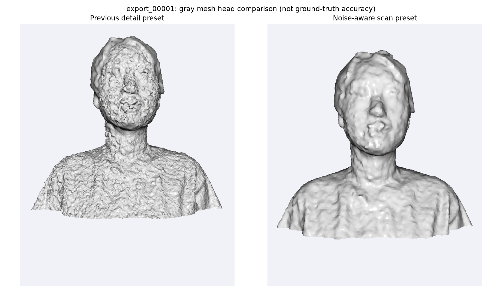
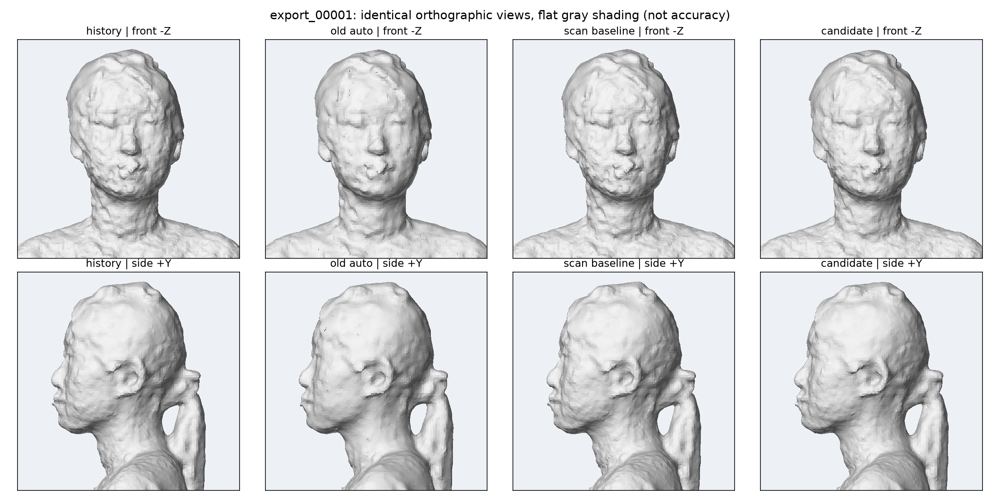
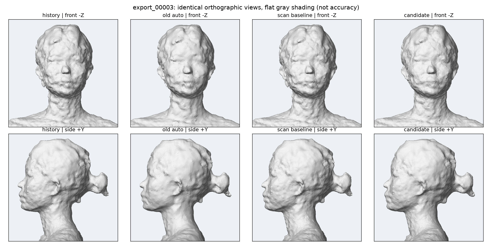
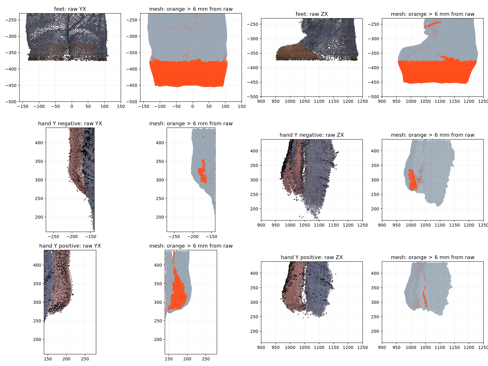
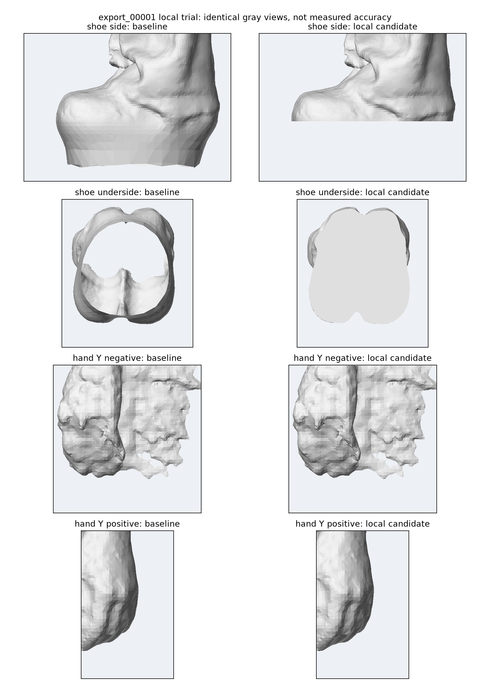

# 点云重建试验过程与结果

整理日期：2026-11-01。本文件统一记录从拿到设备合成 PLY 开始，历次去噪、重建、局部修复和人体分割的尝试、结果及取舍。后续试验继续补在本文件中。

原先分散的自动流程回归、鞋底与手掌试验、手部通用优化、两种预训练分割模型、识别区域手部优化、掌面厚块排查说明已合并到这里。历史结果按当时输入和版本解释，不能直接当成最新模型的结果。

项目清理后，重复或已撤回的模型仅保留历史指标和代表性对比图；下文历史命令是当时的试验记录，部分脚本已删除，不能继续作为当前入口。现有代码和结果目录以 [使用说明](使用说明.md) 及本文件最后的清理记录为准。旧模型报告统一归档在 outputs/experiments/archived_runs.json。

日常命令见 [使用说明](使用说明.md)，位置文件字段见 [人体部位位置文件](人体部位位置文件.md)，前期汇报稿见 [中期答辩说明](中期答辩说明.md)。

## 一、目前采用什么，什么还没解决

| 内容 | 当前状态 | 说明 |
| --- | --- | --- |
| 稳定 scan 点云去噪与 Poisson 重建 | 默认采用 | 常规数据使用 2 mm 采样、depth 9、12 mm 法线邻域、两轮点云去噪和两轮基础网格平滑 |
| 额外双边网格过滤 | 默认关闭 | 可用 --refine 试用，没有证明对所有数据更好 |
| 鞋底截断补面 | 默认尝试 | 00001 已由用户确认；新数据仍需检查，不等于还原真实鞋底 |
| 少量非流形面清理 | 满足限制时尝试 | 超出预算或仍无法统一朝向时保留中间结果并报错 |
| 法线方向修正与孤立黑点颜色修补 | 默认采用 | 改外观，不恢复新的几何细节 |
| HumanPartSegmentation 公开权重 | 未采用 | 作者参考样例和本项目四组数据均出现单一类别输出 |
| Sapiens 人体部位识别 | 默认尝试 | 生成 body_parts.json，定位部位，不区分每根手指 |
| 基于识别区域的局部 Taubin 手部平滑 | 历史默认，已替换 | 最大位移 2 mm 的保守方案，后由手腕限厚与整手强平滑替代 |
| 原始观测约束的掌面厚块收薄 | 未采用 | 试验出现凹痕、折边，保守版本收益又不足；正式模型未替换 |
| 手腕引导的近似掌面收薄 | 已撤回默认 | 独立预览后曾接入，2026-11-04 按用户要求恢复仅识别阶段 |
| 整手强平滑及后续指部回补 | 已撤回默认 | 指形变尖，回补后用户仍不满意，恢复整手优化前基准 |
| 条件掌面限厚及掌面强平滑 | 2026-11-04 已撤回默认 | 掌面 P95 同时超过腕厚 1.35 倍和 8 mm 才处理；限厚到指尖，不做手指/手背平滑；不可靠则保持基准 |

当前使用 Meta/Sapiens 仅识别阶段，不执行手部变形，恢复后的模型和外部软件代码评估见第十八节；第十四至十六节均为已撤回的手部方案记录。

## 二、数据与评价方式

输入为摄影设备已经合成好的彩色 PLY，目前主要对照 data 中的 export_00000～export_00003。只有合成文件，没有逐帧点云、深度图、相机位姿和原始采集工程，无法回到采集与逐帧配准阶段重做。

几何重建和局部过滤使用传统方法；后期加入的 Sapiens 是预训练图像分割模型，仅用于提供区域位置，不能再把当前整条流程称为完全不使用深度学习。

试验主要同时看三类证据：相同视角和材质的外观对比、与原始点云的贴合距离、几何安全检查。原始点云本身有噪声和缺失，不是无误差真值。

| 指标 | 能说明什么 | 不能说明什么 |
| --- | --- | --- |
| 原始点到网格距离 | 已有观测是否贴合生成的表面 | 无法单独排除多余表面 |
| 网格到原始点距离 | 哪些生成表面缺少附近观测 | 远离观测不必然等于形状错误 |
| P95 | 95% 的样本数值不超过该值 | 不同方向、区域或样本集合不能直接混比 |
| 相邻面法线夹角 | 局部方向变化和表面起伏 | 越平顺不等于越符合真实解剖结构 |
| 边界、非流形、翻面、穿插 | 指定范围内的几何缺陷 | 局部通过不等于全身封闭或可直接打印 |

各轮参数和输入可能不同，重新运行也可能产生少量局部数值差异。下文数字保留对应轮次，不统一改成最新版本。

<a id="early"></a>
## 三、前期：基础去噪、面部与局部重建对比

### 1. 建立完整人体流程

先清理无效坐标和重复点，再体素降采样、统计离群点去除（SOR）、DBSCAN 主体筛选、稳健局部平面去噪、法线估计与统一、Poisson 重建、碎片清理和颜色映射。处理结果另存，原始点云保留。


早期 3 mm 采样示例：493522 点降至 304985，再经 SOR 降至 303619。SOR 删除 1366 个孤立点，约占降采样结果的 0.45%。降采样减少的点不能全部算成噪声；该图也不是当前 2 mm 配置的统计。

### 2. 追求更细网格，还是先抑制噪声



加入去噪的 scan 方案减少了脸部和颈部碎颗粒，但鼻口仍模糊。单纯提高重建精细度也会保留噪声，因此完整 scan 流程更适合作为基础。此对比同时改变多项配置，不能把改善归因于一个参数。

### 3. 单独裁头、MLS 与更强过滤


比较完整人体中的头部、局部 MLS 中等粒度和较粗粒度重建。较粗方案更平顺，但没有证明能更好恢复五官，因此头部裁切重建未成为完整人体默认方案。


较强过滤减少小起伏，但鼻口的大尺度形状问题仍存在，并有损失细节的风险。前期曾保留上部区域限定位移的轻度双边法线过滤；后续自动流程回归时，额外双边过滤改为默认关闭。

| 前期上部区域后处理记录 | 00001 | 00002 |
| --- | --- | --- |
| 头部顶点移动 P95 | 0.574 mm | 0.701 mm |
| 原始头部观测到网格 P95 | 6.321→6.414 mm | 7.647→7.912 mm |
| 相邻面法线夹角中位数 | 5.437°→3.574° | 7.675°→5.256° |

表面更平顺，但观测距离略增，不能称为真实精度提升。完整对比图：[00001](../outputs/comparisons/refine/export_00001/full_head_comparison.png)、[00002](../outputs/comparisons/refine/export_00002/full_head_comparison.png)。本阶段历史模型、报告和试验代码已按之前整理要求清理，保留对比图；当时的 18 项测试也不表示当前仍有 tests 目录。

<a id="regression"></a>
## 四、2026-10-29：自动参数回归与 history 复现

用户发现自动重建的面部和全身平滑程度明显不如 history。对 00001、00003 重跑基线和候选，确认不能只把问题归因于鞋底删面。

| 方案 | 采样 | 法线邻域 | 基础 Taubin | 鞋底删面 | 对照范围 |
| --- | --- | --- | --- | --- | --- |
| history 基线复现 | 2 mm | 12 mm / 64 邻点 | 2 轮 | 关闭 | 两组均重跑 |
| 旧自动流程 | 约 1.75 或 1.84 mm | 约 11 mm / 64 邻点 | 0 轮 | 开启 | 用户旧结果，另外含双边过滤 |
| 扩大邻域候选 | 2 mm | 14 mm / 96 邻点 | 2 轮 | 关闭 | 两组均重跑 |
| 旧自动配置关闭鞋底 | 1.747 mm | 10.961 mm / 64 邻点 | 0 轮 | 关闭 | 单独重跑 00001 |

00001 旧自动结果有 757 条边界边、6 条非流形边，朝向统一失败；单独关闭鞋底后仍有 5 条非流形边。基线复现则为 32 条边界边、0 条非流形边且朝向统一成功，说明自动参数组合本身发生回归。

在位置相近的匹配面中，00001 旧自动结果约 94% 与 history 朝向相反。这是相对朝向统计，不是“94% 的面错误”；history 自身的全局方向也可能朝内。00003 没有出现相同程度的全局反转，不能把 00001 的成因套到所有扫描。

| 同一区域网格到原始点的距离 P95 | 基线 | 扩大邻域 |
| --- | --- | --- |
| 00001 头部 | 5.193 mm | 5.212 mm |
| 00001 身体中段 | 3.336 mm | 3.332 mm |
| 00003 头部 | 5.723 mm | 5.713 mm |
| 00003 身体中段 | 3.509 mm | 3.483 mm |





四列依次为 history、旧自动、基线复现、扩大邻域。上排正面、下排侧面，采用双面灰度正交视角，不模拟 MeshLab 的背面剔除和真实光照。扩大邻域没有显示出明确优势，未设为默认。

该轮基线 00001 为 390428 面、32 条边界边；00003 为 405472 面、12 条边界边。两者非流形边为 0，95% 顶点到 history 最近距离小于 0.001 mm，但少量局部仍有约 1～1.5 mm 差异，不称为完全相同文件。

**采用的修正：**恢复 2 mm 采样、12 mm / 64 邻点法线、depth 9、两轮点云去噪（累计上限 1 mm）和两轮基础网格平滑；额外双边过滤默认关闭；局部离散度作为诊断，不再据此随意缩小邻域。

### 后续截图揭示的朝向问题

用户进一步比较 history 与 20261029_212248_041159 的 00001。头部顶点到 history 的距离 P95 只有约 0.000028 mm，顶点法线点积中位数却为 -1，说明几何接近但朝向几乎反转，造成新版更亮、凹凸更强。

因此撤回了依据有向通量对开口网格做整体翻面的处理；有向通量仅作诊断。制作的 仅修正朝向对照（旧文件已清理） 已核验顶点位置、颜色完全不变，只调整面绕序与法线。数值接近不能替代相同 MeshLab 设置下的视觉检查。

<a id="sole"></a>
## 五、2026-10-29 起：鞋底厚块与早期手掌试验

### 鞋底：截断并补面，用户确认后采用

00001 的主体原始观测最低 X 约 -374.99 mm，网格延伸到约 -456.35 mm，额外向下约 81.36 mm，明显缺少观测支持。

候选在最低观测下方 3 mm，即 X 约 -377.99 mm 处截断，并沿切口三角补面。相比仅删面，这次补闭切口；候选边界边和非流形边均为 0，鞋底之外顶点和颜色不变，但未做全身自交检查。





对比图左为原模型，右为鞋底加温和手部处理；鞋底变化明显，手部变化有限。橙色支撑图表示有顶点距主体点云超过 6 mm，是诊断阈值，不是错误概率。

用户认可鞋底后加入 run.py，最初按原始点云哈希匹配 00001；之后按用户要求向新数据默认开放底面估计及截断补面尝试。可用 --no-shoe-repair 关闭。旧 --sole-axis 删面功能仍独立存在，不能与新补面功能同时使用。

平底是人工近似，不是实测鞋底纹理、弯曲或厚度。原模型底部两脚已有共同连接，本轮没有强行分鞋；也不能把该次 X 坐标直接用于其他模型。

保留的 鞋底候选 PLY（旧文件已清理） 用于历史对照。新扫描的坐姿、倾斜方向和异常地面仍需人工检查。

### 手掌：人工框选的局部平面拟合未采用

两侧手部网格到最近原始观测的最大距离约 13、21 mm。人工限定手部范围后，尝试稳健平面投影、冻结边界及翻面保护，累计位移上限 4 mm。实际移动 276 个顶点，最大约 2.98 mm，局部距离 P95 仍约 6.65 mm，连片形状没有明显改善。

该手掌方案未采用。它依赖本次姿态的人工框，不能推广到所有新 PLY；手不能像缺失鞋底那样直接切平。

<a id="topology"></a>
## 六、2026-10-30：只有 intermediate 的原因与拓扑回退

00002 因少量非流形边导致朝向统一失败，流程正确地没有把中间模型当成最终成功结果导出。

随后增加受限回退：在副本中清理非流形小面、保留最大主体，再要求朝向统一、边和顶点流形检查通过。删除面数和面积都不得超过原模型的 0.1%，超预算或仍失败则保留中间结果并记录失败。

该轮 00002 删除 88 面（约 0.0212%）和 220.96 mm² 表面积（约 0.0124%）；边界边由 30 增至 42，非流形边降为 0，朝向统一成功。顶点位置保留，但可能留下小开口，不属于自动补洞或打印认证。见 该轮报告（旧文件已清理）。

<a id="appearance"></a>
## 七、2026-10-30：模型发暗、法线方向与黑点颜色修补

00000、00001 的发暗不能简单解释为颜色值低。后续采用相邻面定向和外部射线首次命中投票判断外侧，避免只依靠开口表面的有向通量；判定不足时保留原方向。

颜色方面只修补小型暗色连通块，参考边界颜色插值，不整体提亮。最大候选斑块尺度 12 mm、暗色亮度阈值 0.1；真实黑色细节也可能被误判，不能称为恢复真实颜色。

| 当时独立外观试验 | 调整绕序的面数 | 修补颜色的顶点数 |
| --- | ---: | ---: |
| 00000 | 483288 | 1987 |
| 00001 | 389470 | 6976 |
| 00002 | 0 | 5594 |
| 00003 | 0 | 5159 |

这些是 outputs/appearance 对应轮次报告的数量，后续重跑可能稍有变化。外观处理已接入 run.py，位置和面连接不变；--normals-only 只修方向，--no-appearance 全部关闭。它改善显示和局部颜色瑕疵，不增加五官或手指几何细节。

<a id="geometric-hands"></a>
## 八、2026-10-31：不依赖分割的通用手部优化

四组数据使用同一规则，比较人体比例与表面距离定位、薄结构检测、局部双边平滑、原始观测约束的平面投影。

薄结构检测能覆盖部分手部，但也误选袖口和衣服折边，不能当成准确人体识别。小邻域、1.5 mm 位移上限候选的局部原始点到网格 P95 只下降约 0.001～0.025 mm，外形改善很小；00000、00002、00003 各新增一对局部穿插，00001 虽未新增但收益也不足。

**结论：未采用。**该轮 outputs/experiments/hand_generalization 已按用户要求整目录删除，释放约 327.33 MiB；仅保留本段过程和结论，不提供已删除图片或脚本的失效链接。

<a id="humanpart"></a>
## 九、2026-10-31：HumanPartSegmentation 公开权重试用失败

来源：[HumanPartSegmentation](https://github.com/issacchan26/HumanPartSegmentation)，固定提交 85b968a9906abe5b305ef634d34712ac88c17e77。试过官方 best_28_class.pt、best_4_class.pt、best_6_class.pt，来源哈希记录在 tools/humanseg/source_manifest.json。

使用隔离的 Python 3.11.16、PyTorch 2.5.1+cpu、PyG 2.6.1、torch_cluster 1.6.3+pt25cpu；未给 dachuang 安装依赖。权重严格加载，学习层未改，传全 1 占位特征以绕过上游只适合 CUDA 的设备分支。

| 对照 | 结果 |
| --- | --- |
| 作者带 28 类标注的 training_reference，eval 推理 | 10000 点全部为类别 17（left_hip），与参考标注一致率 5.47% |
| 原坐标/归一化坐标、float32/float64 | 仍为单一类别 |
| 临时 train 模式诊断 | 一致率约 13.67%，仍不可用，且不是标准推理结果 |
| 官方 4 类权重 | 作者样例全部为类别 0 |
| 官方 6 类权重 | 作者样例全部为类别 4 |
| 用户四组扫描，各采样 10000 点，水平朝向 0°/180° | 28 类模型仍全部为 left_hip，没有找到手部 |

参考样例的 5.47% 不是用户数据准确率，也不是独立测试集精度。预测置信度接近 1 仍可能完全错误。[上游 Issue #2](https://github.com/issacchan26/HumanPartSegmentation/issues/2) 有类似单一类别现象；本项目没有重新训练，无法唯一认定是权重、训练过程还是版本兼容导致。

**结论：未接入。**[四组失败对比](../outputs/segmentation/humanpart/comparison_yaw_180.png) 和小体积报告保留在 outputs/segmentation/humanpart。临时环境、权重、错误着色点云及数组已删除，约释放 1459 MiB。tools/humanseg 仅为适配代码存档，缺少环境和权重时不能直接复现。

<a id="sapiens"></a>
## 十、2026-10-31：Sapiens 分割与位置文件接入

### 方法与四组结果

采用 Meta 官方 Sapiens-Lite 0.3B TorchScript 分割权重。先渲染四个水平正交视角（0°、90°、180°、270°，768×1024），对图像分割，再按射线命中的三角面与重心坐标把标签投票回网格。

掠射像素不参与有效投票，其余按可见角度加权；至少两个视角支持、加权占比达到 0.65 才保留。按同一规则去掉小于 max(12, 最大连通块顶点数的 3%) 的手部孤立标签。该规则减少少量头发误标签，也可能漏掉真实指尖。


每行左为原始渲染、中为二维分割、右为三维手部标签；绿色为左手，粉色为右手。

| 最初独立手部投票试验 | 姿态 | 左手标签顶点 | 右手标签顶点 |
| --- | --- | ---: | ---: |
| 00000 | 双手举起 | 1962 | 2129 |
| 00001 | 双手下垂、接近身体 | 1239 | 1005 |
| 00002 | 一手放在头上 | 1783 | 1654 |
| 00003 | 双臂向两侧下方展开 | 1391 | 2002 |

上述是最初手部标签试验，不是后续“所有类别一起融合”的生产位置文件数量；输入网格、融合规则和重跑版本不同，数量会变化，不能把标签越多理解为识别越好。

四组均出现可用的人体区域定位，没有重现上一项目的全身单一类别。标签试验只着色，不改来源网格位置、连接关系或非手部 RGB；这还不是几何修复。没有人工逐点真值，不能报告分割准确率。28 个输出类别包含背景和衣物，不区分每根手指，衣服覆盖部位也不能据此得到内部解剖结构。

### 环境、权重与独立复现

几何和映射使用 dachuang，GPU 推理复用已有 test0（PyTorch 2.5.1+cu124、RTX 4060 Laptop 8GB），没有安装或修改 conda 依赖。float32、batch size 1，RGB mean=[123.5,116.5,103.5]、std=[58.5,57,57.5]。PyTorch 分配显存峰值约 2791 MiB；加载后单图推理约 0.8～1.7 秒，不含加载、渲染和映射。

官方权重约 1.36 GB，保留供复用，已核验 Hugging Face LFS SHA256；固定版本和来源分别记录在 tools/sapiens/checkpoint_manifest.json、source_revision.json。

- [官方分割权重](https://huggingface.co/facebook/sapiens-seg-0.3b-torchscript)
- [官方 Lite 推理说明](https://github.com/facebookresearch/sapiens/tree/main/lite)

需要重新生成独立比较图时，从项目根目录依次运行以下命令，不能更新原图后继续混用旧标签：

```powershell
& 'D:\Anaconda\conda\envs\dachuang\python.exe' -B tools/sapiens/render_views.py
& 'D:\Anaconda\conda\envs\test0\python.exe' -B tools/sapiens/infer.py
& 'D:\Anaconda\conda\envs\dachuang\python.exe' -B tools/sapiens/map_hands.py
& 'D:\Anaconda\conda\envs\dachuang\python.exe' -B tools/sapiens/make_summary.py
```

这些独立试验渲染脚本按本批 X 正向朝上、毫米坐标工作；生产模块支持自动/手动坐标轴。倾斜、坐姿、严重遮挡及其他设备数据未充分验证。

### 先只接入位置文件

按用户要求，最初只让 run.py 多生成 body_parts.json，记录各部位顶点编号、中心、包围盒、毫米坐标和来源网格哈希，不改几何。渲染、标签等临时文件自动清理；失败记录原因并保留重建结果。

后来接入手部平滑时，利用不变的顶点编号继承标签，并同步更新中心、包围盒和最终网格哈希。读取时必须检查哈希，不能把旧位置文件直接套到重网格化或重新导出的 PLY。详细字段、缺失部位语义及读取示例仍单独放在 [位置文件说明](人体部位位置文件.md)。

<a id="segmented-hands"></a>
## 十一、2026-11-01：识别区域内手部优化及正式接入

四组数据共用同样规则，比较轻度双边法线过滤、较强双边过滤、原始点云局部平面拟合和局部 Taubin 平滑。前三者没有稳定收益；Taubin 对小凹凸有轻微改善，没有恢复新的手指细节。

只允许手部标签顶点移动，边界内侧按网格表面距离 6 mm 渐弱，最外圈固定。Taubin 10 轮，系数 0.45/-0.47，最大位移 2 mm。新增局部穿插或翻面的危险顶点退回原位，再检查；检查包括手附近的身体三角形，但不是全身自交检查，也不自动消除已有穿插。

| 独立试验 | 起伏指标下降 | 原始观测到网格 P95，前→后 | 最大移动 | 是否保留完整候选 |
| --- | ---: | ---: | ---: | --- |
| 00000 | 2.8% | 3.178→3.194 mm | 1.990 mm | 否，收益不足 |
| 00001 | 11.3% | 5.379→5.393 mm | 1.813 mm | 是 |
| 00002 | 11.2% | 6.147→6.171 mm | 1.928 mm | 是 |
| 00003 | 9.5% | 5.100→5.142 mm | 1.984 mm | 是 |


起伏指标指相邻面法线夹角中位数的下降，不是手部精度提升率。平滑略微增加了观测贴合距离，视觉变化也较小。

筛选要求：无新增局部穿插或翻面、观测到网格 P95 增幅不超过 0.15 mm、起伏指标下降超过 5%，并有实际移动。四组最终候选均无新增局部穿插或翻面；分别退回 21、32、26、29 个危险顶点。

### 用户要求接入 run.py 后，完整运行 00003

默认只尝试这一种 Taubin 候选，不生成整套试验输出。收益不足、分割失败或安全检查不通过时保留原模型；--no-hand-refine 仅关闭手部优化，--no-segmentation 同时关闭识别和手部优化。

00003 完整运行约 297.5 秒，采用了手部优化，起伏指标下降约 9.4%，最大移动约 1.984 mm，退回 29 个危险顶点，未新增局部穿插或翻面。该轮原始观测到网格 P95 为 5.095→5.126 mm。这是新完整重建的结果，不与上表独立试验的 9.5% 混记。

已核验最终 PLY/OBJ 顶点一致、位置文件哈希和中心/包围盒匹配。重复运行复用结果，三个输出文件字节不变，不会再次叠加平滑；模拟手部阶段异常也会保留模型和位置文件。

结果：最终 PLY（旧文件已清理）、OBJ（旧文件已清理）、运行报告（旧文件已清理）。

独立多候选比较仍可用 `python hand_refine.py --all`。结果在 outputs/experiments/segmented_hands：comparison.jpg 为五列方法对比，report.json/summary.json 为指标；局部裁切 PLY 的边界和标签空缺可能呈现洞，不代表完整模型被挖洞。独立候选坐标变化后，不要直接复用原模型的位置文件。

<a id="palm"></a>
## 十二、2026-11-01：掌面厚块的进一步排查

用户认可手背形状，但指出掌心有较厚的一块。检查的是上一节已导出的 00003；以下试验没有替换其正式 PLY、OBJ 或位置文件。

### 原因定位

四个水平视角的保守识别主要覆盖手的一个表面，另一面有不少未确定顶点，因此此前标签内平滑没有完整覆盖掌面。

| 该轮 00003 范围统计 | 左手 | 右手 |
| --- | ---: | ---: |
| 正式位置文件中的手部标签顶点 | 1299 | 1745 |
| 沿网格探索到的额外未确定表面候选 | 2382 | 2151 |
| 额外候选中距原始点超过 6 mm 的顶点 | 604 | 591 |
| 额外候选到原始点的距离 P95 | 19.18 mm | 19.74 mm |

额外范围只是试验几何区域，不是新确认的语义标签。部分掌面缺少直接观测，鼓包很可能与缺失处补面有关；单纯增加平滑次数不能解决。

### 尝试与取舍

在 palm_refine.py 中，按语义种子沿网格扩展未确定区域，同时用距离、包围范围和最近已知语义约束，保护已识别的手臂、衣物等其他部位。

先试周围原始观测支撑的局部曲面插值，掌面两侧独立拟合。直接投影产生凹痕，平滑位移后仍有折边，视觉不合适，未采用。

再试在缺少支撑处沿局部薄方向平顺曲面，保护距原始点 4 mm 内的表面、边界和侧向轮廓，候选位移上限 6 mm；随后增加位移过渡平滑，并对新增翻面/穿插退回处理。

| 最终保守候选 | 结果 |
| --- | --- |
| 移动超过 0.1 mm 的顶点 | 563 |
| 最大移动 | 约 3.08 mm |
| 网格到原始点距离 P95 | 16.391→16.333 mm |
| 原始观测到网格 P95 | 基本不变，约 5.230 mm |
| 新增局部穿插 / 翻面 | 0 / 0 |
| 表面法线变化 | 略有增加 |
| 是否采用 | 否，收益不足 |

几何安全检查通过不等于外形更好。这轮强处理会产生凹痕或折边，保守处理收益又很小，因此未加入默认流程。

保留的对照材料：

- [原始点与网格投影诊断](../outputs/experiments/palm_support/diagnosis.jpg)：绿色为原始点，红色为原手部标签的网格顶点。
- 局部拟合尝试（旧文件已清理）：有局部凹痕/折边，不推荐采用。
- [最终保守尝试](../outputs/experiments/palm_support/export_00003/fair/comparison.jpg)：变化有限。
- [最终指标报告](../outputs/experiments/palm_support/export_00003/fair/report.json)。

失败完整候选已删除，保留图片及小体积记录约 0.69 MiB。`python palm_refine.py --scan 3` 可复现当前保守试验；它不会更新正式模型或给 body_parts.json 添加未经确认的标签。

**尚未完成的方向：**补充俯仰识别视角、增加掌面覆盖，再研究缺失表面的曲面和厚度约束。增加识别覆盖也不能凭空得到真实厚度，仍需检查原始采集是否有足够掌面观测。面部大尺度形状、手指粘连和缺失也尚未解决。

<a id="wrist-palm"></a>
## 十三、2026-11-01：从手腕内侧延伸的近似收薄

用户提出以手腕内侧为起点，逐渐向掌心延伸切除厚块，并明确允许不追求真实解剖厚度。因此本轮改以外观近似为目标，不再要求每个调整位置都有原始点云直接支撑。

新增 wrist_palm_trial.py，先对 00003 运行温和、较强两档预览。根据已有手部/前臂标签和局部几何估计手腕位置、手腕到手掌的方向，以及参考掌面方向。该方法用的是几何方向启发式，不是额外训练的掌背分类器；方向模糊或标签不足时跳过。

从手腕内侧建立浅斜参考面，结合手背近似曲面设置厚度下限；起点、掌面两侧和靠近指根的区域逐渐减弱处理，远端手指不纳入主要收薄段。对选定手背方向的顶点显式固定。为了保留现有连接，本轮先将凸出部分向参考面收回，没有直接删面挖洞。

两档比例分别为 0.55、0.90，位移上限 20 mm；参考厚度下限按手宽估计并限制在 12～20 mm，仅是建模参数，不能当作实际测量结果。增加 15 轮位移过渡平滑。新增翻面或局部穿插处先减小位移，仍不通过则局部退回原位置；无法通过则整份候选退回。

第一轮未平滑位移的温和版可见收薄，但局部有折痕；强版没有通过完整的候选保护。后续增加位移平滑，并调整局部回退方式。最终导出情况、实际移动量和检查数字以本轮 [报告](../outputs/experiments/wrist_palm/export_00003/report.json) 为准。

| 最终预览 | 移动超过 0.1 mm 的顶点 | 最大实际内收 | 保持原位的选定手背顶点 | 新增局部穿插 / 翻面 |
| --- | ---: | ---: | ---: | --- |
| 温和版 | 823 | 11.41 mm | 4618 | 0 / 0 |
| 较强版 | 678 | 12.43 mm | 4618 | 0 / 0 |

较强版有更多危险位置退回，因此实际移动顶点数反而较少。侧面可见局部收薄，掌面和拇指根部过渡仍有折痕，较强版更明显；掌面中部的大尺度鼓包并未全部解决。建议先查看温和版，不把本轮称为已经完成通用掌面修复。

- 温和版 PLY（旧文件已清理）。
- 较强版 PLY（旧文件已清理），同目录另有较强版 OBJ。

- [掌面与手背对比](../outputs/experiments/wrist_palm/export_00003/comparison.jpg)：原模型、温和、较强三列。
- 侧面厚度对比（旧文件已清理）：相同相机与灰色材质，用于看轮廓厚度。
- 候选只有确实发生移动且通过局部检查才导出，不将退回原形的结果当成收薄成功。

复现：`python wrist_palm_trial.py --scan 3`。可选 --max-move-mm，取值大于 0 且不超过 30。输出位于 outputs/experiments/wrist_palm/export_00003，原始数据和正式 models 输出保持原样，run.py 默认流程没有改变。独立候选的哈希已变化，不能直接套用来源模型的 body_parts.json；本轮尚未验证其他姿态。

### 后续：按手腕厚度设置上限

用户认为 strong 版差距仍不明显，提出将最大厚度限定在手腕厚度左右。新增 wrist_thickness_trial.py，不再只移动局部异常顶点，而是沿手背到掌面的方向，对完整厚度列做压缩。

补查发现，之前 35 mm 的拓扑扩展范围仍遗漏一部分较厚外表面；本轮扩大几何测量范围，保留已识别的其他部位。手腕参考位置也从语义交界向前臂方向搜索，避免把已经鼓起的掌根当成正常手腕。以近腕较窄截面的射线间距中位数作为参考，左右约为 41.92、34.36 mm。

| 00003 固定掌面射线抽样 | 左手，前→后 | 右手，前→后 |
| --- | --- | --- |
| 目标厚度 | 41.92 mm | 34.36 mm |
| 厚度中位数 | 47.22→41.71 mm | 43.81→34.12 mm |
| 厚度 P95 | 65.52→42.56 mm | 57.82→35.30 mm |
| 抽样最大厚度 | 67.81→43.66 mm | 60.77→37.99 mm |
| 有效匹配射线数 | 1200 | 1314 |

这是指定方向、指定掌面区域的网格厚度抽样，不是全身最大厚度或医学测量；少量样本仍超出目标，不能宣称处处严格达标。直接限厚版移动 942 个顶点，最大内收约 26.18 mm，侧面轮廓明显变薄，过渡仍较粗。

较大压缩会让部分面法线转过 90 度，单凭与旧法线点积小于零不能一概判为拓扑翻面。因此本轮改查实际新增穿插、三角面塌缩和一致朝向。自动整体回退版本没有新增穿插，但实际收薄较弱；为展示用户要求的硬限厚外形，另存不做整体回退的预览。该预览可一致定向，但有 **23 对新增局部相交三角面**，未通过正式采用标准，尚未接入 run.py。后续需要局部重网格化或重新补面来处理这些相交，不能把外观达标当成网格修复完成。

- 直接限厚预览 PLY（旧文件已清理），同目录有 OBJ。
- 侧面厚度对比（旧文件已清理）。
- [掌面/手背对比](../outputs/experiments/wrist_thickness/export_00003/comparison_hard_preview.jpg)。
- [实际厚度与缺陷报告](../outputs/experiments/wrist_thickness/export_00003/report_hard_preview.json)。

复现外观预览：`python wrist_thickness_trial.py --scan 3 --hard-preview`。--ratio 1 表示目标等于手腕参考厚度，也可用 --thickness-mm 30 显式指定。没有 --hard-preview 时执行整体回退的保守试验。失败的保守输出大网格不保留，报告和对比图保留。所有候选独立保存，正式模型、OBJ、位置文件和原始点云不变。

### 限厚后追加局部平滑

在上述 hard_cap_preview 上运行 palm_smooth_trial.py，比较轻、中、强三档。只平滑限厚发生位移的掌面及其附近两圈邻域，固定手背和其他语义部位，手腕、指根区域限制处理范围。顶点不得向掌面外侧回鼓，追加位移也有限幅，保留面连接与颜色。

| 候选 | 平滑轮数 / 最大追加位移 | 相邻面角度 P90 | 相对正式来源新增的局部相交对数 |
| --- | --- | --- | ---: |
| 未平滑限厚版 | — | 34.18° | 23 |
| 轻度 | 8 / 2 mm | 29.50° | 3 |
| 中等 | 24 / 4 mm | 29.03° | 3 |
| 较强 | 48 / 5 mm | 29.62° | 5 |

选择中等版：表面方向起伏指标 P90 下降约 15.1%，没有三角面塌缩。较强版比限厚输入新增两对局部相交，未选。相交检查使用完整手部范围，不仅是本次有位移的顶点，避免漏记固定区域仍有的问题。

| 中等版厚度复查 | 左手，平滑前→后 | 右手，平滑前→后 |
| --- | --- | --- |
| 掌面厚度 P95 | 42.56→42.09 mm | 35.30→34.70 mm |
| 抽样最大厚度 | 43.66→43.00 mm | 37.99→36.78 mm |

厚度没有回鼓，但相对正式来源的新增相交仍剩 3 对，不能称为完全修好。过渡比未平滑限厚版更顺，仍有粗糙和折边；本轮继续作为 00003 独立预览，不改 run.py 默认行为。

- 选中的中等平滑版 PLY（旧文件已清理），同目录有 OBJ。
- [各档掌面/手背对比](../outputs/experiments/wrist_thickness/export_00003/smoothed/comparison.jpg)。
- 侧面对比（旧文件已清理）。
- [三档指标与选择记录](../outputs/experiments/wrist_thickness/export_00003/smoothed/report.json)。

复现：`python palm_smooth_trial.py --scan 3`，前提是存在匹配的限厚预览及来源报告。只保存选中版本的完整 PLY/OBJ，其余候选保留对比图和指标。

### 按用户偏好改为整手强平滑，优先手腕连续

用户明确表示手部细节不重要，可以更强地平滑，重点是手腕连接自然。本轮不再把手背和手指全部固定，而是对整手统一平滑，并允许相邻前臂参与渐变过渡。手腕向前臂方向 50 mm 内逐渐减弱，几何范围边界再按表面距离做 15 mm 渐变，其他身体部位固定。

输入为上一轮中等平滑版。新增 hand_polish_trial.py，比较以下三种候选：

| 方案 | 轮数 / 最大追加位移 | 整手相邻面角度 P90 | 相对正式来源新增局部相交 |
| --- | --- | --- | ---: |
| 上轮中等平滑版 | — | 23.80° | 3 对 |
| 强 Laplacian 平滑 | 100 / 10 mm | 11.25° | 0 对 |
| 超强 Laplacian 平滑 | 220 / 15 mm | 11.24° | 0 对 |
| 保形 Taubin 平滑 | 120 / 10 mm | 16.98° | 6 对 |

选择 100 轮强平滑：220 轮仅有不到 0.1% 的 P90 改善，却使手形进一步收缩；保形候选保留了较多细节，并出现新的局部相交。选中版本的整手 P90 较输入下降约 53%，没有检出三角面塌缩，之前剩余的 3 对新增相交在本轮完整局部范围检查中消除。仍未执行全身自交检查，不将局部结果当作全身打印认证。

选中版本的左、右掌面厚度 P95 约 40.42、35.10 mm，抽样最大约 43.46、36.12 mm，仍保持前一轮的限厚效果。强平滑会让手形、拇指和指部轮廓更简化，细节明显减少；腕部渐变比之前更连贯。随轮廓收缩，部分固定射线不再命中；这些厚度统计只比较平滑前后都命中的样本，左、右分别为 1059、1176 条，不与上轮全部样本直接等同。

- 100 轮强平滑 PLY（旧文件已清理），同目录有 OBJ。
- [选中版本前后对比](../outputs/experiments/wrist_thickness/export_00003/polished/selected_comparison.jpg)。
- 选中版本侧面对比（旧文件已清理）。
- [三种候选与检查报告](../outputs/experiments/wrist_thickness/export_00003/polished/report.json)。

复现：`python hand_polish_trial.py --scan 3`。颜色和面连接保持不变，手部及腕部渐变范围之外的顶点固定；导出后的 PLY/OBJ 已核对一致。原始点云、正式模型、位置文件、限厚版和上轮平滑版均保持原样。这仍是 00003 独立预览，run.py 默认方案尚未更改，其他姿态仍需另行验证。

## 十四、正式接入并统一运行 00000～00003

按用户要求，run.py（版本 10）现默认调用正式模块 hand_pipeline.py，日常仍用 `python run.py 3`，本轮使用 `python run.py --all` 统一重建四组。

生产流程只运行选定方案：识别区域定位 → 估计近腕较窄截面厚度 → 对超厚掌面压缩 → 温和整理过渡 → 整手 100 轮强平滑；腕部向前臂 50 mm 渐弱，区域边界另有 15 mm 渐变。手部细节简化是本轮用户明确接受的取舍。

为适应多种姿态，补充了以下处理：手的两面都被识别、掌背方向不明确时采用对称限厚；附近未确定顶点只在最近语义为对应手或前臂时参与，保护贴近头发、脸或裤子的区域；少量近乎退化小面的顶点局部减小位移，再复查。限厚方案新增局部相交时尝试只做强平滑，再尝试 50%/25% 位移回退，仍不通过则保留原模型。报告明确区分“限厚与平滑采用”“仅平滑回退”“未采用”，不能仅凭文件导出成功就认为所有处理都已执行。

采用后的 PLY、OBJ 和 body_parts.json 在同一次目录同步更新；编号和面连接保持不变，标签继承原编号，中心、包围盒、来源哈希同步刷新。缓存包含正式手部模块；相同输入和代码重复运行不会再次累积平滑。--no-hand-refine 可关闭整套手部处理，--no-segmentation 同时跳过识别和手部处理。生产输出不额外堆积试验候选或图片。

本轮曾遇到 Windows 拒绝覆盖已有 OBJ 的异常。最初按文件占用处理，并改为在 intermediate 中完成处理、最后发布规范名称；后续确认根因是 Windows ACL 继承：TemporaryDirectory 的私有权限随直接重命名的文件一起进入最终目录，只允许创建者、SYSTEM 和管理员访问。由沙箱账号生成的文件因此可能对用户不可读、不可删除；由用户自己运行时则对用户正常，但沙箱账号不可读。它不是 PLY 格式损坏。

现已修正 run.py 的发布与回滚：将临时文件内容复制到最终目录内以普通方式新建的同级暂存文件，再原子替换。这样保留最终目录的正常继承权限，不直接搬出私有临时文件，也不额外授予 Everyone 全控制权限。对本轮仍在的异常结果只修复受保护 ACL，共 6 个文件；不更改内容。00000、00001、00002 原结果及 00003 当前保留结果均已能读取；修复前后模型哈希核对一致。另用用户登录账号、AdministratorToken=False 验证新发布测试 PLY 可以读取、删除，测试文件随后清理。用户不需要以管理员权限运行 VS Code 或 run.py。

本轮四组历史结果与实际采用情况如下（随后仅恢复指部，这两种方案现均已撤回默认；当前结果见第十六节）：

| 数据 | 当前查看结果 | 实际处理 |
| --- | --- | --- |
| 00000 | 指部恢复版 PLY（旧文件已清理） | 右手限厚及强平滑；左侧前臂标签不足，保留；最后仅恢复指部 |
| 00001 | 指部恢复版 PLY（旧文件已清理） | 贴近裤子，采用 50% 位移平滑回退，未强行限厚；最后仅恢复指部 |
| 00002 | 保留原手部的 PLY（旧文件已清理） | 完成重建及拓扑清理；手部候选未通过检查，保留原手部，无需恢复指尖 |
| 00003 | 指部恢复版 PLY（旧文件已清理） | 限厚、强平滑和腕部渐变；最后仅恢复指部 |

### 后续：手指变尖，仅恢复指部

用户确认掌面与手背效果保留，但指出整手强平滑把手指拉得太尖，要求手指恢复原样。此阶段不重新运行 Poisson、不重新限厚，也不再平滑掌面/手背。

从同次 intermediate 基础网格重放少量拓扑清理和鞋底处理，恢复与最终网格一致的顶点编号及面连接，作为强平滑前的指部参考；必须核对形状数量、面编号和大多数未处理躯干顶点的对应关系，未通过则不改输入。

最初只恢复指尖会出现“圆头接在细杆上”的衔接问题。后续 finger_restore.py（版本 2）用原手部投影的细长骨架分支扩展到指部主体，厚掌面骨架保持保护，指根内侧渐变；融合的宽指部再按远端范围恢复末端。此处是几何分区启发式，不是逐指语义模型，不能凭空把原有粘连手指分开。

| 新一版相对前一指尖恢复版 | 改变顶点数 | 范围之外 |
| --- | ---: | --- |
| 00000 | 900 | 坐标逐点不变；未处理的左手保留 |
| 00001 | 619 | 坐标逐点不变 |
| 00003 | 1175 | 坐标逐点不变 |

完整恢复区直接使用强平滑前的参考坐标；指根渐变区做衔接。颜色、三角面连接、指部范围外的坐标保持不变，位置文件中心、包围盒和哈希同步更新。已经改变的模型另存时间目录，未覆盖原模型。本轮局部相交统计（恢复前→后）分别为 0→0、8→24、0→1；恢复原形可能带回原网格已有缺陷，部分过渡仍需检查，因此不宣称完成拓扑修复，也没有为了消除这些相交去改动用户要求保留的掌面/手背。

最新 PLY/OBJ 已读回，坐标、颜色、面编号、指部参考匹配和位置文件绑定均完成核验；最终文件使用正常继承权限。未来 run.py 中也增加指部保护，并纳入代码缓存校验，避免再次把指部整体拉尖。独立修正入口为 `python restore_latest_fingers.py --all`，相同版本完成后会跳过，00002 因没有需要恢复的指部保持原结果。

## 十五、文件保留与后续记录方式

| 位置 | 用途 |
| --- | --- |
| data/ | 原始合成点云，不作为实验输出覆盖 |
| outputs/history/ | 历史重建对照 |
| outputs/models/输入名/时间/ | 正式运行结果及报告；最新结果以具体目录区分 |
| outputs/comparisons/ | 早期去噪、头部重建、过滤强弱对比图 |
| outputs/experiments/parameter_regression/ | 自动参数回归对比 |
| outputs/experiments/normal_direction_check/ | 隔离法线影响的对照 |
| outputs/experiments/local_support/ | 早期鞋底及人工框选手掌试验 |
| outputs/appearance/ | 外观处理独立对照与报告 |
| outputs/segmentation/humanpart/ | 失败分割的小体积报告与图 |
| outputs/segmentation/sapiens/ | 成功的独立分割对照、标签与来源记录 |
| outputs/experiments/segmented_hands/ | 语义区域内四种手部候选对比 |
| outputs/experiments/palm_support/ | 掌面厚块排查图和小体积记录 |
| outputs/experiments/wrist_palm/ | 手腕引导的近似收薄预览与对比 |
| outputs/experiments/wrist_thickness/ | 手腕厚度上限试验，硬限厚预览含未修复局部相交 |

已删除的 hand_generalization 试验、HumanPart 临时环境及失败大文件不再列为可运行结果。Sapiens 成功权重继续保留，以免重复下载。本次文档合并没有移动或删除上述模型、图像、原始数据和权重。

后续每轮在本文件追加“问题与输入 → 方法与统一参数 → 对比图与指标 → 是否采用及原因 → 输出/清理记录”，并同步修改第一节的当前状态，避免再次出现多份说明互相矛盾。

## 十六、撤回整手优化，改为厚度检测后只处理掌面

用户认为整手强平滑和后续指部回补都不如今天优化前的指形。本轮从同次 intermediate 重放基础网格、少量拓扑清理和鞋底处理，恢复整手优化前坐标；不使用强平滑结果进行反向补救。颜色、已有朝向与顶点编号继续保留，基础重建和鞋底不重跑。

当时 run.py（版本 11）默认调用 palm_pipeline.py：

1. 先估计近腕截面厚度和掌面厚度。掌面抽样厚度 P95 同时超过手腕的 **1.35 倍**、且多出 **8 mm** 才处理。这是当前统一启发式阈值，不是解剖标准。
2. 厚度正常则整手不改；手/前臂标签不足、与裤子或头部贴合导致厚度不可靠、掌背方向不明确时也保留基准，不做整手平滑回退。
3. 明显过厚时，以背侧为固定参考，沿厚度方向内收。处理范围延伸到指尖，不再在远端提前衰减；指部投影轮廓保持原样，不对指部做三维平滑。
4. 强 Laplacian 平滑仍可运行 100 轮，但只作用于掌面内部；指部掩码、背侧和边界固定，掌面内部最大追加位移 8 mm，边界按 8 mm 表面距离渐变，腕部起始 10 mm 渐变。掌背和指部范围是几何估计，Sapiens 本身没有逐指/掌背标签。
5. 检查局部新增穿插和面塌缩；少量问题点附近逐步保留原坐标并渐弱位移，剩余区域继续收薄。如果仍不通过，整只手保留基准。这样可能残留厚块，不宣称处处达到腕厚。

00003 双手确认明显偏厚，采用限厚和掌面局部强平滑：

| 同一组固定掌面射线 | 左手 | 右手 |
| --- | --- | --- |
| 手腕参考厚度 | 35.09 mm | 34.47 mm |
| 掌面厚度中位数，前→后 | 46.81→33.16 mm | 43.51→32.00 mm |
| 掌面厚度 P95，前→后 | 64.67→47.54 mm | 57.97→35.06 mm |
| 抽样最大厚度，前→后 | 67.45→64.06 mm | 60.62→38.78 mm |
| 局部保留/减弱的顶点 | 270 | 107 |
| 背侧固定顶点 | 2336 | 2599 |
| 新增局部相交 / 面塌缩 | 0 / 0 | 0 / 0 |

左掌仍有少量原形保留，因此 P95 和最大值未达到腕厚；右掌改善更明显。两手分别有 815、881 条匹配射线。指部投影轮廓坐标误差小于 1e-6 mm（计算值约 1e-13 mm），只允许深度变化；这不代表能恢复输入缺失的真实手指，也不是全身拓扑认证。

日常仍用 `python run.py 3` 或 `python run.py --all`；无需额外执行手部脚本。已有四组通过 `python apply_palm_policy.py --all` 复用中间网格另存 `_palm_only` 结果，不重复 Poisson；缓存校验包含新掌面模块，重复运行不会累积平滑。历史整手/指部回补代码仅保留复现用途，恢复脚本会跳过新版 palm_policy 结果。

本轮四组当前结果（与第十四节旧结果区分）：

| 数据 | 当前查看结果 | 实际采用情况 |
| --- | --- | --- |
| 00000 | [PLY](../outputs/models/export_00000/20261101_212836_355405_palm_only/export_00000_mesh.ply) | 恢复整手优化前基准；左侧标签不足，右掌未超过腕厚阈值，不再改动 |
| 00001 | [PLY](../outputs/models/export_00001/20261101_212932_033803_palm_only/export_00001_mesh.ply) | 双掌检测偏厚后局部收薄；中位数约 52.84→48.09、46.65→39.83 mm；保护和局部回退使 P95 仍约 69.42、61.76 mm，改善有限 |
| 00002 | [PLY](../outputs/models/export_00002/20261101_213015_114223_palm_only/export_00002_mesh.ply) | 保留基准；左掌掌背不明确，右掌未超过倍数阈值 |
| 00003 | [PLY](../outputs/models/export_00003/20261101_212637_452697_palm_only/export_00003_mesh.ply) | 双掌限厚及掌面内部强平滑，数据见上表；背侧与指部轮廓保留 |

各目录有同步 OBJ、body_parts.json、report.json 以及同视角掌面策略对比图。00000/00002 相对基准的手部位移为零；00001/00003 的新增局部相交和面塌缩均为零。这里的“恢复”指恢复本项目整手优化前的重建坐标，不能恢复扫描文件本来没有的真实细节。

## 十七、项目清理：同一数据同一天只保留一组

按用户最新要求，历史阶段模型保留一部分，采用“每份输入、每个日期选择最新完整结果”的规则；今天均选择最终 `_palm_only` 版本。00000、00001、00002、00003 分别保留 2、4、2、3 组，共 11 组；原 history/scan 对照组另行保留。具体日期见使用说明。

清理了 13 个同日重复或失败模型目录、废弃的独立手部试验和指部回补入口、失败的 HumanPart 工具、旧输出目录中的试验脚本、重复网格与逐视角临时分割图。实验留下代表性对比图与小报告，已删除模型的报告合并到 outputs/experiments/archived_runs.json。下文以前提到的试验命令不再代表当前可执行入口；已失效的旧文件链接作了标注或移除。

正式依赖的 hand_pipeline.py 几何函数和 finger_restore.py 指部分区掩码继续保留，避免误删当前掌面处理所用代码；未修改建模参数。原始 data、正式代码、history 和 11 组保留模型均核对哈希。清理后执行 `python run.py --all`，四组最新结果及部位文件全部命中缓存，模型文件未改变，没有重复重建或平滑。

最初的无备份批量删除被自动安全审查阻止，未执行。随后先创建并逐条 SHA256 校验单个恢复压缩包，再按用户追加的跨日保留规则缩小清理清单后执行。恢复包在 outputs/cleanup_backup/20261101_before_cleanup.zip，约 1.15 GiB；它保留了初始清理计划内的文件，因此其中也可能有后来决定继续保留的跨日模型副本。最终保留和删除清单、恢复包哈希及验证结果统一在 outputs/cleanup_manifest.json。

## 十八、2026-11-04：恢复 Meta 只识别阶段，检查外部建模软件文件

用户再次否定手部外形，要求退回使用 Meta 识别部位时的样子。结合第十节“先只接入位置文件”，本次按 **Sapiens 只输出 body_parts.json、尚未进行手部变形** 的阶段恢复。run.py 版本 12 默认 hand_refine=False；普通命令保留识别，所有后加的局部手部平滑、整手强平滑、指部回补、掌面限厚均关闭。历史掌面方案仅可由 --hand-refine 显式试用。

tools/restore_segmentation_stage.py 从各自 intermediate 重放原来的少量拓扑清理及鞋底补面，核对顶点和面编号后恢复基础坐标，保留当前外观颜色与面朝向；部位标签按不变编号继承并刷新中心、包围盒和哈希。没有重新运行 Poisson；这是恢复本项目的基础重建，不是恢复采集缺失的真实手指。原文件不覆盖。

| 数据 | 仅识别阶段 PLY | 相对上一结果恢复的顶点数 |
| --- | --- | ---: |
| 00000 | [PLY](../outputs/models/export_00000/20261104_153726_910412_segmentation_only/export_00000_mesh.ply) | 0 |
| 00001 | `20261104_153732_168568_segmentation_only`（同日较早版本已清理） | 773 |
| 00002 | [PLY](../outputs/models/export_00002/20261104_153747_460445_segmentation_only/export_00002_mesh.ply) | 0 |
| 00003 | [PLY](../outputs/models/export_00003/20261104_153802_390478_segmentation_only/export_00003_mesh.ply) | 1156 |
| 00004 | `20261104_153829_444727_segmentation_only`（同日较早版本已清理） | 782 |

00000/00002 原本就未采用上一轮手部变形，因此本次坐标无需改变。运行 --all 校验时发现新增 export_00005：基础重建生成了 intermediate，但少量拓扑清理后仍无法形成可一致朝向的流形表面，未导出最终模型，原因保存在该次 failure.json；这是 00005 的基础几何问题，不是恢复脚本或部位识别失败，本轮没有放宽检查。

### 外部文件检查结论

来源为 D:/dachuang/chongjian(1)/新建文件夹/新建文件夹。共 86 个 .cpp、53 个 .sbn；86 个 .cpp 均含 GLSL 着色器标记（uniform/varying/sampler/gl_FragData 等）。扩展名虽然是 cpp，内容实际属于 OpenGL 图形处理阶段；目录没有 CMake、头文件或完整应用入口。部分文件还是片段或调试分支，例如 normalizationShader 文件从函数中间开始。不能将这些文件直接当作完整 C++ 点云重建项目编译。

| 文件 | 实际内容与可参考点 | 对现有项目的限制 |
| --- | --- | --- |
| f_smoothp.cpp | 三维体素密度邻域平均、阈值化、密度差分梯度法线；有真正的几何场处理思路 | 需要先构造 Voxel 体纹理及空间映射；平滑与填充可能粘连手指、加厚薄处，不宜直接替代当前流程 |
| f_smoothp_marching.cpp | 更大邻域的密度平滑；文件主要输出体素密度 | 名称含 marching，但未提供完整三角形提取表、顶点生成与网格导出流程；不是现成 Marching Cubes 重建器 |
| f_RelightPostprocess.cpp | 空颜色像素从非空邻域取平均等图像后处理 | 可参考用于颜色洞修补；只能改善颜色，不能消除几何厚块；当前只有顶点色，需改写到网格邻域并保护衣物边界 |
| f_filterGizmo.cpp | 亮度、对比度、Gamma、饱和度、色调等外观调节 | 不能替代法线定向修正或几何修复；整体提亮也不能区分真实黑衣与异常黑点 |
| f_upscale_mesh.cpp | 多相机投影、畸变参数、颜色投影与邻域取样 | 依赖相机矩阵、深度/颜色投影、纹理体等输入；目前只有合成 PLY，缺少这些采集数据 |
| f_mesh_combined.cpp、f_triangles_uv_mesh.cpp 等 | 纹理网格显示、颜色合成、片元输出 | 主要影响显示，不提供离群点去噪、手部语义或重建修复 |
| f_raycast.cpp、多 patch 系列 | 基于位置/法线/UV/八叉树纹理的查找、图像块处理 | 依赖原软件组织的纹理、缓冲区和调度，无法靠这些片段还原完整处理链 |

较值得借鉴的是“在体素场上处理后再生成表面”和“局部颜色空洞修补”，但本轮只做代码评估，未将这些片段接入默认流程，也没有证据表明它们能改善现有手部。目录中没有发现人体部位识别权重或可直接使用的手掌厚度修复模块；Sapiens 继续承担现有位置识别。外部文件仅阅读，未修改、编译或运行。

## 十九、逐路原始数据：独立采集样例的补色验证

用户已确认 `data_raw/raw(2)/raw/` 不是现有 data 中模型的配套采集，撤回此前“对应第四组”的假设，不进行跨采集的几何优劣比较。本轮仅在这批 RAW 内进行同一网格、同视角、同光照的颜色对照。

18 路点云合计 285,055 点，配有 36 张彩色照片和相机参数。依据有效相机投影判断缺色，使用邻近且法线方向一致的有效观测补色；试验网格中近乎纯黑顶点从 12,322 降至 975。几何部分仍有缺失，12 mm 观测距离约束去除了明显外扩但留下孔洞，不能据此声称脸或手的几何优于原方案。原始输入不改写，尚未接入 run.py。

完整的数据价值分析、参数使用原则、以后保留哪些输入以及本轮统计，统一见新增的 [原始数据与 PLY 输入选择说明](原始数据与PLY输入选择说明.md)。

随后按用户要求，错误 RAW 样例及其原始导出、融合点云、网格、图片和报告全部删除；上文仅保留已核验的试验统计，不再提供这些结果的文件链接。另按“同一数据同一天留最新完整结果”清理 4 组较早完整模型和 1 组失败输出，表面试验仅保留对比图与小报告，移除可再生成的网格。原始 data、history、保留模型及分割权重不改写，可复用脚本继续保留；详见 `outputs/cleanup_20261104_raw.json`。
