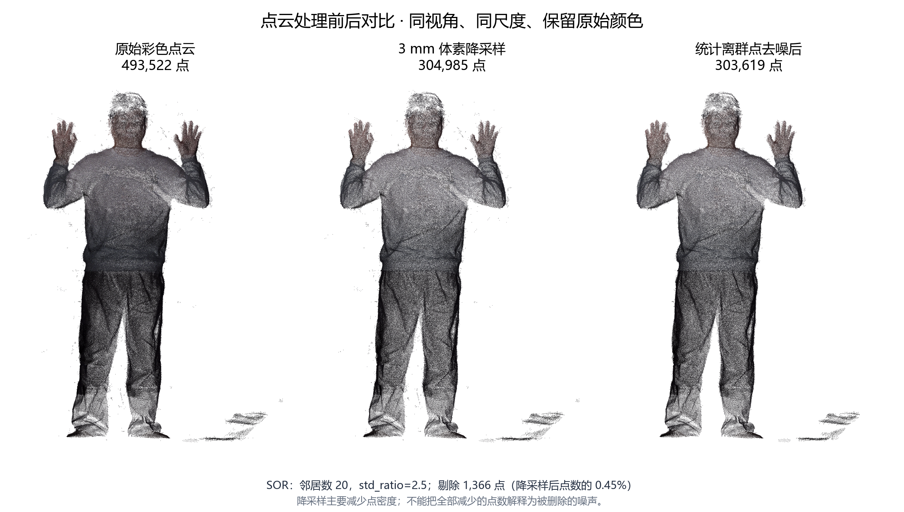
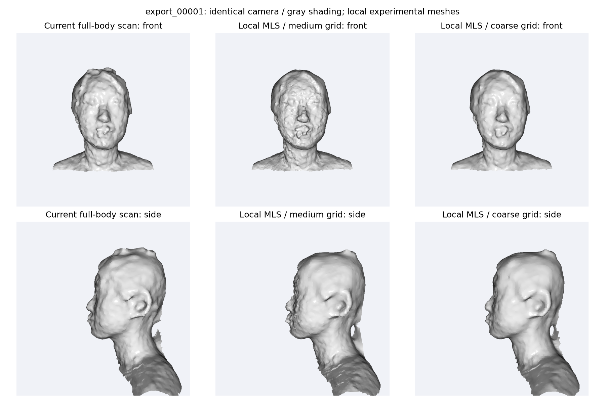

# 点云重建试验过程与结果

整理日期：2026-11-01。本文件统一记录从拿到设备合成 PLY 开始，历次去噪、重建、局部修复和人体分割的尝试、结果及取舍。后续试验继续补在本文件中。

原先分散的自动流程回归、鞋底与手掌试验、手部通用优化、两种预训练分割模型、识别区域手部优化、掌面厚块排查说明已合并到这里。历史结果按当时输入和版本解释，不能直接当成最新模型的结果。

项目清理后，重复或已撤回的模型仅保留历史指标和代表性对比图；下文历史命令是当时的试验记录，部分脚本已删除，不能继续作为当前入口。现有代码和结果目录以 [使用说明](使用说明.md) 及本文件最后的清理记录为准。旧模型报告统一归档在 outputs/experiments/archived_runs.json。

日常命令见 [使用说明](使用说明.md)，位置文件字段见 [人体部位位置文件](人体部位位置文件.md)，前期汇报稿见 [中期答辩说明](中期答辩说明.md)。

## 一、目前采用什么，什么还没解决

| 内容 | 当前状态 | 说明 |
| --- | --- | --- |
| 稳定 scan 点云去噪与 Poisson 重建 | 默认采用 | 常规数据使用 2 mm 采样、depth 9、12 mm 法线邻域、两轮点云去噪和两轮基础网格平滑 |
| 额外双边网格过滤 | 默认关闭 | 可用 --refine 试用，没有证明对所有数据更好 |
| 鞋底截断补面 | 默认尝试 | 00001 已由用户确认；新数据仍需检查，不等于还原真实鞋底 |
| 少量非流形面清理 | 满足限制时尝试 | 超出预算或仍无法统一朝向时保留中间结果并报错 |
| 法线方向修正与孤立黑点颜色修补 | 默认采用 | 改外观，不恢复新的几何细节 |
| HumanPartSegmentation 公开权重 | 未采用 | 作者参考样例和本项目四组数据均出现单一类别输出 |
| Sapiens 人体部位识别 | 默认尝试 | 生成 body_parts.json，定位部位，不区分每根手指 |
| 基于识别区域的局部 Taubin 手部平滑 | 历史默认，已替换 | 最大位移 2 mm 的保守方案，后由手腕限厚与整手强平滑替代 |
| 原始观测约束的掌面厚块收薄 | 未采用 | 试验出现凹痕、折边，保守版本收益又不足；正式模型未替换 |
| 手腕引导的近似掌面收薄 | 已撤回默认 | 独立预览后曾接入，2026-11-04 按用户要求恢复仅识别阶段 |
| 整手强平滑及后续指部回补 | 已撤回默认 | 指形变尖，回补后用户仍不满意，恢复整手优化前基准 |
| 条件掌面限厚及掌面强平滑 | 2026-11-04 已撤回默认 | 掌面 P95 同时超过腕厚 1.35 倍和 8 mm 才处理；限厚到指尖，不做手指/手背平滑；不可靠则保持基准 |

当前使用 Meta/Sapiens 仅识别阶段，不执行手部变形，恢复后的模型和外部软件代码评估见第十八节；第十四至十六节均为已撤回的手部方案记录。

## 二、数据与评价方式

输入为摄影设备已经合成好的彩色 PLY，目前主要对照 data 中的 export_00000～export_00003。只有合成文件，没有逐帧点云、深度图、相机位姿和原始采集工程，无法回到采集与逐帧配准阶段重做。

几何重建和局部过滤使用传统方法；后期加入的 Sapiens 是预训练图像分割模型，仅用于提供区域位置，不能再把当前整条流程称为完全不使用深度学习。

试验主要同时看三类证据：相同视角和材质的外观对比、与原始点云的贴合距离、几何安全检查。原始点云本身有噪声和缺失，不是无误差真值。

| 指标 | 能说明什么 | 不能说明什么 |
| --- | --- | --- |
| 原始点到网格距离 | 已有观测是否贴合生成的表面 | 无法单独排除多余表面 |
| 网格到原始点距离 | 哪些生成表面缺少附近观测 | 远离观测不必然等于形状错误 |
| P95 | 95% 的样本数值不超过该值 | 不同方向、区域或样本集合不能直接混比 |
| 相邻面法线夹角 | 局部方向变化和表面起伏 | 越平顺不等于越符合真实解剖结构 |
| 边界、非流形、翻面、穿插 | 指定范围内的几何缺陷 | 局部通过不等于全身封闭或可直接打印 |

各轮参数和输入可能不同，重新运行也可能产生少量局部数值差异。下文数字保留对应轮次，不统一改成最新版本。

<a id="early"></a>
## 三、前期：基础去噪、面部与局部重建对比

### 1. 建立完整人体流程

先清理无效坐标和重复点，再体素降采样、统计离群点去除（SOR）、DBSCAN 主体筛选、稳健局部平面去噪、法线估计与统一、Poisson 重建、碎片清理和颜色映射。处理结果另存，原始点云保留。



早期 3 mm 采样示例：493522 点降至 304985，再经 SOR 降至 303619。SOR 删除 1366 个孤立点，约占降采样结果的 0.45%。降采样减少的点不能全部算成噪声；该图也不是当前 2 mm 配置的统计。

### 2. 追求更细网格，还是先抑制噪声


加入去噪的 scan 方案减少了脸部和颈部碎颗粒，但鼻口仍模糊。单纯提高重建精细度也会保留噪声，因此完整 scan 流程更适合作为基础。此对比同时改变多项配置，不能把改善归因于一个参数。

### 3. 单独裁头、MLS 与更强过滤



比较完整人体中的头部、局部 MLS 中等粒度和较粗粒度重建。较粗方案更平顺，但没有证明能更好恢复五官，因此头部裁切重建未成为完整人体默认方案。


较强过滤减少小起伏，但鼻口的大尺度形状问题仍存在，并有损失细节的风险。前期曾保留上部区域限定位移的轻度双边法线过滤；后续自动流程回归时，额外双边过滤改为默认关闭。

| 前期上部区域后处理记录 | 00001 | 00002 |
| --- | --- | --- |
| 头部顶点移动 P95 | 0.574 mm | 0.701 mm |
| 原始头部观测到网格 P95 | 6.321→6.414 mm | 7.647→7.912 mm |
| 相邻面法线夹角中位数 | 5.437°→3.574° | 7.675°→5.256° |

表面更平顺，但观测距离略增，不能称为真实精度提升。完整对比图：[00001](../outputs/comparisons/refine/export_00001/full_head_comparison.png)、[00002](../outputs/comparisons/refine/export_00002/full_head_comparison.png)。本阶段历史模型、报告和试验代码已按之前整理要求清理，保留对比图；当时的 18 项测试也不表示当前仍有 tests 目录。

<a id="regression"></a>
## 四、2026-10-29：自动参数回归与 history 复现

用户发现自动重建的面部和全身平滑程度明显不如 history。对 00001、00003 重跑基线和候选，确认不能只把问题归因于鞋底删面。

| 方案 | 采样 | 法线邻域 | 基础 Taubin | 鞋底删面 | 对照范围 |
| --- | --- | --- | --- | --- | --- |
| history 基线复现 | 2 mm | 12 mm / 64 邻点 | 2 轮 | 关闭 | 两组均重跑 |
| 旧自动流程 | 约 1.75 或 1.84 mm | 约 11 mm / 64 邻点 | 0 轮 | 开启 | 用户旧结果，另外含双边过滤 |
| 扩大邻域候选 | 2 mm | 14 mm / 96 邻点 | 2 轮 | 关闭 | 两组均重跑 |
| 旧自动配置关闭鞋底 | 1.747 mm | 10.961 mm / 64 邻点 | 0 轮 | 关闭 | 单独重跑 00001 |

00001 旧自动结果有 757 条边界边、6 条非流形边，朝向统一失败；单独关闭鞋底后仍有 5 条非流形边。基线复现则为 32 条边界边、0 条非流形边且朝向统一成功，说明自动参数组合本身发生回归。

在位置相近的匹配面中，00001 旧自动结果约 94% 与 history 朝向相反。这是相对朝向统计，不是“94% 的面错误”；history 自身的全局方向也可能朝内。00003 没有出现相同程度的全局反转，不能把 00001 的成因套到所有扫描。

| 同一区域网格到原始点的距离 P95 | 基线 | 扩大邻域 |
| --- | --- | --- |
| 00001 头部 | 5.193 mm | 5.212 mm |
| 00001 身体中段 | 3.336 mm | 3.332 mm |
| 00003 头部 | 5.723 mm | 5.713 mm |
| 00003 身体中段 | 3.509 mm | 3.483 mm |


四列依次为 history、旧自动、基线复现、扩大邻域。上排正面、下排侧面，采用双面灰度正交视角，不模拟 MeshLab 的背面剔除和真实光照。扩大邻域没有显示出明确优势，未设为默认。

该轮基线 00001 为 390428 面、32 条边界边；00003 为 405472 面、12 条边界边。两者非流形边为 0，95% 顶点到 history 最近距离小于 0.001 mm，但少量局部仍有约 1～1.5 mm 差异，不称为完全相同文件。

**采用的修正：**恢复 2 mm 采样、12 mm / 64 邻点法线、depth 9、两轮点云去噪（累计上限 1 mm）和两轮基础网格平滑；额外双边过滤默认关闭；局部离散度作为诊断，不再据此随意缩小邻域。

### 后续截图揭示的朝向问题

用户进一步比较 history 与 20261029_212248_041159 的 00001。头部顶点到 history 的距离 P95 只有约 0.000028 mm，顶点法线点积中位数却为 -1，说明几何接近但朝向几乎反转，造成新版更亮、凹凸更强。

因此撤回了依据有向通量对开口网格做整体翻面的处理；有向通量仅作诊断。制作的 仅修正朝向对照（旧文件已清理） 已核验顶点位置、颜色完全不变，只调整面绕序与法线。数值接近不能替代相同 MeshLab 设置下的视觉检查。

<a id="sole"></a>
## 五、2026-10-29 起：鞋底厚块与早期手掌试验

### 鞋底：截断并补面，用户确认后采用

00001 的主体原始观测最低 X 约 -374.99 mm，网格延伸到约 -456.35 mm，额外向下约 81.36 mm，明显缺少观测支持。

候选在最低观测下方 3 mm，即 X 约 -377.99 mm 处截断，并沿切口三角补面。相比仅删面，这次补闭切口；候选边界边和非流形边均为 0，鞋底之外顶点和颜色不变，但未做全身自交检查。


对比图左为原模型，右为鞋底加温和手部处理；鞋底变化明显，手部变化有限。橙色支撑图表示有顶点距主体点云超过 6 mm，是诊断阈值，不是错误概率。

用户认可鞋底后加入 run.py，最初按原始点云哈希匹配 00001；之后按用户要求向新数据默认开放底面估计及截断补面尝试。可用 --no-shoe-repair 关闭。旧 --sole-axis 删面功能仍独立存在，不能与新补面功能同时使用。

平底是人工近似，不是实测鞋底纹理、弯曲或厚度。原模型底部两脚已有共同连接，本轮没有强行分鞋；也不能把该次 X 坐标直接用于其他模型。

保留的 鞋底候选 PLY（旧文件已清理） 用于历史对照。新扫描的坐姿、倾斜方向和异常地面仍需人工检查。

### 手掌：人工框选的局部平面拟合未采用

两侧手部网格到最近原始观测的最大距离约 13、21 mm。人工限定手部范围后，尝试稳健平面投影、冻结边界及翻面保护，累计位移上限 4 mm。实际移动 276 个顶点，最大约 2.98 mm，局部距离 P95 仍约 6.65 mm，连片形状没有明显改善。

该手掌方案未采用。它依赖本次姿态的人工框，不能推广到所有新 PLY；手不能像缺失鞋底那样直接切平。

<a id="topology"></a>
## 六、2026-10-30：只有 intermediate 的原因与拓扑回退

00002 因少量非流形边导致朝向统一失败，流程正确地没有把中间模型当成最终成功结果导出。

随后增加受限回退：在副本中清理非流形小面、保留最大主体，再要求朝向统一、边和顶点流形检查通过。删除面数和面积都不得超过原模型的 0.1%，超预算或仍失败则保留中间结果并记录失败。

该轮 00002 删除 88 面（约 0.0212%）和 220.96 mm² 表面积（约 0.0124%）；边界边由 30 增至 42，非流形边降为 0，朝向统一成功。顶点位置保留，但可能留下小开口，不属于自动补洞或打印认证。见 该轮报告（旧文件已清理）。

<a id="appearance"></a>
## 七、2026-10-30：模型发暗、法线方向与黑点颜色修补

00000、00001 的发暗不能简单解释为颜色值低。后续采用相邻面定向和外部射线首次命中投票判断外侧，避免只依靠开口表面的有向通量；判定不足时保留原方向。

颜色方面只修补小型暗色连通块，参考边界颜色插值，不整体提亮。最大候选斑块尺度 12 mm、暗色亮度阈值 0.1；真实黑色细节也可能被误判，不能称为恢复真实颜色。

| 当时独立外观试验 | 调整绕序的面数 | 修补颜色的顶点数 |
| --- | ---: | ---: |
| 00000 | 483288 | 1987 |
| 00001 | 389470 | 6976 |
| 00002 | 0 | 5594 |
| 00003 | 0 | 5159 |

这些是 outputs/appearance 对应轮次报告的数量，后续重跑可能稍有变化。外观处理已接入 run.py，位置和面连接不变；--normals-only 只修方向，--no-appearance 全部关闭。它改善显示和局部颜色瑕疵，不增加五官或手指几何细节。

<a id="geometric-hands"></a>
## 八、2026-10-31：不依赖分割的通用手部优化

四组数据使用同一规则，比较人体比例与表面距离定位、薄结构检测、局部双边平滑、原始观测约束的平面投影。

薄结构检测能覆盖部分手部，但也误选袖口和衣服折边，不能当成准确人体识别。小邻域、1.5 mm 位移上限候选的局部原始点到网格 P95 只下降约 0.001～0.025 mm，外形改善很小；00000、00002、00003 各新增一对局部穿插，00001 虽未新增但收益也不足。

**结论：未采用。**该轮 outputs/experiments/hand_generalization 已按用户要求整目录删除，释放约 327.33 MiB；仅保留本段过程和结论，不提供已删除图片或脚本的失效链接。

<a id="humanpart"></a>
## 九、2026-10-31：HumanPartSegmentation 公开权重试用失败

来源：[HumanPartSegmentation](https://github.com/issacchan26/HumanPartSegmentation)，固定提交 85b968a9906abe5b305ef634d34712ac88c17e77。试过官方 best_28_class.pt、best_4_class.pt、best_6_class.pt，来源哈希记录在 tools/humanseg/source_manifest.json。

使用隔离的 Python 3.11.16、PyTorch 2.5.1+cpu、PyG 2.6.1、torch_cluster 1.6.3+pt25cpu；未给 dachuang 安装依赖。权重严格加载，学习层未改，传全 1 占位特征以绕过上游只适合 CUDA 的设备分支。

| 对照 | 结果 |
| --- | --- |
| 作者带 28 类标注的 training_reference，eval 推理 | 10000 点全部为类别 17（left_hip），与参考标注一致率 5.47% |
| 原坐标/归一化坐标、float32/float64 | 仍为单一类别 |
| 临时 train 模式诊断 | 一致率约 13.67%，仍不可用，且不是标准推理结果 |
| 官方 4 类权重 | 作者样例全部为类别 0 |
| 官方 6 类权重 | 作者样例全部为类别 4 |
| 用户四组扫描，各采样 10000 点，水平朝向 0°/180° | 28 类模型仍全部为 left_hip，没有找到手部 |

参考样例的 5.47% 不是用户数据准确率，也不是独立测试集精度。预测置信度接近 1 仍可能完全错误。[上游 Issue #2](https://github.com/issacchan26/HumanPartSegmentation/issues/2) 有类似单一类别现象；本项目没有重新训练，无法唯一认定是权重、训练过程还是版本兼容导致。

**结论：未接入。**[四组失败对比](../outputs/segmentation/humanpart/comparison_yaw_180.png) 和小体积报告保留在 outputs/segmentation/humanpart。临时环境、权重、错误着色点云及数组已删除，约释放 1459 MiB。tools/humanseg 仅为适配代码存档，缺少环境和权重时不能直接复现。

<a id="sapiens"></a>
## 十、2026-10-31：Sapiens 分割与位置文件接入

### 方法与四组结果

采用 Meta 官方 Sapiens-Lite 0.3B TorchScript 分割权重。先渲染四个水平正交视角（0°、90°、180°、270°，768×1024），对图像分割，再按射线命中的三角面与重心坐标把标签投票回网格。

掠射像素不参与有效投票，其余按可见角度加权；至少两个视角支持、加权占比达到 0.65 才保留。按同一规则去掉小于 max(12, 最大连通块顶点数的 3%) 的手部孤立标签。该规则减少少量头发误标签，也可能漏掉真实指尖。


每行左为原始渲染、中为二维分割、右为三维手部标签；绿色为左手，粉色为右手。

| 最初独立手部投票试验 | 姿态 | 左手标签顶点 | 右手标签顶点 |
| --- | --- | ---: | ---: |
| 00000 | 双手举起 | 1962 | 2129 |
| 00001 | 双手下垂、接近身体 | 1239 | 1005 |
| 00002 | 一手放在头上 | 1783 | 1654 |
| 00003 | 双臂向两侧下方展开 | 1391 | 2002 |

上述是最初手部标签试验，不是后续“所有类别一起融合”的生产位置文件数量；输入网格、融合规则和重跑版本不同，数量会变化，不能把标签越多理解为识别越好。

四组均出现可用的人体区域定位，没有重现上一项目的全身单一类别。标签试验只着色，不改来源网格位置、连接关系或非手部 RGB；这还不是几何修复。没有人工逐点真值，不能报告分割准确率。28 个输出类别包含背景和衣物，不区分每根手指，衣服覆盖部位也不能据此得到内部解剖结构。

### 环境、权重与独立复现

几何和映射使用 dachuang，GPU 推理复用已有 test0（PyTorch 2.5.1+cu124、RTX 4060 Laptop 8GB），没有安装或修改 conda 依赖。float32、batch size 1，RGB mean=[123.5,116.5,103.5]、std=[58.5,57,57.5]。PyTorch 分配显存峰值约 2791 MiB；加载后单图推理约 0.8～1.7 秒，不含加载、渲染和映射。

官方权重约 1.36 GB，保留供复用，已核验 Hugging Face LFS SHA256；固定版本和来源分别记录在 tools/sapiens/checkpoint_manifest.json、source_revision.json。

- [官方分割权重](https://huggingface.co/facebook/sapiens-seg-0.3b-torchscript)
- [官方 Lite 推理说明](https://github.com/facebookresearch/sapiens/tree/main/lite)

需要重新生成独立比较图时，从项目根目录依次运行以下命令，不能更新原图后继续混用旧标签：

```powershell
& 'D:\Anaconda\conda\envs\dachuang\python.exe' -B tools/sapiens/render_views.py
& 'D:\Anaconda\conda\envs\test0\python.exe' -B tools/sapiens/infer.py
& 'D:\Anaconda\conda\envs\dachuang\python.exe' -B tools/sapiens/map_hands.py
& 'D:\Anaconda\conda\envs\dachuang\python.exe' -B tools/sapiens/make_summary.py
```

这些独立试验渲染脚本按本批 X 正向朝上、毫米坐标工作；生产模块支持自动/手动坐标轴。倾斜、坐姿、严重遮挡及其他设备数据未充分验证。

### 先只接入位置文件

按用户要求，最初只让 run.py 多生成 body_parts.json，记录各部位顶点编号、中心、包围盒、毫米坐标和来源网格哈希，不改几何。渲染、标签等临时文件自动清理；失败记录原因并保留重建结果。

后来接入手部平滑时，利用不变的顶点编号继承标签，并同步更新中心、包围盒和最终网格哈希。读取时必须检查哈希，不能把旧位置文件直接套到重网格化或重新导出的 PLY。详细字段、缺失部位语义及读取示例仍单独放在 [位置文件说明](人体部位位置文件.md)。

<a id="segmented-hands"></a>
## 十一、2026-11-01：识别区域内手部优化及正式接入

四组数据共用同样规则，比较轻度双边法线过滤、较强双边过滤、原始点云局部平面拟合和局部 Taubin 平滑。前三者没有稳定收益；Taubin 对小凹凸有轻微改善，没有恢复新的手指细节。

只允许手部标签顶点移动，边界内侧按网格表面距离 6 mm 渐弱，最外圈固定。Taubin 10 轮，系数 0.45/-0.47，最大位移 2 mm。新增局部穿插或翻面的危险顶点退回原位，再检查；检查包括手附近的身体三角形，但不是全身自交检查，也不自动消除已有穿插。

| 独立试验 | 起伏指标下降 | 原始观测到网格 P95，前→后 | 最大移动 | 是否保留完整候选 |
| --- | ---: | ---: | ---: | --- |
| 00000 | 2.8% | 3.178→3.194 mm | 1.990 mm | 否，收益不足 |
| 00001 | 11.3% | 5.379→5.393 mm | 1.813 mm | 是 |
| 00002 | 11.2% | 6.147→6.171 mm | 1.928 mm | 是 |
| 00003 | 9.5% | 5.100→5.142 mm | 1.984 mm | 是 |


起伏指标指相邻面法线夹角中位数的下降，不是手部精度提升率。平滑略微增加了观测贴合距离，视觉变化也较小。

筛选要求：无新增局部穿插或翻面、观测到网格 P95 增幅不超过 0.15 mm、起伏指标下降超过 5%，并有实际移动。四组最终候选均无新增局部穿插或翻面；分别退回 21、32、26、29 个危险顶点。

### 用户要求接入 run.py 后，完整运行 00003

默认只尝试这一种 Taubin 候选，不生成整套试验输出。收益不足、分割失败或安全检查不通过时保留原模型；--no-hand-refine 仅关闭手部优化，--no-segmentation 同时关闭识别和手部优化。

00003 完整运行约 297.5 秒，采用了手部优化，起伏指标下降约 9.4%，最大移动约 1.984 mm，退回 29 个危险顶点，未新增局部穿插或翻面。该轮原始观测到网格 P95 为 5.095→5.126 mm。这是新完整重建的结果，不与上表独立试验的 9.5% 混记。

已核验最终 PLY/OBJ 顶点一致、位置文件哈希和中心/包围盒匹配。重复运行复用结果，三个输出文件字节不变，不会再次叠加平滑；模拟手部阶段异常也会保留模型和位置文件。

结果：最终 PLY（旧文件已清理）、OBJ（旧文件已清理）、运行报告（旧文件已清理）。

独立多候选比较仍可用 `python hand_refine.py --all`。结果在 outputs/experiments/segmented_hands：comparison.jpg 为五列方法对比，report.json/summary.json 为指标；局部裁切 PLY 的边界和标签空缺可能呈现洞，不代表完整模型被挖洞。独立候选坐标变化后，不要直接复用原模型的位置文件。

<a id="palm"></a>
## 十二、2026-11-01：掌面厚块的进一步排查

用户认可手背形状，但指出掌心有较厚的一块。检查的是上一节已导出的 00003；以下试验没有替换其正式 PLY、OBJ 或位置文件。

### 原因定位

四个水平视角的保守识别主要覆盖手的一个表面，另一面有不少未确定顶点，因此此前标签内平滑没有完整覆盖掌面。

| 该轮 00003 范围统计 | 左手 | 右手 |
| --- | ---: | ---: |
| 正式位置文件中的手部标签顶点 | 1299 | 1745 |
| 沿网格探索到的额外未确定表面候选 | 2382 | 2151 |
| 额外候选中距原始点超过 6 mm 的顶点 | 604 | 591 |
| 额外候选到原始点的距离 P95 | 19.18 mm | 19.74 mm |

额外范围只是试验几何区域，不是新确认的语义标签。部分掌面缺少直接观测，鼓包很可能与缺失处补面有关；单纯增加平滑次数不能解决。

### 尝试与取舍

在 palm_refine.py 中，按语义种子沿网格扩展未确定区域，同时用距离、包围范围和最近已知语义约束，保护已识别的手臂、衣物等其他部位。

先试周围原始观测支撑的局部曲面插值，掌面两侧独立拟合。直接投影产生凹痕，平滑位移后仍有折边，视觉不合适，未采用。

再试在缺少支撑处沿局部薄方向平顺曲面，保护距原始点 4 mm 内的表面、边界和侧向轮廓，候选位移上限 6 mm；随后增加位移过渡平滑，并对新增翻面/穿插退回处理。

| 最终保守候选 | 结果 |
| --- | --- |
| 移动超过 0.1 mm 的顶点 | 563 |
| 最大移动 | 约 3.08 mm |
| 网格到原始点距离 P95 | 16.391→16.333 mm |
| 原始观测到网格 P95 | 基本不变，约 5.230 mm |
| 新增局部穿插 / 翻面 | 0 / 0 |
| 表面法线变化 | 略有增加 |
| 是否采用 | 否，收益不足 |

几何安全检查通过不等于外形更好。这轮强处理会产生凹痕或折边，保守处理收益又很小，因此未加入默认流程。

保留的对照材料：

- [原始点与网格投影诊断](../outputs/experiments/palm_support/diagnosis.jpg)：绿色为原始点，红色为原手部标签的网格顶点。
- 局部拟合尝试（旧文件已清理）：有局部凹痕/折边，不推荐采用。
- [最终保守尝试](../outputs/experiments/palm_support/export_00003/fair/comparison.jpg)：变化有限。
- [最终指标报告](../outputs/experiments/palm_support/export_00003/fair/report.json)。

失败完整候选已删除，保留图片及小体积记录约 0.69 MiB。`python palm_refine.py --scan 3` 可复现当前保守试验；它不会更新正式模型或给 body_parts.json 添加未经确认的标签。

**尚未完成的方向：**补充俯仰识别视角、增加掌面覆盖，再研究缺失表面的曲面和厚度约束。增加识别覆盖也不能凭空得到真实厚度，仍需检查原始采集是否有足够掌面观测。面部大尺度形状、手指粘连和缺失也尚未解决。

<a id="wrist-palm"></a>
## 十三、2026-11-01：从手腕内侧延伸的近似收薄

用户提出以手腕内侧为起点，逐渐向掌心延伸切除厚块，并明确允许不追求真实解剖厚度。因此本轮改以外观近似为目标，不再要求每个调整位置都有原始点云直接支撑。

新增 wrist_palm_trial.py，先对 00003 运行温和、较强两档预览。根据已有手部/前臂标签和局部几何估计手腕位置、手腕到手掌的方向，以及参考掌面方向。该方法用的是几何方向启发式，不是额外训练的掌背分类器；方向模糊或标签不足时跳过。

从手腕内侧建立浅斜参考面，结合手背近似曲面设置厚度下限；起点、掌面两侧和靠近指根的区域逐渐减弱处理，远端手指不纳入主要收薄段。对选定手背方向的顶点显式固定。为了保留现有连接，本轮先将凸出部分向参考面收回，没有直接删面挖洞。

两档比例分别为 0.55、0.90，位移上限 20 mm；参考厚度下限按手宽估计并限制在 12～20 mm，仅是建模参数，不能当作实际测量结果。增加 15 轮位移过渡平滑。新增翻面或局部穿插处先减小位移，仍不通过则局部退回原位置；无法通过则整份候选退回。

第一轮未平滑位移的温和版可见收薄，但局部有折痕；强版没有通过完整的候选保护。后续增加位移平滑，并调整局部回退方式。最终导出情况、实际移动量和检查数字以本轮 [报告](../outputs/experiments/wrist_palm/export_00003/report.json) 为准。

| 最终预览 | 移动超过 0.1 mm 的顶点 | 最大实际内收 | 保持原位的选定手背顶点 | 新增局部穿插 / 翻面 |
| --- | ---: | ---: | ---: | --- |
| 温和版 | 823 | 11.41 mm | 4618 | 0 / 0 |
| 较强版 | 678 | 12.43 mm | 4618 | 0 / 0 |

较强版有更多危险位置退回，因此实际移动顶点数反而较少。侧面可见局部收薄，掌面和拇指根部过渡仍有折痕，较强版更明显；掌面中部的大尺度鼓包并未全部解决。建议先查看温和版，不把本轮称为已经完成通用掌面修复。

- 温和版 PLY（旧文件已清理）。
- 较强版 PLY（旧文件已清理），同目录另有较强版 OBJ。

- [掌面与手背对比](../outputs/experiments/wrist_palm/export_00003/comparison.jpg)：原模型、温和、较强三列。
- 侧面厚度对比（旧文件已清理）：相同相机与灰色材质，用于看轮廓厚度。
- 候选只有确实发生移动且通过局部检查才导出，不将退回原形的结果当成收薄成功。

复现：`python wrist_palm_trial.py --scan 3`。可选 --max-move-mm，取值大于 0 且不超过 30。输出位于 outputs/experiments/wrist_palm/export_00003，原始数据和正式 models 输出保持原样，run.py 默认流程没有改变。独立候选的哈希已变化，不能直接套用来源模型的 body_parts.json；本轮尚未验证其他姿态。

### 后续：按手腕厚度设置上限

用户认为 strong 版差距仍不明显，提出将最大厚度限定在手腕厚度左右。新增 wrist_thickness_trial.py，不再只移动局部异常顶点，而是沿手背到掌面的方向，对完整厚度列做压缩。

补查发现，之前 35 mm 的拓扑扩展范围仍遗漏一部分较厚外表面；本轮扩大几何测量范围，保留已识别的其他部位。手腕参考位置也从语义交界向前臂方向搜索，避免把已经鼓起的掌根当成正常手腕。以近腕较窄截面的射线间距中位数作为参考，左右约为 41.92、34.36 mm。

| 00003 固定掌面射线抽样 | 左手，前→后 | 右手，前→后 |
| --- | --- | --- |
| 目标厚度 | 41.92 mm | 34.36 mm |
| 厚度中位数 | 47.22→41.71 mm | 43.81→34.12 mm |
| 厚度 P95 | 65.52→42.56 mm | 57.82→35.30 mm |
| 抽样最大厚度 | 67.81→43.66 mm | 60.77→37.99 mm |
| 有效匹配射线数 | 1200 | 1314 |

这是指定方向、指定掌面区域的网格厚度抽样，不是全身最大厚度或医学测量；少量样本仍超出目标，不能宣称处处严格达标。直接限厚版移动 942 个顶点，最大内收约 26.18 mm，侧面轮廓明显变薄，过渡仍较粗。

较大压缩会让部分面法线转过 90 度，单凭与旧法线点积小于零不能一概判为拓扑翻面。因此本轮改查实际新增穿插、三角面塌缩和一致朝向。自动整体回退版本没有新增穿插，但实际收薄较弱；为展示用户要求的硬限厚外形，另存不做整体回退的预览。该预览可一致定向，但有 **23 对新增局部相交三角面**，未通过正式采用标准，尚未接入 run.py。后续需要局部重网格化或重新补面来处理这些相交，不能把外观达标当成网格修复完成。

- 直接限厚预览 PLY（旧文件已清理），同目录有 OBJ。
- 侧面厚度对比（旧文件已清理）。
- [掌面/手背对比](../outputs/experiments/wrist_thickness/export_00003/comparison_hard_preview.jpg)。
- [实际厚度与缺陷报告](../outputs/experiments/wrist_thickness/export_00003/report_hard_preview.json)。

复现外观预览：`python wrist_thickness_trial.py --scan 3 --hard-preview`。--ratio 1 表示目标等于手腕参考厚度，也可用 --thickness-mm 30 显式指定。没有 --hard-preview 时执行整体回退的保守试验。失败的保守输出大网格不保留，报告和对比图保留。所有候选独立保存，正式模型、OBJ、位置文件和原始点云不变。

### 限厚后追加局部平滑

在上述 hard_cap_preview 上运行 palm_smooth_trial.py，比较轻、中、强三档。只平滑限厚发生位移的掌面及其附近两圈邻域，固定手背和其他语义部位，手腕、指根区域限制处理范围。顶点不得向掌面外侧回鼓，追加位移也有限幅，保留面连接与颜色。

| 候选 | 平滑轮数 / 最大追加位移 | 相邻面角度 P90 | 相对正式来源新增的局部相交对数 |
| --- | --- | --- | ---: |
| 未平滑限厚版 | — | 34.18° | 23 |
| 轻度 | 8 / 2 mm | 29.50° | 3 |
| 中等 | 24 / 4 mm | 29.03° | 3 |
| 较强 | 48 / 5 mm | 29.62° | 5 |

选择中等版：表面方向起伏指标 P90 下降约 15.1%，没有三角面塌缩。较强版比限厚输入新增两对局部相交，未选。相交检查使用完整手部范围，不仅是本次有位移的顶点，避免漏记固定区域仍有的问题。

| 中等版厚度复查 | 左手，平滑前→后 | 右手，平滑前→后 |
| --- | --- | --- |
| 掌面厚度 P95 | 42.56→42.09 mm | 35.30→34.70 mm |
| 抽样最大厚度 | 43.66→43.00 mm | 37.99→36.78 mm |

厚度没有回鼓，但相对正式来源的新增相交仍剩 3 对，不能称为完全修好。过渡比未平滑限厚版更顺，仍有粗糙和折边；本轮继续作为 00003 独立预览，不改 run.py 默认行为。

- 选中的中等平滑版 PLY（旧文件已清理），同目录有 OBJ。
- [各档掌面/手背对比](../outputs/experiments/wrist_thickness/export_00003/smoothed/comparison.jpg)。
- 侧面对比（旧文件已清理）。
- [三档指标与选择记录](../outputs/experiments/wrist_thickness/export_00003/smoothed/report.json)。

复现：`python palm_smooth_trial.py --scan 3`，前提是存在匹配的限厚预览及来源报告。只保存选中版本的完整 PLY/OBJ，其余候选保留对比图和指标。

### 按用户偏好改为整手强平滑，优先手腕连续

用户明确表示手部细节不重要，可以更强地平滑，重点是手腕连接自然。本轮不再把手背和手指全部固定，而是对整手统一平滑，并允许相邻前臂参与渐变过渡。手腕向前臂方向 50 mm 内逐渐减弱，几何范围边界再按表面距离做 15 mm 渐变，其他身体部位固定。

输入为上一轮中等平滑版。新增 hand_polish_trial.py，比较以下三种候选：

| 方案 | 轮数 / 最大追加位移 | 整手相邻面角度 P90 | 相对正式来源新增局部相交 |
| --- | --- | --- | ---: |
| 上轮中等平滑版 | — | 23.80° | 3 对 |
| 强 Laplacian 平滑 | 100 / 10 mm | 11.25° | 0 对 |
| 超强 Laplacian 平滑 | 220 / 15 mm | 11.24° | 0 对 |
| 保形 Taubin 平滑 | 120 / 10 mm | 16.98° | 6 对 |

选择 100 轮强平滑：220 轮仅有不到 0.1% 的 P90 改善，却使手形进一步收缩；保形候选保留了较多细节，并出现新的局部相交。选中版本的整手 P90 较输入下降约 53%，没有检出三角面塌缩，之前剩余的 3 对新增相交在本轮完整局部范围检查中消除。仍未执行全身自交检查，不将局部结果当作全身打印认证。

选中版本的左、右掌面厚度 P95 约 40.42、35.10 mm，抽样最大约 43.46、36.12 mm，仍保持前一轮的限厚效果。强平滑会让手形、拇指和指部轮廓更简化，细节明显减少；腕部渐变比之前更连贯。随轮廓收缩，部分固定射线不再命中；这些厚度统计只比较平滑前后都命中的样本，左、右分别为 1059、1176 条，不与上轮全部样本直接等同。

- 100 轮强平滑 PLY（旧文件已清理），同目录有 OBJ。
- [选中版本前后对比](../outputs/experiments/wrist_thickness/export_00003/polished/selected_comparison.jpg)。
- 选中版本侧面对比（旧文件已清理）。
- [三种候选与检查报告](../outputs/experiments/wrist_thickness/export_00003/polished/report.json)。

复现：`python hand_polish_trial.py --scan 3`。颜色和面连接保持不变，手部及腕部渐变范围之外的顶点固定；导出后的 PLY/OBJ 已核对一致。原始点云、正式模型、位置文件、限厚版和上轮平滑版均保持原样。这仍是 00003 独立预览，run.py 默认方案尚未更改，其他姿态仍需另行验证。

## 十四、正式接入并统一运行 00000～00003

按用户要求，run.py（版本 10）现默认调用正式模块 hand_pipeline.py，日常仍用 `python run.py 3`，本轮使用 `python run.py --all` 统一重建四组。

生产流程只运行选定方案：识别区域定位 → 估计近腕较窄截面厚度 → 对超厚掌面压缩 → 温和整理过渡 → 整手 100 轮强平滑；腕部向前臂 50 mm 渐弱，区域边界另有 15 mm 渐变。手部细节简化是本轮用户明确接受的取舍。

为适应多种姿态，补充了以下处理：手的两面都被识别、掌背方向不明确时采用对称限厚；附近未确定顶点只在最近语义为对应手或前臂时参与，保护贴近头发、脸或裤子的区域；少量近乎退化小面的顶点局部减小位移，再复查。限厚方案新增局部相交时尝试只做强平滑，再尝试 50%/25% 位移回退，仍不通过则保留原模型。报告明确区分“限厚与平滑采用”“仅平滑回退”“未采用”，不能仅凭文件导出成功就认为所有处理都已执行。

采用后的 PLY、OBJ 和 body_parts.json 在同一次目录同步更新；编号和面连接保持不变，标签继承原编号，中心、包围盒、来源哈希同步刷新。缓存包含正式手部模块；相同输入和代码重复运行不会再次累积平滑。--no-hand-refine 可关闭整套手部处理，--no-segmentation 同时跳过识别和手部处理。生产输出不额外堆积试验候选或图片。

本轮曾遇到 Windows 拒绝覆盖已有 OBJ 的异常。最初按文件占用处理，并改为在 intermediate 中完成处理、最后发布规范名称；后续确认根因是 Windows ACL 继承：TemporaryDirectory 的私有权限随直接重命名的文件一起进入最终目录，只允许创建者、SYSTEM 和管理员访问。由沙箱账号生成的文件因此可能对用户不可读、不可删除；由用户自己运行时则对用户正常，但沙箱账号不可读。它不是 PLY 格式损坏。

现已修正 run.py 的发布与回滚：将临时文件内容复制到最终目录内以普通方式新建的同级暂存文件，再原子替换。这样保留最终目录的正常继承权限，不直接搬出私有临时文件，也不额外授予 Everyone 全控制权限。对本轮仍在的异常结果只修复受保护 ACL，共 6 个文件；不更改内容。00000、00001、00002 原结果及 00003 当前保留结果均已能读取；修复前后模型哈希核对一致。另用用户登录账号、AdministratorToken=False 验证新发布测试 PLY 可以读取、删除，测试文件随后清理。用户不需要以管理员权限运行 VS Code 或 run.py。

本轮四组历史结果与实际采用情况如下（随后仅恢复指部，这两种方案现均已撤回默认；当前结果见第十六节）：

| 数据 | 当前查看结果 | 实际处理 |
| --- | --- | --- |
| 00000 | 指部恢复版 PLY（旧文件已清理） | 右手限厚及强平滑；左侧前臂标签不足，保留；最后仅恢复指部 |
| 00001 | 指部恢复版 PLY（旧文件已清理） | 贴近裤子，采用 50% 位移平滑回退，未强行限厚；最后仅恢复指部 |
| 00002 | 保留原手部的 PLY（旧文件已清理） | 完成重建及拓扑清理；手部候选未通过检查，保留原手部，无需恢复指尖 |
| 00003 | 指部恢复版 PLY（旧文件已清理） | 限厚、强平滑和腕部渐变；最后仅恢复指部 |

### 后续：手指变尖，仅恢复指部

用户确认掌面与手背效果保留，但指出整手强平滑把手指拉得太尖，要求手指恢复原样。此阶段不重新运行 Poisson、不重新限厚，也不再平滑掌面/手背。

从同次 intermediate 基础网格重放少量拓扑清理和鞋底处理，恢复与最终网格一致的顶点编号及面连接，作为强平滑前的指部参考；必须核对形状数量、面编号和大多数未处理躯干顶点的对应关系，未通过则不改输入。

最初只恢复指尖会出现“圆头接在细杆上”的衔接问题。后续 finger_restore.py（版本 2）用原手部投影的细长骨架分支扩展到指部主体，厚掌面骨架保持保护，指根内侧渐变；融合的宽指部再按远端范围恢复末端。此处是几何分区启发式，不是逐指语义模型，不能凭空把原有粘连手指分开。

| 新一版相对前一指尖恢复版 | 改变顶点数 | 范围之外 |
| --- | ---: | --- |
| 00000 | 900 | 坐标逐点不变；未处理的左手保留 |
| 00001 | 619 | 坐标逐点不变 |
| 00003 | 1175 | 坐标逐点不变 |

完整恢复区直接使用强平滑前的参考坐标；指根渐变区做衔接。颜色、三角面连接、指部范围外的坐标保持不变，位置文件中心、包围盒和哈希同步更新。已经改变的模型另存时间目录，未覆盖原模型。本轮局部相交统计（恢复前→后）分别为 0→0、8→24、0→1；恢复原形可能带回原网格已有缺陷，部分过渡仍需检查，因此不宣称完成拓扑修复，也没有为了消除这些相交去改动用户要求保留的掌面/手背。

最新 PLY/OBJ 已读回，坐标、颜色、面编号、指部参考匹配和位置文件绑定均完成核验；最终文件使用正常继承权限。未来 run.py 中也增加指部保护，并纳入代码缓存校验，避免再次把指部整体拉尖。独立修正入口为 `python restore_latest_fingers.py --all`，相同版本完成后会跳过，00002 因没有需要恢复的指部保持原结果。

## 十五、文件保留与后续记录方式

| 位置 | 用途 |
| --- | --- |
| data/ | 原始合成点云，不作为实验输出覆盖 |
| outputs/history/ | 历史重建对照 |
| outputs/models/输入名/时间/ | 正式运行结果及报告；最新结果以具体目录区分 |
| outputs/comparisons/ | 早期去噪、头部重建、过滤强弱对比图 |
| outputs/experiments/parameter_regression/ | 自动参数回归对比 |
| outputs/experiments/normal_direction_check/ | 隔离法线影响的对照 |
| outputs/experiments/local_support/ | 早期鞋底及人工框选手掌试验 |
| outputs/appearance/ | 外观处理独立对照与报告 |
| outputs/segmentation/humanpart/ | 失败分割的小体积报告与图 |
| outputs/segmentation/sapiens/ | 成功的独立分割对照、标签与来源记录 |
| outputs/experiments/segmented_hands/ | 语义区域内四种手部候选对比 |
| outputs/experiments/palm_support/ | 掌面厚块排查图和小体积记录 |
| outputs/experiments/wrist_palm/ | 手腕引导的近似收薄预览与对比 |
| outputs/experiments/wrist_thickness/ | 手腕厚度上限试验，硬限厚预览含未修复局部相交 |

已删除的 hand_generalization 试验、HumanPart 临时环境及失败大文件不再列为可运行结果。Sapiens 成功权重继续保留，以免重复下载。本次文档合并没有移动或删除上述模型、图像、原始数据和权重。

后续每轮在本文件追加“问题与输入 → 方法与统一参数 → 对比图与指标 → 是否采用及原因 → 输出/清理记录”，并同步修改第一节的当前状态，避免再次出现多份说明互相矛盾。

## 十六、撤回整手优化，改为厚度检测后只处理掌面

用户认为整手强平滑和后续指部回补都不如今天优化前的指形。本轮从同次 intermediate 重放基础网格、少量拓扑清理和鞋底处理，恢复整手优化前坐标；不使用强平滑结果进行反向补救。颜色、已有朝向与顶点编号继续保留，基础重建和鞋底不重跑。

当时 run.py（版本 11）默认调用 palm_pipeline.py：

1. 先估计近腕截面厚度和掌面厚度。掌面抽样厚度 P95 同时超过手腕的 **1.35 倍**、且多出 **8 mm** 才处理。这是当前统一启发式阈值，不是解剖标准。
2. 厚度正常则整手不改；手/前臂标签不足、与裤子或头部贴合导致厚度不可靠、掌背方向不明确时也保留基准，不做整手平滑回退。
3. 明显过厚时，以背侧为固定参考，沿厚度方向内收。处理范围延伸到指尖，不再在远端提前衰减；指部投影轮廓保持原样，不对指部做三维平滑。
4. 强 Laplacian 平滑仍可运行 100 轮，但只作用于掌面内部；指部掩码、背侧和边界固定，掌面内部最大追加位移 8 mm，边界按 8 mm 表面距离渐变，腕部起始 10 mm 渐变。掌背和指部范围是几何估计，Sapiens 本身没有逐指/掌背标签。
5. 检查局部新增穿插和面塌缩；少量问题点附近逐步保留原坐标并渐弱位移，剩余区域继续收薄。如果仍不通过，整只手保留基准。这样可能残留厚块，不宣称处处达到腕厚。

00003 双手确认明显偏厚，采用限厚和掌面局部强平滑：

| 同一组固定掌面射线 | 左手 | 右手 |
| --- | --- | --- |
| 手腕参考厚度 | 35.09 mm | 34.47 mm |
| 掌面厚度中位数，前→后 | 46.81→33.16 mm | 43.51→32.00 mm |
| 掌面厚度 P95，前→后 | 64.67→47.54 mm | 57.97→35.06 mm |
| 抽样最大厚度，前→后 | 67.45→64.06 mm | 60.62→38.78 mm |
| 局部保留/减弱的顶点 | 270 | 107 |
| 背侧固定顶点 | 2336 | 2599 |
| 新增局部相交 / 面塌缩 | 0 / 0 | 0 / 0 |

左掌仍有少量原形保留，因此 P95 和最大值未达到腕厚；右掌改善更明显。两手分别有 815、881 条匹配射线。指部投影轮廓坐标误差小于 1e-6 mm（计算值约 1e-13 mm），只允许深度变化；这不代表能恢复输入缺失的真实手指，也不是全身拓扑认证。

日常仍用 `python run.py 3` 或 `python run.py --all`；无需额外执行手部脚本。已有四组通过 `python apply_palm_policy.py --all` 复用中间网格另存 `_palm_only` 结果，不重复 Poisson；缓存校验包含新掌面模块，重复运行不会累积平滑。历史整手/指部回补代码仅保留复现用途，恢复脚本会跳过新版 palm_policy 结果。

本轮四组当前结果（与第十四节旧结果区分）：

| 数据 | 当前查看结果 | 实际采用情况 |
| --- | --- | --- |
| 00000 | [PLY](../outputs/models/export_00000/20261101_212836_355405_palm_only/export_00000_mesh.ply) | 恢复整手优化前基准；左侧标签不足，右掌未超过腕厚阈值，不再改动 |
| 00001 | [PLY](../outputs/models/export_00001/20261101_212932_033803_palm_only/export_00001_mesh.ply) | 双掌检测偏厚后局部收薄；中位数约 52.84→48.09、46.65→39.83 mm；保护和局部回退使 P95 仍约 69.42、61.76 mm，改善有限 |
| 00002 | [PLY](../outputs/models/export_00002/20261101_213015_114223_palm_only/export_00002_mesh.ply) | 保留基准；左掌掌背不明确，右掌未超过倍数阈值 |
| 00003 | [PLY](../outputs/models/export_00003/20261101_212637_452697_palm_only/export_00003_mesh.ply) | 双掌限厚及掌面内部强平滑，数据见上表；背侧与指部轮廓保留 |

各目录有同步 OBJ、body_parts.json、report.json 以及同视角掌面策略对比图。00000/00002 相对基准的手部位移为零；00001/00003 的新增局部相交和面塌缩均为零。这里的“恢复”指恢复本项目整手优化前的重建坐标，不能恢复扫描文件本来没有的真实细节。

## 十七、项目清理：同一数据同一天只保留一组

按用户最新要求，历史阶段模型保留一部分，采用“每份输入、每个日期选择最新完整结果”的规则；今天均选择最终 `_palm_only` 版本。00000、00001、00002、00003 分别保留 2、4、2、3 组，共 11 组；原 history/scan 对照组另行保留。具体日期见使用说明。

清理了 13 个同日重复或失败模型目录、废弃的独立手部试验和指部回补入口、失败的 HumanPart 工具、旧输出目录中的试验脚本、重复网格与逐视角临时分割图。实验留下代表性对比图与小报告，已删除模型的报告合并到 outputs/experiments/archived_runs.json。下文以前提到的试验命令不再代表当前可执行入口；已失效的旧文件链接作了标注或移除。

正式依赖的 hand_pipeline.py 几何函数和 finger_restore.py 指部分区掩码继续保留，避免误删当前掌面处理所用代码；未修改建模参数。原始 data、正式代码、history 和 11 组保留模型均核对哈希。清理后执行 `python run.py --all`，四组最新结果及部位文件全部命中缓存，模型文件未改变，没有重复重建或平滑。

最初的无备份批量删除被自动安全审查阻止，未执行。随后先创建并逐条 SHA256 校验单个恢复压缩包，再按用户追加的跨日保留规则缩小清理清单后执行。当时的恢复包约 1.15 GiB，包含初始清理计划内的文件，已在第二十四节的清理中移除。最终保留和删除清单、恢复包哈希及验证结果记录在 outputs/cleanup_manifest.json。

## 十八、2026-11-04：恢复 Meta 只识别阶段，检查外部建模软件文件

用户再次否定手部外形，要求退回使用 Meta 识别部位时的样子。结合第十节“先只接入位置文件”，本次按 **Sapiens 只输出 body_parts.json、尚未进行手部变形** 的阶段恢复。run.py 版本 12 默认 hand_refine=False；普通命令保留识别，所有后加的局部手部平滑、整手强平滑、指部回补、掌面限厚均关闭。历史掌面方案仅可由 --hand-refine 显式试用。

tools/restore_segmentation_stage.py 从各自 intermediate 重放原来的少量拓扑清理及鞋底补面，核对顶点和面编号后恢复基础坐标，保留当前外观颜色与面朝向；部位标签按不变编号继承并刷新中心、包围盒和哈希。没有重新运行 Poisson；这是恢复本项目的基础重建，不是恢复采集缺失的真实手指。原文件不覆盖。

| 数据 | 仅识别阶段 PLY | 相对上一结果恢复的顶点数 |
| --- | --- | ---: |
| 00000 | [PLY](../outputs/models/export_00000/20261104_153726_910412_segmentation_only/export_00000_mesh.ply) | 0 |
| 00001 | `20261104_153732_168568_segmentation_only`（同日较早版本已清理） | 773 |
| 00002 | [PLY](../outputs/models/export_00002/20261104_153747_460445_segmentation_only/export_00002_mesh.ply) | 0 |
| 00003 | [PLY](../outputs/models/export_00003/20261104_153802_390478_segmentation_only/export_00003_mesh.ply) | 1156 |
| 00004 | `20261104_153829_444727_segmentation_only`（同日较早版本已清理） | 782 |

00000/00002 原本就未采用上一轮手部变形，因此本次坐标无需改变。运行 --all 校验时发现新增 export_00005：基础重建生成了 intermediate，但少量拓扑清理后仍无法形成可一致朝向的流形表面，未导出最终模型，原因保存在该次 failure.json；这是 00005 的基础几何问题，不是恢复脚本或部位识别失败，本轮没有放宽检查。

### 外部文件检查结论

来源为 D:/dachuang/chongjian(1)/新建文件夹/新建文件夹。共 86 个 .cpp、53 个 .sbn；86 个 .cpp 均含 GLSL 着色器标记（uniform/varying/sampler/gl_FragData 等）。扩展名虽然是 cpp，内容实际属于 OpenGL 图形处理阶段；目录没有 CMake、头文件或完整应用入口。部分文件还是片段或调试分支，例如 normalizationShader 文件从函数中间开始。不能将这些文件直接当作完整 C++ 点云重建项目编译。

| 文件 | 实际内容与可参考点 | 对现有项目的限制 |
| --- | --- | --- |
| f_smoothp.cpp | 三维体素密度邻域平均、阈值化、密度差分梯度法线；有真正的几何场处理思路 | 需要先构造 Voxel 体纹理及空间映射；平滑与填充可能粘连手指、加厚薄处，不宜直接替代当前流程 |
| f_smoothp_marching.cpp | 更大邻域的密度平滑；文件主要输出体素密度 | 名称含 marching，但未提供完整三角形提取表、顶点生成与网格导出流程；不是现成 Marching Cubes 重建器 |
| f_RelightPostprocess.cpp | 空颜色像素从非空邻域取平均等图像后处理 | 可参考用于颜色洞修补；只能改善颜色，不能消除几何厚块；当前只有顶点色，需改写到网格邻域并保护衣物边界 |
| f_filterGizmo.cpp | 亮度、对比度、Gamma、饱和度、色调等外观调节 | 不能替代法线定向修正或几何修复；整体提亮也不能区分真实黑衣与异常黑点 |
| f_upscale_mesh.cpp | 多相机投影、畸变参数、颜色投影与邻域取样 | 依赖相机矩阵、深度/颜色投影、纹理体等输入；目前只有合成 PLY，缺少这些采集数据 |
| f_mesh_combined.cpp、f_triangles_uv_mesh.cpp 等 | 纹理网格显示、颜色合成、片元输出 | 主要影响显示，不提供离群点去噪、手部语义或重建修复 |
| f_raycast.cpp、多 patch 系列 | 基于位置/法线/UV/八叉树纹理的查找、图像块处理 | 依赖原软件组织的纹理、缓冲区和调度，无法靠这些片段还原完整处理链 |

较值得借鉴的是“在体素场上处理后再生成表面”和“局部颜色空洞修补”，但本轮只做代码评估，未将这些片段接入默认流程，也没有证据表明它们能改善现有手部。目录中没有发现人体部位识别权重或可直接使用的手掌厚度修复模块；Sapiens 继续承担现有位置识别。外部文件仅阅读，未修改、编译或运行。

## 十九、逐路原始数据：独立采集样例的补色验证

用户已确认 `data_raw/raw(2)/raw/` 不是现有 data 中模型的配套采集，撤回此前“对应第四组”的假设，不进行跨采集的几何优劣比较。本轮仅在这批 RAW 内进行同一网格、同视角、同光照的颜色对照。

18 路点云合计 285,055 点，配有 36 张彩色照片和相机参数。依据有效相机投影判断缺色，使用邻近且法线方向一致的有效观测补色；试验网格中近乎纯黑顶点从 12,322 降至 975。几何部分仍有缺失，12 mm 观测距离约束去除了明显外扩但留下孔洞，不能据此声称脸或手的几何优于原方案。原始输入不改写，尚未接入 run.py。

完整的数据价值分析、参数使用原则、以后保留哪些输入以及本轮统计，统一见新增的 [原始数据与 PLY 输入选择说明](原始数据与PLY输入选择说明.md)。

随后按用户要求，错误 RAW 样例及其原始导出、融合点云、网格、图片和报告全部删除；上文仅保留已核验的试验统计，不再提供这些结果的文件链接。另按“同一数据同一天留最新完整结果”清理 4 组较早完整模型和 1 组失败输出，表面试验仅保留对比图与小报告，移除可再生成的网格。原始 data、history、保留模型及分割权重不改写，可复用脚本继续保留；详见 `outputs/cleanup_20261104_raw.json`。

## 二十、配套 RAW 的多视角几何对照

在 1、2 号的配套 RAW 上，沿用 Meta 脸颈和左右手标签。每个待调整点需要至少两路其他视角在位置和法线方向上支持，点只沿自身法线移动，上限 0.8 mm。用固定随机种子在三个区域留出约 20% 的观测点，两组重建及校正投票都排除这些点，再用相同 Poisson 参数做对照。

4 mm 邻域下，1、2 号分别只调整 17、33 个点。6 mm 邻域下分别调整 891、330 个点，但区域留出点的贴合距离 P95 变化都不超过 0.04 mm。两组灰模的手指和腕部轮廓无明显改善。2 号候选的非流形边从 12 条增加至 14 条。本轮结果保留为独立试验。

用 `python tools/multiview_geometry_trial.py --scan 1 --relaxed` 可复跑 6 mm 档。对照图和数值报告位于 `outputs/experiments/multiview_geometry/`。

## 二十一、配套照片的立体测深试验

用 1、2 号已校验的主相机照片，按 Meta 脸颈和左右手范围提取特征。通过双向匹配、2 像素重投影误差上限和原始表面邻域检查后，1 号脸颈得到 24 个点，双手为 0；2 号脸颈 6 个点，左手 1 个、右手 2 个。脸颈顶点在这些点的 4 mm 范围内的比例分别约为 1.4% 和 0.5%。

随后用照片小窗口沿网格法线搜索深度。1、2 号脸颈分别有 278、71 个采样顶点可作双视角比较，其中 19、7 个有明确的双视角候选。三个视角对同一非零深度修正都达成一致的候选为 0，手部同样为 0。结果作为几何覆盖诊断保留。

用 `python tools/stereo_geometry_trial.py --scan 1` 可复跑，默认用已有的 Sapiens 环境运行 OpenCV。结果见 [1 号报告](../outputs/experiments/stereo_geometry/export_00001/report.json) 和 [2 号报告](../outputs/experiments/stereo_geometry/export_00002/report.json)。

本轮删除正式补色模型生成前的 6 个可再生试验 PLY 和上一轮 4 mm 档的 2 张重复预览，共约 87.88 MiB。保留原始采集、正式模型、历史报告、6 mm 灰模对照和此前脸颈补色候选。

## 二十二、原照片的轮廓约束试验

1、2 号各取 12 张已配对的主相机照片，根据标定转正并裁切，复用 Meta 生成前景。用本路 RAW 点云核对分割覆盖，只对通过该部位覆盖检查的视角投票。待剪顶点至少要被两路夹角超过 20° 的视角判为背景，且 5 mm 内没有原始点云支持。两组共 24 张照片均通过整体覆盖检查。

1 号脸颈及双手没有单路背景票。2 号脸颈和抬起的左手有少量单路背景票，均未达到两路一致条件。两组的可剪候选三角面都是 0。叠加图可用于区分外轮廓与五官、掌面等内部起伏，本次保留为诊断试验。

用 `python tools/photo_silhouette_trial.py --scan 1 2` 可复跑。绿色是照片分割轮廓，青色是模型投影轮廓。见 [1 号叠加图](../outputs/experiments/photo_silhouette/export_00001/overlay.jpg) 和 [2 号叠加图](../outputs/experiments/photo_silhouette/export_00002/overlay.jpg)。

## 二十三、脸颈照片贴图

沿用 1、2 号的正式网格及 Meta 脸颈位置。脸颈单独分配 1024 × 1024 纹理，逐像素从配套照片取色。只融合标定通过、当前表面可见且附近有本路点云支持的照片，边缘过渡回原色。其余区域把现有顶点色烘焙到 2048 × 2048 纹理。

| 数据 | 有照片支持的候选纹理像素 | 留出视角颜色误差中位数变化 | 同视角对比 |
| --- | ---: | ---: | --- |
| 00001 | 98.8% | 下降 13.6% | [对比图](../outputs/experiments/uv_detail/export_00001/comparison.jpg) |
| 00002 | 96.6% | 下降 9.1% | [对比图](../outputs/experiments/uv_detail/export_00002/comparison.jpg) |

每次留出一路相机，用其余相机的颜色预测该路照片的颜色。图中从左到右为正式顶点色、照片补过的顶点色、照片 UV 贴图。1 号眼周和脸颊略有改善，2 号变化较小，原有表面起伏仍可见。两组均已核对 OBJ 的三角面、UV 和纹理，导出坐标最大误差约 0.005 mm。

在项目根目录运行 `python tools/face_uv_trial.py --scan 1 2` 可复跑对比，每组实测约 50 秒。用 MeshLab 打开 `face_uv.obj`，同目录保留 `face_uv.mtl` 和两张 PNG。

正式流程从版本 16 开始，在最终网格与部位文件完成后自动尝试贴图。配套照片和脸颈位置齐全且颜色检查通过时，结果写到本次模型的 `textured/` 目录。实测 00001 额外用时 45 秒，留出相机的颜色误差中位数下降 13.3%，复跑命中缓存。只有 PLY 的 00000 正常生成普通模型。四个贴图包文件继承正式输出目录的权限。

## 二十四、按日期整理输出

每份输入每个日期保留一组完整模型。00001 在 2026-11-05 保留带正式贴图的 23:32 版本，21:41 版本的报告收入 `outputs/experiments/archived_runs.json`。独立脸颈着色和 UV 试验保留对比图和报告，试验 PLY 与贴图包已清理。旧恢复压缩包已移除，历史清理记录保留。此次共清理约 1.38 GiB。

## 二十五、衣裤粗糙度和平滑试验

用 00001、00002 的正式模型做正反面同视角对照。关闭颜色后，胸前和大腿仍可见细碎的几何起伏。彩色视图上还有额外的黑点和色斑。已有的正式轻度平滑在两组上都通过了检查，作用区域的相邻面夹角 P90 约下降 4.9%。

额外试验仅移动躯干和衣裤标签内的顶点。沿法线松弛和中等双边平滑均提高了起伏指标。8 轮 Taubin 的两组变化都在 1% 以内，并出现局部翻面。16 轮同样未通过。正式流程保留原方案，试验只存对比图和指标。

见 [00001 对比](../outputs/experiments/body_smooth/export_00001/comparison.jpg) 和 [00002 对比](../outputs/experiments/body_smooth/export_00002/comparison.jpg)。从左到右分别是正式彩色、正式灰模、候选灰模、候选彩色。

## 二十六、重建前的衣裤点云去噪

把正式模型的上衣、裤子标签投到 00001、00002 的原始合成点云。只对同一衣裤区域内邻点充足、接近局部平面的点做限幅投影，单点上限 1.2 mm。衣裤边缘附近按拟合半径保留缓冲。衣裤区随机留出约 20% 的点，两边都只用其余点重建，保持相同 Poisson 参数。

| 拟合半径 | 00001 移动超过 0.1 mm 的点数 | 00002 移动超过 0.1 mm 的点数 | 结果 |
| --- | ---: | ---: | --- |
| 5 mm | 1,118 | 1,234 | 灰模差异不明显。两组基础网格的非流形边分别增加 1 条和 2 条 |
| 8 mm | 2,182 | 3,154 | 衣裤粗糙度变化仍小于 0.04°。00002 基础网格新增 1 条非流形边 |

两档的留出点贴合距离 P95 变化均小于 0.004 mm。这里测的是用留出样本重建的基础网格，正式流程后续另有拓扑清理。两档均未采用。只保留对比图和报告，左列为基准，右列为去噪候选。

在项目根目录运行 `python tools/garment_denoise_trial.py --scan 1 2` 可复跑 5 mm 档，追加 `--radius-mm 8` 复跑 8 mm 档。见 [00001 的 8 mm 对比](../outputs/experiments/garment_point_denoise/export_00001/radius_8mm/comparison.jpg) 和 [00002 的 8 mm 对比](../outputs/experiments/garment_point_denoise/export_00002/radius_8mm/comparison.jpg)。

## 二十七、2026-11-11 第二路照片标定与按部位补色

在 00001、00002 的同一正式网格上比较原顶点色、主照片投影、双照片投影和按区域筛选的候选。第二张照片的标定从采集索引提取，分别核对已有主相机、另一相机和 PhotogrammetryInfo 相对变换。每组 18 路中 15 路通过，4、6、15 路的相对变换不一致，第二照片跳过。

投影继续检查可见性、表面方向和逐路点云支持。每次留出整路相机，两张照片同时退出融合，只用相同的主照片观测评价两种候选，防止同路照片相互验证。指标是已有几何上的颜色一致性，不能解释为真实颜色或几何精度。

候选只选择误差中位数至少下降 5%、P90 不增加且观测数足够的区域。评价包含区域边缘 6 mm 渐变。00001 选中主照片的面颈补色，误差中位数约下降 6.8%。00002 选中双照片的面颈、左手和主照片的右手补色，分别约下降 11.0%、7.5%、9.1%。这是候选选择依据，后续仍需其他数据验证。双照片没有稳定优于主照片。

整身照片投影能减少一些色斑，但衣裤区域未通过上述统一标准。手掌厚度、手指和五官的几何起伏仍存在。本轮未接入正式建模入口，每组只保留一份 selected_colors.ply、对比图和报告。导出的候选已重新读取，核对顶点位置、三角面连接以及选区外颜色。

对比图从左到右为当前顶点色、主照片整身投影、双照片整身投影、按区域筛选的候选。只有最右列对应本轮候选 PLY。

- [00001 对比](../outputs/experiments/secondary_photo/export_00001/comparison.jpg)
- [00002 对比](../outputs/experiments/secondary_photo/export_00002/comparison.jpg)

复现入口为 `python tools/secondary_photo_trial.py --scan 1 2 --calibration-index 采集索引.xml`。索引与当前逐路标定必须匹配。

## 二十八、举手与垂手的手部观测对照

使用 00000～00003 的原始点云及对应 Meta 标签，按手腕到手部方向建立局部坐标，统一从掌面和侧面观察。长袖样本的前臂标签不足时，用邻近袖口估计腕部。选区与坐标轴是几何近似，并非逐指识别。

00000 的原始点云能看到张开的手指和明显指缝。00001、00002 的相应手部选区较紧凑，点云中没有同样清楚的分指轮廓。这个差异涉及实际手势、遮挡及采集覆盖，不能仅凭手臂高度判断是否需要修复。四组基础重建使用相同的常规采样和法线尺度。

00003 则在原始观测中仍能看到部分分指轮廓，但基础网格连住了指缝。其左右手标签顶点到原始点云距离 P95 约为 11.5、8.2 mm，00000 约为 2.4、2.3 mm，说明前者有更多缺少附近观测支持的外扩表面。这些距离衡量观测支撑，不是真实手型精度。

局部比较三种候选：原始法线的细重建、小邻域法线的细重建、6 mm 稳健拟合配合轻度去噪和较粗局部 Poisson。细重建普遍产生较多碎面和孔洞。较粗候选在 00003 分开了部分指缝并缩小外扩，但指尖仍粗糙，掌侧和腕口仍有开口。00001、00002 未得到清楚的分指收益。

本轮未替换完整人体模型。只保留 00003 两份较粗局部预览，其他试验 PLY 已清理；四组均保留对比图和报告。局部预览未与手腕拼接，不能用作完整人体网格。图中基础网格也是局部语义裁切，裁切边缘的开口不能直接解释为原完整模型的孔洞。

复现：`python tools/hand_pose_trial.py --scan 0 1 2 3`。输出位于 `outputs/experiments/hand_pose/`。下一步应区分原始观测仍有指缝的局部重建和观测缺失时的手型先验补全，避免对所有手部统一压薄或强平滑。

## 二十九、手部密度场与骨架试验

在四组相同手部选区上构建 2 mm 三维密度场，平滑后阈值化、清除小连通块，进行三维细化和短枝剪除。直接细化表面点形成的薄壳出现较多环路与分叉。随后试验沿局部掌厚方向填补跨度不超过 40 mm 的体素间隙，再提取骨架。这个填补假设只适用于局部单层表面，弯曲、交叠的手指可能不满足。

增加了掌面投影骨架，再根据局部厚度中点将其放回三维。图中第二列是这种投影后回填深度的骨架，最右列则是三维体素骨架引导的试验表面，两者用途不同。投影骨架在 00000、00003 能显示主要手指方向，但额外端点仍存在。00000 左手在不同密度阈值下有 6～7 个非腕端点，右手有 8 个，不能把它们直接解释为手指数量。00001 左手在相同阈值变化下端点为 4、3、5，尚不稳定。

三维骨架引导表面在保留宽掌部密度体后仍有断裂、假孔及颗粒；00000 的原完整网格更自然。四组均未采用。保留两类骨架点云、对比图和小报告，试验表面 PLY 已清理。入口为 `python tools/hand_density_trial.py --scan 0 1 2 3`，需要查看表面 PLY 时可加 `--keep-meshes`。脚本借用已安装 scikit-image 的 conda 基础环境处理体素，不向日常建模环境安装新依赖。

本轮说明密度骨架可辅助检查手指走向，但仍需分支稳定性、掌部连接和观测支持约束，才能用于形状修改。

## 三十、掌部区域约束与多尺度手指中心线

继续使用 00000～00003 的原始点云和匹配的 Meta 标签，不修改完整人体网格。采用同一套参数，先用 1.2 mm 三维小格均衡重复采样，再投影到局部掌面。保留较大指缝，只填补不超过 20 mm² 的小采样孔。以近腕宽区域估计掌部，将掌部当作路径根区域，而不是要求宽手掌也收缩成单线。

在密度区域内建立邻接图，追踪偏向内部的最短路径，并逐次排除已经解释的细长区域。这是路径追踪试验，不是完整复现某种现成骨架算法。加入物理长度、长宽比和末端宽度限制，避免把普通掌缘起伏当成手指。

统一比较 1.5、2、2.5 mm 三档网格与 0.8、1、1.2 三档密度阈值，共九组配置。按端点位置、路径距离和方向聚合分支；每组配置对同一候选最多贡献一票，不强制生成五条。要求至少七组支持，并检查原始三维截面的两侧点支撑、深度覆盖和深度跳变。两条稳定路径若仍大幅共用细长段，则标记为无法分清的共用分支。评分是启发式观测证据，不是准确率或概率。

本轮筛选后的候选数量如下。数量表示通过上述检查的几何中心线，不能直接解释为已正确识别的手指数量。

| 数据 | 左手 | 右手 | 观察 |
| --- | ---: | ---: | --- |
| 00000 | 5 | 3 | 左手五条主要走向更清楚；右手仍有漏检和不稳定候选 |
| 00001 | 1 | 1 | 分指观测不足或路径共用，仍无法稳定区分全部手指 |
| 00002 | 0 | 0 | 候选未通过稳定性或三维观测支撑检查，保留拒识结果 |
| 00003 | 5 | 5 | 双手主要分支与原始点云的手指走向相符，掌部杂枝减少 |

相比直接细化，本轮对清楚张开的手部更容易排除掌部杂枝，但对紧凑、粘连或遮挡手型仍不够可靠。00000 右手的漏检也说明目前尚不适合统一驱动手指形状修改。没有人体关节真值，不能据此宣称识别准确率提升；也没有评估基于这些中心线的表面重建收益。正式 run.py 和手部几何保持原状。

新增入口 `python tools/hand_branch_trial.py --scan 0 1 2 3`。不安装新依赖、不调用外部权重。可用 `--self-check` 检查已知五分支、四分支、无手指的紧凑掌部及路径匹配；五分支和四分支还经过密度与多尺度筛选的完整检查。四组实际数据的输入哈希在运行结束核对，中心线 PLY 重新读取验证。

输出只保留小型中心线、坐标和评分 JSON、对比图，合计约 2.9 MiB，没有生成新的完整模型。图中从左到右为原始点云、上一轮投影骨架、掌部及全部候选、通过筛选的候选；蓝点为估计掌部，绿线为通过筛选的候选，橙线为不确定候选。每只手的第二行为侧视图，用于检查投影重叠，不是另一套独立识别。

- [00000 骨架对比](../outputs/experiments/hand_branches/export_00000/comparison.jpg)
- [00001 骨架对比](../outputs/experiments/hand_branches/export_00001/comparison.jpg)
- [00002 骨架对比](../outputs/experiments/hand_branches/export_00002/comparison.jpg)
- [00003 骨架对比](../outputs/experiments/hand_branches/export_00003/comparison.jpg)

## 三十一、中心线接入实际手指表面处理

将中心线算法提取到 hand_centerlines.py，试验入口继续使用同一套实现。新增 skeleton_hand.py，由 `python run.py 3 --hand-skeleton` 显式调用，默认关闭，与旧的 --hand-refine 互斥。正常顺序为重建、外观及部位识别、身体/面部表面处理、骨架限定的手指贴合、最终导出。缺少人体部位位置或没有稳定中心线时跳过；不使用新增权重或额外软件环境。

中心线只用来限定原始点云和网格上对应的手指中段。对这些区域拟合原始点云局部面，限制法向位移不超过 4 mm，随后平滑位移场；估计掌部、分支根部过渡和距候选末端 8 mm 的区域保持固定。相邻分支归属不明确的地方不处理，不把现有整只手收缩成骨架，也不强制改变手指粗细。网格顶点编号、三角面连接和颜色不变，因此本方法不会自动切开已经连住的指缝。

初版只有整手统一缩小位移，少量脆弱三角面会阻止其他区域的有效调整。第二版增加局部回退：让翻折附近的位移归零并过渡，其余区域仍须通过相同检查。检查包括翻面/塌陷、新增局部相交、同一组原始点到表面的距离，以及同一组候选顶点到原始点云的距离。没有足够观测贴合收益时回退。局部检查不代表完整模型可打印，也不是真实解剖精度验证。

为分开评价上游变化，先冻结上一轮四组完整模型与标签，直接调用 run.py 内相同的后处理和导出函数，不重复运行 Poisson。四组使用统一参数。

| 数据 | 实际结果 | 同视角观察 |
| --- | --- | --- |
| 00000 | 双手通过，最大位移约 1.8 mm | 局部贴合小幅改善，原来清楚的手指轮廓保持，视觉变化较小 |
| 00001 | 左手仅 31 个顶点通过，右手可处理区域不足 | 没有明显分指或整体手型改善 |
| 00002 | 没有通过筛选的中心线，整手保持基准 | 没有变化 |
| 00003 | 左手通过，右手候选被几何检查拒绝 | 左手局部贴合改善，粘连形状仍存在，整体变化不明显 |

然后实际执行 `python run.py 3 --hand-skeleton` 完整验证第二版，约 114 秒完成。当时的完整试跑目录已按同日归档规则清理，结果数据保留在本节，最新统一入口结果见第三十二节。新一轮生成的几何和标签与冻结基准略有差别；最终左手调整 282 个顶点，最大位移约 3.1 mm，右手回退。PLY、OBJ、部位位置文件和中心线来源校验均通过。重复调用已完成步骤不会再次平滑。此处的顶点数量和位移只用于说明处理范围，不是效果提升指标。

本轮结论：已经接入可选流程，但收益主要是少量表面贴合，尚未解决手掌厚块和手指粘连，暂不默认启用。没有把中心线识别改善等同于重建改善。后续若要真正分开指缝，需要另行处理局部连接关系或重新构建并拼接手指表面。

验证包含已知四/五分支与紧凑掌部合成形状、局部翻折回退、开关传递、实际步骤导出、完整建模、来源和标签哈希、区域外顶点及颜色保护，以及避免重复处理。OBJ 文本坐标、颜色和三角面与 PLY 对应；查看器导入可能重排顶点，不能按导入后的行号直接比较。

新增中心线文件 hand_centerlines.json 记录处理前的中心线、评分、毫米坐标及处理后网格哈希；body_parts.json 仍与最终网格匹配。独立复现为 `python tools/hand_skeleton_trial.py --scan 0 1 2 3`，仅保留局部手部预览。首版完整试跑目录和实验中的重复完整 PLY/OBJ 已清理，保留最终完整模型一组、对比图、小型局部预览和报告。

- [00000 几何处理对比](../outputs/experiments/hand_skeleton/export_00000/comparison.jpg)
- [00001 几何处理对比](../outputs/experiments/hand_skeleton/export_00001/comparison.jpg)
- [00002 几何处理对比](../outputs/experiments/hand_skeleton/export_00002/comparison.jpg)
- [00003 几何处理对比](../outputs/experiments/hand_skeleton/export_00003/comparison.jpg)

## 三十二、自适应密度、观测厚度与统一自动入口

根据“骨架周围低密度处不连接，手部厚度限制在合理范围”的建议，新增 hand_density_constraints.py。在四组相同基准上比较，参数计算不使用数据编号或人工挑选的个体参数。

密度先按当前点间距划分小格，避免重复拍到的区域支配计数，再计算掌面投影覆盖。随机留出约两成格点，用其覆盖评分的低分位数估计阈值；每个查询还按邻近真实观测做归一化。因此它是相对覆盖评分，不是统一的每立方毫米点数。只在多条稳定中心线之间检查三角面的多个位置，缺少观测支撑的虚接才成为删面候选。原始点云不删除，掌根和原有指尖盖面保护。

厚度参考局部双侧深度带和同一扫描的腕部。腕部截面不足或变化过大时不作为硬上限；局部观测不完整时，仅在覆盖充分且有多条稳定分支的区域，从 10 mm 内的双侧截面插值。整体厚度需同时超过参考范围 15% 且超出至少 8 mm，才尝试收紧。位移沿估计掌厚方向，限制幅度并平滑过渡；翻折、相交、原始点贴合和整体厚度收益均检查。插值和腕厚只是几何约束，不是真实解剖厚度的测量。

第一轮的局部限厚会调整本来较正常的 00000，且容易出现局部凹痕。随后增加整体异常门槛、平滑过渡、局部回退和至少 1 mm 的厚度 P95 收益要求。新增步骤因此跳过 00000。允许开口的实验在 00003 左右手分别筛去 128、116 个面，左手的截面厚度 P95 约从 45.2 mm 降到 44.2 mm；右手限厚候选仍因几何检查失败回退。它能找到低覆盖虚接，但也留下孔洞，没有生成完整、自然的手指侧面，不能将删面数量解释为重建精度提升。

用户进一步要求新数据直接处理，不需要选择方案。因此当前日常入口统一为：

```powershell
python run.py
python run.py 3
```

默认自动流程是同一套质量策略：识别人及部位 → 估计采样尺度、覆盖密度、稳定中心线和厚度参考 → 对超出采样误差的手指尝试贴合，对明显过厚的区域尝试限厚 → 统一检查与回退。没有可靠人体证据时仍走通用物体基础处理。不会按 00000、00001 等编号切换手部方法。

自动模式额外拒绝增加开口边的删面候选，并跳过贴合误差已处于当前采样尺度以内的正常区域。四组冻结基准的自动对照最终都保留原手部：00000 正常，00001/00002 的可用证据或几何收益不足，00003 的限厚收益不足或发生翻折，删面又会增加开口。这是明确的回退结果，不能声称手指已经重建改善。统一入口解决了人工挑方案的问题，缺失观测的自然手指补全仍未解决。

日常无需使用实验开关。为保留可复现对比，--hand-density 仍可显式允许导出带开口候选，--hand-skeleton 保留此前轻度贴合实验，--no-hand-refine 关闭当前自动步骤。它们互斥，不是要求用户逐个尝试的常规流程。

自动决策写入 report.json 的 hand_processing，包含采样误差、密度阈值、厚度参考、候选检查和回退原因。仍只发布一组最终 PLY/OBJ，顶点编号和颜色保留，body_parts.json 的坐标和哈希随最终几何刷新。实际删面时重新计算拓扑报告。

验证包括：合成点云中的真实覆盖/空指缝区分、单侧观测拒绝厚度推断、掌部与指尖保护、局部翻折回退、四组实际数据、日常入口默认开启与手动关闭、缺少人体标签时跳过、最终 PLY/OBJ 一致性、源点云和非手部区域保护。密度实验对比位于 hand_density_refine；统一自动对照位于 hand_auto。两者不可混为同一输出效果。

- [00000 自动处理对照](../outputs/experiments/hand_auto/export_00000/comparison.jpg)
- [00001 自动处理对照](../outputs/experiments/hand_auto/export_00001/comparison.jpg)
- [00002 自动处理对照](../outputs/experiments/hand_auto/export_00002/comparison.jpg)
- [00003 自动处理对照](../outputs/experiments/hand_auto/export_00003/comparison.jpg)
- [00003 允许开口的密度实验](../outputs/experiments/hand_density_refine/export_00003/comparison.jpg)

最后使用不带手部参数的 `python run.py 3` 完整验证统一入口。当时目录为 `outputs/models/export_00003/20261111_220043_639442/`（已按同日归档规则清理，当前模型见第三十三节），源代码签名、PLY/OBJ 文件哈希、部位位置、中心线输出哈希及重复处理保护均通过。当前新生成的网格和标签与冻结基准略有差别：右手通过一次局部贴合，左手保持原形；双手限厚和新增开口候选都没有通过质量门。因此不能声称本次已把手部厚度或分指效果普遍改善。

完整试跑记录约 499 秒，其中手部步骤约 207 秒；当时与对照实验并行，不能直接作为日常单任务速度基准。手部检查仍有耗时，当前通过已完成步骤与完整输出的缓存避免重复处理，并没有通过关闭必要检查宣称提速。

同日旧完整模型与密度实验的重复完整 PLY/OBJ 已清理，保留最新默认流程的一组完整模型。实验保留对比图、局部预览和报告；默认运行不会输出多份手部方案让用户挑选。

## 三十三、椭圆柱截面参考与掌部整体收紧

上一版掌部仍厚，报告表明逐顶点限厚经常因局部折叠回退；整手厚度统计也会被指部和其他位置掩盖。本轮改用掌部单独的截面评价，并增加 palm_volume.py，用腕部、指根位置与原始观测估计平滑的整体深度变换。

用户提出沿骨架取周围一圈柱面来估厚。实现中以腕部轴和掌部主轴近似骨架切线，分段提取点云横截面，拟合椭圆并分别记录宽度与厚度。按角度平衡点数，检查十二个扇区是否有足够覆盖、拟合误差和相邻截面的突变；缺圈时不把拟合出的半径当作可靠观测。合成完整椭圆能恢复设定的宽厚，只有局部弧段的样本会被拒绝。该结果是几何包络参考，不是手指关节识别或真实人体厚度测量。

腕部参考沿近邻前臂方向取截面，避免手腕弯曲时仍沿手掌方向量到斜截面。可靠的原始双侧观测和椭圆截面可以收紧参考范围。掌部沿厚度方向平滑收缩，较有原始观测支撑的一侧作为参考面；手腕、指根和区域边缘逐渐过渡，识别出的指尖明确固定。宽度方向不作整体缩窄，三角面和颜色不改变。发现少量相交时，按整片投影区域平滑减弱位移，避免重新形成逐顶点凹坑。

本轮先在四组冻结基准上使用同一套算法和参数规则比较：

| 数据 | 结果 | 掌部厚度统计 P85，单位 mm |
| --- | --- | --- |
| 00000 | 保持原形 | 参考范围内或腕部截面不足，未强制收紧 |
| 00001 | 保持原形 | 候选的有效收紧不足或参考截面不足 |
| 00002 | 左右掌通过 | 左 47.3 → 43.3；右 62.3 → 58.9 |
| 00003 | 右掌通过，左掌回退 | 右 57.0 → 49.4；左侧参考面不够稳定 |

P85 是同一批掌部截面上的几何统计，不能解释为真实手型精度。原有错误、噪声和缺失手指仍存在。接受候选要求掌部有足够收紧、参考侧及整体观测距离没有明显退化、没有新增局部相交或翻折。保存的预览重新读取核对颜色和三角面连接，00003 检测出的指尖位置也做了逐点保护核对。

通过后已接回默认的统一入口，仍是 `python run.py 3`。自动流程采用整体掌部限厚，原逐顶点限厚停止在同一流程重复尝试，密度分析及禁止新增开口的策略保留。所有数据走相同规则，未按编号写特殊参数；缺少可靠证据时保留原模型。

随后完整运行 00003，约 117 秒完成，手部步骤约 23 秒。新生成的几何及标签与冻结基准略有差别：最终右掌 P85 约从 56.7 mm 降到 49.1 mm，左掌仍因参考面不稳定而回退。最终文件的源代码签名、PLY/OBJ 哈希、部位位置、中心线关联和重复处理保护均通过；网格连接没有变化，没有通过删面获得变薄效果。当前完整模型为 `outputs/models/export_00003/20261111_224933_047889/`，同日旧完整试跑目录已清理，实验保留局部预览、对比和报告。

独立复现统一步骤：`python tools/hand_skeleton_trial.py --scan 0 1 2 3`。单独观察掌部步骤可加 `--mode palm`，它是内部对照入口，日常不需要额外选择。报告的 hand_processing.palm_volume 保存参考厚度、截面拟合、接受/回退原因与掌部前后统计。

- [00002 默认流程对比](../outputs/experiments/hand_auto/export_00002/comparison.jpg)
- [00003 默认流程对比](../outputs/experiments/hand_auto/export_00003/comparison.jpg)
- [00003 单独掌部对比](../outputs/experiments/palm_volume/export_00003/comparison.jpg)

## 三十四、12 mm 手指包络与柱面外观测排除实验

按用户提出的外观目标，将手指厚度设为约 12 mm。这是本项目的简化外观约束，不是通用人体解剖标准。新增 finger_envelope.py，统一使用可靠中心线构造椭圆截面参考，厚度半轴为 6 mm；保留手指投影宽度，指根与邻近分支之间平滑过渡。

本实验以已有网格截面确定中心与收缩量。原始观测只统计柱内外覆盖，柱外点不阻止收紧，原始 PLY 不删点。它尚不是“过滤柱外点后重新重建手指”：原网格的连接仍在，仅对翻折小片区尝试使用既有边界重新三角化。因此原来粘连的指面仍可能在压薄后互相穿插。

先后比较逐顶点限厚、分支之间连续混合的整体深度收缩和局部重新三角化。逐顶点裁剪更容易产生折面；连续收缩减少了突变，但没有普遍解决粘连。尝试的原生补面接口在本机发生崩溃，已移除，最终实验使用纯 Python 的小边界耳切三角化。正式模型不受影响。

四组均采用同一套参数，在冻结基准上调用 run.py 的内部实验步骤。结果如下；表中的候选厚度只统计可靠中心线覆盖的指部截面 P95，不包括整个手掌，也不是所有表面点都在柱内的证明。

| 数据 | 候选效果 | 实际采用情况 |
| --- | --- | --- |
| 00000 | 左指部 P95 22.49 → 12.17 mm，右 17.72 → 12.02 mm；无新增局部相交 | 双手通过实验检查，保留局部预览 |
| 00001 | 左右候选分别约 10.38、11.94 mm，但出现新增局部相交 | 双手回退 |
| 00002 | 没有可靠指部中心线 | 保持原形 |
| 00003 | 左侧候选仍约 15.60 mm；右侧约 11.90 mm，但双侧出现新增局部相交 | 双手回退 |

00000 左右指部已测截面最大厚度分别不超过实验的 13 mm 容差，不能据此宣称新数据都能处理到 12 mm。00003 的失败说明：忽略柱外观测并压薄现有网格，不足以可靠修复已有粘连连接。下一步需要在包络内局部重建侧面及指缝，再与掌部拼接，而非继续增大收缩强度。

本方案尚未接入默认建模。`python run.py 3` 仍使用第三十三节的掌部策略，不会自动强制所有手指为 12 mm。实验复现：`python tools/hand_skeleton_trial.py --mode tube --scan 0 1 2 3`。对比图中的 After 是通过检查后实际保留的结果，失败手部仍显示基准，不能将报告中的被拒候选厚度误认为已导出的厚度。

只保存四组对比图、中心线、报告和 00000 双手局部 PLY 预览，总计约 2.4 MB；没有新增完整人体实验模型。

- [00000 手指包络前后对比](../outputs/experiments/finger_tube/export_00000/comparison.jpg)
- [00003 回退对照及报告](../outputs/experiments/finger_tube/export_00003/report.json)

## 三十五、掌部参考面优先，排除包络外观测后小幅拟合

用户进一步明确，重点是 00003 的掌心厚块，而不是继续压细手指；可以先给出简化的掌部参考形状，舍弃外面的观测，再小幅贴合内部观测。本轮没有把手指 12 mm 的目标用于手掌。

先试曲面锚定的整体掌部收缩：将原来的单个二次曲面换成平滑的局部参考曲面，并让掌心到指根的保护权重连续变化。各档强度都检查，选择实际厚度改善最大的合格结果，避免更强的收缩因局部回退反而更厚。四组使用同一套规则；00003 左掌厚度 P85 从 46.8 降到 38.9 mm，右掌从 57.0 降到 43.6 mm。它仍以收缩原网格为主，效果有限。

随后增加 reference 模式：

1. 从有较可靠观测的一侧构造平滑参考曲面，再按腕部截面确定掌部厚度包络。本轮掌部参考厚度取腕厚的 0.9 倍，并限制在 20–30 mm，属于简化外观规则。
2. 包络确定后，排除超过其厚度范围的观测。保留少量采样容差；这些外部点既不进入小幅拟合，也不作为贴合距离的否决依据。原始输入 PLY 本身不删点。
3. 仅使用参考面附近、包络内的观测作局部修正，修正幅度最多 1 mm。点不足时直接采用参考形状，不强行贴回厚块。
4. 让原表面平滑趋近该参考包络，手腕和指根渐变，可靠中心线覆盖的远端手指固定。小范围连接难以维持时，替换局部三角连接，并将与邻面相交的补片扩大后重新处理；失败仍回退。没有重新运行整个点云的 Poisson，也没有恢复真实缺失的手指细节。

接受结果仍要求没有新增局部相交、没有新增开口、保留足够的有效截面，且掌部确实变薄。拓扑检查中遇到原基准已有的极小三角面时，只将本次新增的退化面作为局部补片失败，避免把原始缺陷误判为新增缺陷。检查不能等同于完整打印可用性或真实人体精度验证。

四组冻结基准的 reference 对照结果如下。厚度是同批掌部射线截面上的 P85，不是实际人体厚度或重建精度；掌根、指根渐变区仍可能比参考目标更厚。

| 数据 | 左掌厚度 P85，mm | 右掌厚度 P85，mm |
| --- | --- | --- |
| 00000 | 41.5 → 36.1 | 腕部截面不足，保持原样 |
| 00001 | 57.0 → 52.9 | 腕部截面不足，保持原样 |
| 00002 | 47.3 → 23.9 | 62.3 → 56.8 |
| 00003 | 46.8 → 34.3 | 57.0 → 33.6 |

00003 的收益明显大于前一轮仅收缩网格的方案；没有声称两掌所有截面都已达到 20–30 mm。外部点不再阻止变薄，但参考面、保留的手腕和手指、以及局部连接之间仍需要过渡，部分厚区继续保留。原始输入、非手部顶点与颜色保持；实验允许掌部少量面连接变化，因此不能再将其描述为完全不改变拓扑的处理。00000 原本相对正常的掌部也会被简化，故这一外观方案目前只作为试验，未直接替换所有新数据的默认处理。

最终 00003 导出的完整 PLY 已重新读取验证：顶点数和 RGB 不变，已标注非手部顶点不动，可靠中心线覆盖的远端手指及腕口保护点不动；扩大检查范围后仍没有新增局部相交、开口边或非流形顶点。验证记录及当前实现哈希写入该组 report.json。完整人体的自相交与打印检查仍未全部执行。对比图可见掌心更薄，但局部侧边仍不完全自然，不能将变薄统计等同于视觉上已完全修复。

本轮仅留 reference/00003 的一份完整 PLY 供查看，曲面收缩旧方案的完整 PLY/OBJ 和参考面方案的重复 OBJ 已清理。其余保存小型手部预览、对比图及报告，未覆盖正式模型或原始数据。

实验入口：`python tools/hand_skeleton_trial.py --mode reference --scan 3 --keep-full 3`。普通 `python run.py 3` 尚未默认使用这项简化参考包络实验。所有扫描采用相同算法和参数规则，不按编号设特殊掌部形状。

- [00003 掌部参考面实验对比](../outputs/experiments/palm_reference/export_00003/comparison.jpg)
- [00003 具体接受与回退记录](../outputs/experiments/palm_reference/export_00003/report.json)

## 三十六、整掌参考面与腕口过渡

按用户要求，把右掌局部收紧扩展到掌心和掌根，左掌使用同样规则强制尝试。新增内部 whole 实验模式，两侧均采用 20 mm 的简化参考厚度，包络外观测继续排除，仅允许最多 1 mm 的观测拟合。20 mm 是外观目标，不是解剖测量或最终各处实际厚度的承诺。

掌部主要范围使用完整权重，腕口到掌根约 10 mm 内连续过渡；指根保护不再过早遮住掌心，可靠中心线末端的指尖固定。空间包围范围内、靠近同侧前臂标签的未标注掌根面也纳入候选，已标注前臂仍保持。连接困难的小片区允许扩大后重新三角化，不通过删出实际孔洞制造缺口。

00003 在相同冻结基准上的掌部厚度 P85：左掌 46.8 → 33.5 mm，右掌 57.0 → 24.9 mm。相比上一版参考面结果，右掌从约 33.6 mm 进一步收紧，覆盖范围更广；左掌虽采用相同规则，实际收紧仍受到连接质量检查和过渡区限制，未达到与右掌相同厚度，不能宣称整掌已经处处压到 20 mm。

最终 PLY 重新读取通过。源数据、RGB 和已标注非手部顶点保持；两侧腕口保护点与可靠中心线末端指尖保持；扩大局部检查范围后没有新增相交、开口边或非流形顶点。仍未完成全身打印认证。复现命令为 `python tools/hand_skeleton_trial.py --mode whole --scan 3 --keep-full 3`，普通 run.py 尚未默认采用这个简化实验。只保留这一版完整 PLY、局部预览、对比图及报告，重复 OBJ 已清理。

- [整掌版完整 PLY](../outputs/experiments/palm_whole/export_00003/export_00003_mesh.ply)
- [整掌版前后对比](../outputs/experiments/palm_whole/export_00003/comparison.jpg)
- [实际统计与导出后验证](../outputs/experiments/palm_whole/export_00003/report.json)

## 三十七、MANO 手模板拟合初试

授权下载的左右手模型与许可、下载校验记录已从 models/mano 移到 tools/mano，原始 PKL 不修改，也不纳入 Git。新增 tools/mano_fit.py：在现有 NumPy、SciPy、Open3D 环境直接读取旧格式数组，避免为 chumpy 更改环境；实现姿态形变和线性混合蒙皮。零姿态恢复原模板、形状参数响应、左右模型哈希与导出的网格均已核对。这不是 HaMeR 或 WiLoR 图像网络推理。

用 00003 的既有部位位置和几何中心线初始化方向与尺度，比较两种法向朝向，再对有界姿态、形状、旋转和位移作稳健优化。大距离残差截断，尺度与形状设先验，避免把标准模板重新膨胀成扫描中的厚块。只有没有自相交的手模板才作为独立输出。参数规则两侧相同，不按数据编号定制。

左右模板均显示独立五指与较薄的掌部，已导出的模板各有 778 顶点、1538 面，无自相交或非流形顶点。模板到观测的单向距离 P75 分别约 4.5、4.1 mm；此数不能证明真实手型精度，也没有惩罚所有被忽略的外部观测。图中分开的手指来自 MANO 先验，姿态和细节属于推测；颜色只是最近邻转移，黑斑仍可能存在。

tools/mano_join.py 随后尝试用原腕口边界与模板腕口连接。原腕口分别约 107、77 个边界顶点，模板腕口为 16 个。直接连接有 17 组局部相交，调整近腕宽厚与平面后剩 6 组；增加过渡圈的尝试反而更差，已撤回。最终没有发布完整替换模型，也未接入 run.py。后续仍需解决腕口连接，不能把独立手预览说成完整人体已修复。

复现独立拟合：`python tools/mano_fit.py --scan 3`；尝试并检查腕部连接：`python tools/mano_join.py --scan 3`。正式人体和原始点云未修改；本轮仅保留两个小型手模板、对比图和参数/检查报告。

- [MANO 试验对比](../outputs/experiments/mano_fit/export_00003/comparison.jpg)
- [左手模板](../outputs/experiments/mano_fit/export_00003/left_hand_template.ply)
- [右手模板](../outputs/experiments/mano_fit/export_00003/right_hand_template.ply)
- [拟合参数与腕部尝试记录](../outputs/experiments/mano_fit/export_00003/report.json)

方法参考：[MANO 项目](https://mano.is.tue.mpg.de/)、[SMPL-X 蒙皮实现说明](https://github.com/vchoutas/smplx/blob/main/smplx/lbs.py)。

## 三十八、MANO 接入主流程并重建全部六组

MANO 已接入默认 run.py。日常仍使用 `python run.py 3` 或 `python run.py --all`，`--no-hand-refine` 同时关闭原自动手部处理和 MANO。普通物体与缺少可靠部位标签的模型不会套手模板。模型文件位于 tools/mano，未安装额外依赖，也未改变原始 PLY。

腕口改为精确平面裁切，插入的新切割点构成边界，原身体顶点不移动。只对这些新边界点做短程曲线平滑，再将模板腕口调整并连接到边界。裁切碰到其他已识别身体部位、接缝相交或新增开口/非流形时拒绝；双手一起失败后逐侧尝试。模板自身相交时向中性姿态逐级回退，并重新检查，未关闭相交检查。原模型已有的远处开口不误算为新增腕口缺陷。

首次完整运行完成了六组基础模型，并发现无其他几何步骤改动时，中间 PLY 与部位文件不在同一目录的路径问题。修正后，核对仅 MANO 模块发生变化、上游重建代码和输入均不变，复用这六组基础结果再经 run.py --all 执行手部步骤，没有重复降噪或 Poisson。已完成的模板替换不会叠加执行。

| 输入 | 最终采用情况 | 完整输出目录 |
| --- | --- | --- |
| 00000 | 右手替换，左手回退 | outputs/models/export_00000/20261112_184305_461478 |
| 00001 | 裁切范围碰到其他身体部位，保留双手 | outputs/models/export_00001/20261112_184543_517084 |
| 00002 | 裁切范围碰到其他身体部位，保留双手 | outputs/models/export_00002/20261112_184808_765587 |
| 00003 | 双手模板拟合、腕口连接通过 | outputs/models/export_00003/20261112_185042_066240 |
| 00004 | 双手模板拟合、腕口连接通过 | outputs/models/export_00004/20261112_185258_372130 |
| 00005 | 识别为物体，走基础物体流程 | outputs/models/export_00005/20261112_185510_614986 |

模板改变顶点数量和连接，因此新增 mano_pipeline.py 独立发布步骤：保留身体的标签按对应坐标传递，新增手部/腕口顶点按模型区域分配，刷新所有部位索引、中心、包围盒与网格哈希。新增手部的识别投票置信度清空，并明确标注为模板分配。hand_centerlines.json 保留替换前几何中心线作为诊断，拟合关节见 intermediate/mano/report.json；这些关节在腕口过渡前计算，不能当成最终真实关节测量。

最终六组均验证原始数据哈希、当前代码签名、PLY/OBJ 文件哈希与对应坐标/面数；人体部位索引、数量、中心和哈希均与最终 PLY 对应。贴图输出的 OBJ/MTL/PNG 包也核对了哈希。采用替换的模型通过腕口及手部局部相交、开口和非流形检查，未完成全身自相交或打印认证。再次运行 run.py --all 后，六组 PLY/OBJ 和 MANO 决策均逐字节不变，确认没有重复拟合、重复平滑或叠加拼接。

总览显示的是实际最终模型。intermediate/mano/comparison.jpg 则是原手与拟合模板的候选对比；即使某侧最终回退，候选图仍可能显示模板，判断实际采用必须看 report.json 的 mano_hand_processing。独立 MANO 试验的大型重复完整模型已清理，仅保留图、小型手部预览及记录。

- [六组最终模型总览](../outputs/comparisons/mano_batch_20261112/overview.jpg)
- [完整路径及检查结果](../outputs/comparisons/mano_batch_20261112/summary.json)

## 三十九、腕部扭曲与凸起的初步检查

用户指出 00000 右腕扭曲、00003 腕口明显凸起。当前实现需要把模板腕口平移并缩放到扫描切口，再在近腕 35 mm 内衰减形变：00000 右腕对齐平移接近 20 mm，00003 左侧接缝平均跨度约 15 mm。这些是拼接几何的诊断，不代表人体测量；局部相交检查通过也不等于过渡自然。

新增独立 tools/mano_wrist_trial.py，在 00000 和 00003 最终模型上试验两端固定的局部 Taubin 平滑，最多移动 6 mm。00000 右腕通过几何检查，表面局部折痕减弱，但扭转形状仍可见；00003 左右腕的强候选分别出现 31、7 个翻折面而被拒绝。没有将表面拉普拉斯下降当作腕部视觉问题已经解决，也没有修改正式输出。仅保留图、报告和通过检查的局部预览。

MANO 本身是手模型，不包含一整段前臂；同系列 SMPL+H 包含身体与手，SMPL-X 还包含脸。下一步应优先约束前臂轴与腕口姿态，减少局部非刚性拉扯；若采用完整人体模板，可将其前臂—手腕—手掌作为联合拟合先验，再局部融合，避免直接用人体模板替换衣物和身体细节。尚未下载或验证 SMPL+H/SMPL-X 在本项目上的效果。

- [00000 腕部平滑试验](../outputs/experiments/mano_wrist/export_00000/comparison.jpg)
- [00003 候选拒绝记录](../outputs/experiments/mano_wrist/export_00003/report.json)
- 模型范围来源：[MANO/SMPL+H](https://mano.is.tue.mpg.de/)、[SMPL-X](https://smpl-x.is.tue.mpg.de/)。

## 四十、强制截除旧腕带并重新放样

按“腕部强行截断平滑”的要求，新增 tools/wrist_cut_trial.py，使用已导出模型的腕部坐标，在前臂侧 -20 mm 与手掌侧 35 mm 处精确切开，将两端之间原有的扭曲、凸起连接段去除。两端各要求一个完整边界环；不能形成完整腕口或重接后出现开口、非流形、局部相交时拒绝。

保留前臂和手掌端的边界，用截面估计中心与椭圆形状，再生成十二圈连续变化的截面并连接。两端插值使用同一个空间坐标系，避免沿错误环序再次扭转。它是简化的外观重建，不是原腕部解剖恢复；形状会更规整，端部仍可能看出过渡。颜色取原网格近邻，没有新增真实纹理。

00000 右腕、00003 左右腕均通过本轮检查。对比图中旧折块已由较平滑的连接段替换，00000 的腕部仍有整体弯曲，但锐利的凹折减少；00003 原凸起明显减少。保留的原顶点不移动，指部和远处身体保留，切割处的新顶点与新面另行生成。完整 PLY 已重新读取，非流形与新增开口检查通过，保留顶点的 RGB 一致；输入正式模型哈希及输出哈希保存在报告中。仅进行局部相交验证，未作全身打印认证。

复现：`python tools/wrist_cut_trial.py --scan 0 3 --keep-full`。当前是独立试验输出，没有覆盖主流程的正式模型或对应部位文件；完整试验 PLY 未附带重新映射的部位标签，不能直接与原 body_parts.json 混用。

- [00000 完整试验 PLY](../outputs/experiments/wrist_cut/export_00000/export_00000_wrist_cut.ply)
- [00000 前后对比](../outputs/experiments/wrist_cut/export_00000/comparison.jpg)
- [00003 完整试验 PLY](../outputs/experiments/wrist_cut/export_00003/export_00003_wrist_cut.ply)
- [00003 前后对比](../outputs/experiments/wrist_cut/export_00003/comparison.jpg)

## 四十一、双手候选比较与掌侧腕部过渡接入正式流程

本节记录成对替换策略，替代第三十八节的逐侧替换及第四十节跨越前臂的独立试验；连接曲面后续按第四十二节更新。默认 run.py 先拟合左右两只 MANO 候选，再比较原手和候选的掌部厚度。不会按输入编号指定替换，也不会只因为模板更薄就采用。

目前采用保守的外观门槛：原掌部厚度须超过腕部参考厚度 25%，且至少多 8 mm；在原手和候选共同有效的截面上，候选还须减少至少 8 mm。任一手满足时尝试双手一起替换；两只手的拟合、腕口连接及局部检查都通过才发布。检查不通过则保留两只原手，不再单侧替换。截面不足时不据此判定异常。这是用于筛选明显厚块的启发式，不能保证新姿态都能正确判断。

腕部只重建腕口到手掌方向约 35 mm 的连接段，前臂原有顶点保留。用连续截面放样替代旧的扭曲连接带；对切面上扫描残留的小空腔边界作限量补面，并处理贴近切面的数值误差，再检查新增开口、非流形及局部相交。形状会规整一些，前臂与新连接段仍可能看出接缝，不代表真实解剖恢复。

| 输入 | 当前采用情况 | 正式输出目录 |
| --- | --- | --- |
| 00000 | 未达到明确异常门槛，保留双手 | outputs/models/export_00000/20261112_200654_938930 |
| 00003 | 双手均有明显厚度差异，双手一起替换 | outputs/models/export_00003/20261112_201852_457108 |
| 00004 | 右手达到门槛，为保持成对处理而替换双手 | outputs/models/export_00004/20261112_203827_746288 |

00000 复用核对输入、上游代码均未变化的原手基础模型，重新执行候选比较；00003 在只修改手部连接代码后复用其基础模型，重新连接并发布；00004 使用最终代码完整重建。00003 左右候选的共同截面掌厚分别减少约 21 mm；00004 右手约减少 17 mm。这里描述的是厚度变化，不能作为真实几何精度提升。00001、00002、00005 本轮未按新版重新运行。

三组正式 PLY 与 OBJ 均已读取并核对对应几何，部位索引和网格哈希已同步。采用模板的两组通过新接缝的开口、非流形和局部相交检查；再次调用 run.py 处理这三组，PLY/OBJ 逐字节不变，没有叠加替换和平滑。旧版同日重复完整模型只保留小型报告，供历史对比图解释使用。

日常命令不变：`python run.py 3`，或 `python run.py --all`。需要重新计算已有缓存时加 `--redo`；`--no-hand-refine` 同时关闭自动手部处理与 MANO。候选图不等于最终采用结果，应以正式 PLY 和主报告的 mano_hand_processing 为准。

- [新版实际模型腕部总览](../outputs/comparisons/mano_paired_20261112/wrists.jpg)
- [三组决策与输出路径](../outputs/comparisons/mano_paired_20261112/summary.json)
- [重复运行检查](../outputs/comparisons/mano_paired_20261112/cache_check.json)

## 四十二、修正腕部连接的环状硬边

用户截图显示腕口和掌根有明显的环状台阶。旧连接段用两端截面的椭圆近似生成中间圈，但真实边界并非椭圆，端点形状和表面方向都不匹配，容易出现“套筒”外观。单纯增加平滑次数不能解决这种边界不一致。

改为对两端真实边界按弧长采样，统一轮廓方向和相位，再从保留侧相邻三角面估计表面走向，用三次 Hermite 曲线生成中间截面。只去除腕口往手掌约 35 mm 的旧连接段，保留前臂和远端手指的坐标。新增曲面仍检查接缝开口、非流形及局部自相交，失败继续回退，不以关闭检查换取导出。

先在已有 00003、00004 上作受控试验：掌根连接边的相邻面夹角中位数从约 28–40 度降到约 3–8 度，说明环状折边减轻；这仅描述接缝平滑性，不是人体几何精度。随后将相同方法接入正式 MANO 步骤，run.py 版本升至 24，并从原始 PLY 完整重建两组。新版实际模型对比显示掌根硬边减少，但原有前臂凸起、较粗的扫描表面和黑斑仍存在。严格保留前臂的条件下，不能声称腕部所有凸起已经消失。

00004 首次完整重建在基础网格限量拓扑修复阶段被拒绝，尚未进入 MANO；保留失败记录后按相同参数重跑通过，没有放宽检查。本轮未把该次失败作为有效结果，也未改动基础拓扑策略。

| 输入 | 新版正式输出目录 | 本轮结果 |
| --- | --- | --- |
| 00003 | outputs/models/export_00003/20261112_210400_431676 | 双手替换、真实轮廓连接通过 |
| 00004 | outputs/models/export_00004/20261112_211133_206018 | 双手替换、真实轮廓连接通过 |

两组均核对当前代码/原始输入签名、导出 PLY/OBJ 哈希和文件内顶点/面对应关系、部位索引/中心与网格哈希、有限法线及流形检查。新增接缝的开口和局部相交检查通过；再次执行对应 run.py 命令，PLY/OBJ 保持逐字节一致。未作全身自相交或解剖正确性认证。00000 本轮未重建，双手候选的异常门槛策略未改。

日常命令仍为 `python run.py 3` / `python run.py 4`。独立复现轮廓试验可用 `python tools/wrist_cut_trial.py --scan 3 4 --contour`，只保存小型预览、图和报告；正式流程不需要额外调用。已清理同日旧版完整模型和失败中间网格，保留相关报告与对比图。

- [00003 正式模型前后对比](../outputs/comparisons/wrist_contour_20261112/export_00003.jpg)
- [00004 正式模型前后对比](../outputs/comparisons/wrist_contour_20261112/export_00004.jpg)
- [受控试验接缝夹角](../outputs/comparisons/wrist_contour_20261112/seam_angles.json)
- [00003 导出检查](../outputs/comparisons/wrist_contour_20261112/qa_3.json)
- [00004 导出检查](../outputs/comparisons/wrist_contour_20261112/qa_4.json)

## 四十三、2026-11-13：以 MANO 为参考融合原始点云的局部表面变化

用户希望保留 MANO 较薄的掌部，同时减轻模板过于规整、与扫描身体表面观感不一致的问题。本轮为独立实验，没有接入 run.py，也未覆盖正式模型或原始 PLY。

先在当前 MANO 模型的掌部局部作两轮共形中点细分，增加可调整顶点；细分本身不改变参考面的几何形状。只采用距离参考面不超过 3 mm 的原始观测，结合邻域数量、切向距离和表面方向筛选，排除明显位于参考面外的厚块。沿参考面法线估计局部偏移，再去掉大范围偏移，只融合有数据支撑的小尺度起伏，不生成随机噪声。腕口约 35 mm 范围和远端手指固定，非手部的原有顶点逐点不动。

分别试验 0.5 mm 和 1 mm 位移上限。以参考面附近原始点的 20% 为留出观测，比较贴合距离，同时检查共同掌部截面的厚度、翻面和局部新增相交。00004 的初始候选有少量冲突，因此将冲突区域及邻域的位移逐渐退回参考面，之后重新检查；未放宽检查条件。

| 输入 | 保留候选 | 共同掌部截面 P85 厚度变化 左/右 | 留出观测贴合中位数 | 最终局部检查 |
| --- | --- | --- | --- | --- |
| 00003 | 0.5 mm 上限 | +0.018 / -0.015 mm | 1.312 → 1.232 mm | 无新增相交或翻面 |
| 00004 | 1 mm 上限 | +0.121 / +0.070 mm | 1.449 → 1.365 mm | 局部回退后无新增相交或翻面 |

同视角灰模显示掌面增加了观测支持的变化，00004 较明显，00003 较轻微。两组没有重新变回原来的厚掌，但仍未使模板与扫描身体的粗糙程度完全一致。原扫描本身含噪声，不宜将“更粗糙”单独当作优化目标。以上贴合距离仅针对距参考面 3 mm 内的观测，厚度仅为共同射线的统计，不是真实人体测量精度，也没有完成全身自交或可打印认证。

脚本为 `tools/mano_surface_trial.py`，复现命令：`python tools/mano_surface_trial.py --scan 3 4`。每组只保留一份通过检查的完整 PLY，以及对比图、报告和导出检查。候选经过细分，不能直接使用正式模型原有的 body_parts.json 顶点编号。

- [00003 三列对比图](../outputs/experiments/mano_surface/export_00003/comparison.jpg)
- [00004 三列对比图](../outputs/experiments/mano_surface/export_00004/comparison.jpg)
- [00003 实验模型](../outputs/experiments/mano_surface/export_00003/export_00003_mano_surface.ply)
- [00004 实验模型](../outputs/experiments/mano_surface/export_00004/export_00004_mano_surface.ply)

## 四十四、2026-11-13：以原扫描腕部为参考校正 MANO 衔接

用户指出腕部拼接有扭曲，且后续需要人工指定标记点测量。经确认，本轮目标是使衔接处接近原扫描重建模型，不自动把几何最细截面当作测量点，也不要求手指、手掌恢复真实细节。

最初尝试扩大切除重接范围，并用原始点云截面约束连接曲面。部分候选误碰邻近身体表面，或在复杂切口产生开口；纯粹拟合光滑截面也未稳定改善点云贴合，因此这些候选未采用。随后改为保留现有顶点和三角面连接，逐截面参考原扫描重建的中心和宽厚，生成平滑的局部变形，衔接到 MANO 掌根。与最近的原始点云比较作为复核，不把贴合距离等同于真实尺寸误差。

最终独立候选采用同一套规则，在 6、10、14 mm 三档位移上限中选择通过检查且更接近原扫描腕部的一档。冲突位置逐步退回输入模型，禁止新增局部相交和翻面。相对原手部坐标系，-5 mm 以下的原腕部近端和前臂、+40 mm 以外的掌部与手指逐点保留；颜色及面连接保持不变。

| 输入与部位 | 腕部活动区域到原扫描表面的距离中位数 | 选用位移上限 |
| --- | --- | --- |
| 00003 左腕 | 2.119 → 1.692 mm | 14 mm |
| 00003 右腕 | 1.837 → 1.109 mm | 14 mm |
| 00004 左腕 | 0.696 → 0.418 mm | 6 mm |
| 00004 右腕 | 0.963 → 0.639 mm | 10 mm |

这些数值描述同一活动区域对原扫描表面的接近程度，不是测量准确率。00004 的过渡更接近原有轮廓；00003，尤其左腕，仍有明显折边及突起，不能认为腕部问题已经彻底解决。人工测量点应按用户原有规则指定，本次不生成测量标记点。

最终两组均通过 PLY 读回、有限坐标和法线、原顶点/面对应关系、修改区域以外坐标完全不变、颜色不变、流形性质及局部新增相交/翻面检查。原始点云、上游实验模型和正式模型的哈希保持不变。没有接入 run.py；每组仅保留一份实验 PLY 及对照图、报告和导出检查。原 body_parts.json 的哈希不匹配此候选，不应直接作为其已校验位置文件使用。

复现命令：`python tools/wrist_observation_trial.py --scan 3 4`。输入为上一节 MANO 表面融合实验的候选及对应的原扫描重建网格。

- [00003 腕部三列对照](../outputs/experiments/wrist_observation/export_00003/comparison.jpg)
- [00004 腕部三列对照](../outputs/experiments/wrist_observation/export_00004/comparison.jpg)
- [00003 腕部候选 PLY](../outputs/experiments/wrist_observation/export_00003/export_00003_wrist_observation.ply)
- [00004 腕部候选 PLY](../outputs/experiments/wrist_observation/export_00004/export_00004_wrist_observation.ply)

## 四十五、2026-11-13：躯干细碎凹凸的局部二次曲面去噪

在上一节腕部候选的基础上处理 00003、00004。灰模正反面对照中仍有细碎几何起伏，因此颜色修补不能单独解决；衣服的大褶皱也同时存在，不能把所有起伏都当作噪声。本轮没有根据外观断言具体采集误差来源。

新增独立工具 `tools/torso_surface_trial.py`。先核验正式模型与部位文件的哈希，并确认上衣原顶点在实验输入中的编号和坐标完全对应。允许上衣、躯干标签移动，在未识别区域沿网格表面向最近的同类标签补齐，最多 60 mm；已识别的其他部位保留，剔除孤立上衣小块。边界内侧 2 mm 固定，2–12 mm 渐变，避免在领口、衣摆和袖口硬接。上衣范围包含衣袖，脸颈、手、前臂及裤子固定。

对每个活动顶点建立面积加权的局部二次曲面，按残差作稳健重加权，保留较大尺度的曲率，不直接压到平面上。比较 12 mm 邻域/1.5 mm 位移上限和 20 mm 邻域/3 mm 位移上限，每档两轮。新增穿插或翻面的局部位移逐渐退回，再重新检查。三角面连接与颜色不变。

试验采用明确的候选筛选门槛：面夹角 P90 至少下降 5%；七个固定水平复核截面的宽度、厚度变化分别不超过 3 mm，周长变化不超过 2%；固定原始点到网格距离的中位数、P95 增量分别不超过 0.4、0.8 mm；不得新增局部穿插或翻面。门槛是本次实验的形状变化限制，不代表人体尺寸精度要求。截面包含部分上衣/衣袖轮廓，不是解剖测量截面，也不生成或替代人工标记点。

| 输入 | 选用邻域/位移上限 | 面夹角 P90 下降 | 七个截面宽度变化最大值 | 厚度变化最大值 | 周长变化最大比例 |
| --- | --- | --- | --- | --- | --- |
| 00003 | 12 / 1.5 mm | 31.4% | 0.79 mm | 1.05 mm | 1.31% |
| 00004 | 20 / 3 mm | 37.7% | 0.58 mm | 1.42 mm | 1.78% |

00003 的较强档外观更平顺，但某个复核截面的宽度变化达 3.17 mm，未采用。00004 两档均通过，选择起伏下降更明显的一档。视觉复核显示胸、腹、背部细碎凹凸减轻，较大的衣服褶皱与少量深凹坑仍保留；不能声称已恢复真实人体表面。

每组用固定的 8000 个原始点作一致性复核。00003 点到网格的中位数由 1.681 增至 1.758 mm，P95 由 7.351 增至 7.483 mm；00004 中位数由 1.948 增至 2.041 mm，P95 由 7.758 增至 7.914 mm。平顺性改善伴有轻微观测距离增加。这些点不是独立真值或严格留出集，不能将面夹角下降解释成测量准确率提升。

两份导出均通过独立读回复核：面连接、颜色、受保护部位及活动范围外坐标完全保留，流形性质与输入相同，无新增局部相交、翻面或开口。原始点云、正式模型及上游腕部候选的哈希不变。每组仅保留一份选中的完整 PLY、两列采用结果对比、三列候选比较及 JSON 报告，没有接入 `run.py`。原正式 `body_parts.json` 的哈希不匹配此候选，不应作为该候选已校验的部位文件直接使用。

复现：`python tools/torso_surface_trial.py --scan 3 4`，使用既有几何环境。每组本次实测约 54–73 秒，不含最后的导出复核和两列图整理。

- [00003 修正前后](../outputs/experiments/torso_surface/export_00003/comparison.jpg)
- [00004 修正前后](../outputs/experiments/torso_surface/export_00004/comparison.jpg)
- [00003 躯干修正候选](../outputs/experiments/torso_surface/export_00003/export_00003_torso_surface.ply)
- [00004 躯干修正候选](../outputs/experiments/torso_surface/export_00004/export_00004_torso_surface.ply)

## 四十六、2026-11-13：手掌、腕部和躯干整理接入正式版本 25

按用户要求，将第四十三至四十五节的三项修改接入 `run.py` 的默认流程。正式顺序为基础重建、部位识别、原有表面与手部处理、MANO 成对替换判断、掌面观测融合、原扫描腕部截面校正、躯干二次曲面去噪、最终文件和可用照片贴图导出。新建重建和缓存复用两条路径使用同一顺序，三项整理都有独立的完成标记，不会在复用时反复叠加。

纯几何步骤位于 `scan_polish.py`，正式文件发布和回退位于 `scan_polish_pipeline.py`。运行时读取本次模型、原始点云及本次 MANO/部位数据，不读取固定编号的实验候选，不依赖历史实验目录。使用同一套候选参数和检查门槛，不按输入编号选择方法。腕部仅采用保留面连接的校正，没有接入未稳定通过的切除重接后备方案。竖直轴采用 `--seg-axis` 和 `--up-sign`，内部转换后恢复原坐标，非活动顶点保持精确坐标。

`--no-hand-refine` 同时关闭手掌观测融合和腕部校正；`--no-surface-refine` 关闭躯干去噪；没有采用 MANO 时跳过两项 MANO 后续步骤，非人体或缺少部位时跳过不适用的步骤。检查或导出失败保留该步输入，不撤销此前已经通过的步骤。新代码及所调用的几何辅助文件加入重建缓存指纹，旧版本不冒充新版本命中。

掌面细分保留已有顶点编号，新增顶点继承所属手部标签。每步同步刷新部位索引、数量、中心、包围盒、网格哈希和中心线的最终模型关联；中心线坐标不作为重新估计的关节，也不生成或替代人工测量标记点。正式 PLY、OBJ、部位 JSON、中心线关联和报告分步暂存并通过同目录继承权限的发布函数写入；导出失败时从备份回退。原始点云和既有历史结果不覆盖。

`python tools/check_scan_polish.py` 四项检查通过：完成步骤的再次调用不移动模型；模拟第二个文件发布失败后整组文件恢复；躯干步骤误动手部时拒绝；禁用和非人体分支不调用几何修改。完整回归另从原始点云重建 00003、00004，并核对最终文件，而非将实验 PLY 直接复制为正式结果。

两组完整重建均成功，三项新增步骤全部采用，各自用时约 292、290 秒。随后分别再调用正常入口，两组均命中缓存，最终 PLY 哈希不变，部位文件直接复用；未产生第二组当天结果。正式处理实际筛选如下，完整重建的拟合结果与历史实验可能有小差异，不强行按旧编号复制参数：

| 输入 | 掌面融合上限 | 左/右腕变形上限 | 躯干邻域/位移上限 | 躯干面夹角 P90 下降 | 诊断截面宽/厚最大变化 |
| --- | --- | --- | --- | --- | --- |
| 00003 | 0.5 mm | 14 / 10 mm | 12 / 1.5 mm | 31.36% | 0.79 / 1.04 mm |
| 00004 | 1 mm | 6 / 6 mm | 20 / 3 mm | 37.62% | 0.58 / 1.42 mm |

独立导出复核通过：PLY 与 OBJ 文件中实际记录的坐标及三角面连接一致；所有部位索引、数量、中心、包围盒及未识别数量正确；部位文件和中心线所关联的最终网格哈希正确；原始输入、所有代码指纹和全部模型产物哈希一致。OBJ 导入器可能重排顶点，因此检查直接解析 OBJ 文件记录，不能用导入器读回的顶点顺序去套用 PLY 的部位索引。检查保存在各自目录的 `postprocess_export_check.json`。原始数据及上一日正式模型哈希保持不变。

已查看新正式版与前一轮候选的躯干正反面、侧面及双侧腕部对照。躯干效果接近已展示的候选；00003 左腕的明显折边仍残留，没有因接入正式流程而宣称其完全修复。人工测量精度仍需另行验证。外观对照在各目录的 `body_review.jpg`、`wrist_review.jpg`。

- [00003 正式 PLY](../outputs/models/export_00003/20261113_213043_548294/export_00003_mesh.ply)、[OBJ](../outputs/models/export_00003/20261113_213043_548294/export_00003_mesh.obj)
- [00004 正式 PLY](../outputs/models/export_00004/20261113_213546_354928/export_00004_mesh.ply)、[OBJ](../outputs/models/export_00004/20261113_213546_354928/export_00004_mesh.obj)

## 2026-11-14：FLAME 面部先验独立试验

目标为五官稍精细、脸部自然，并保留原头部位置与身体测量基础。用户授权从官方临时链接下载 FLAME 2023 Open；ZIP CRC 通过，模型文件 SHA-256 为 `e75a0990728ba038c7da2a420ae4396f7ddd7781366c13026066c5b24f127623`。模型与压缩包本地保存，Git 忽略，临时下载凭证未保存在项目文件中。来源、许可与命令见 [tools/flame/README.md](../tools/flame/README.md)。

`tools/flame_face_trial.py` 使用原扫描拟合 FLAME 的刚体变换、尺度和前 20 个中性身份形状参数；未使用 DECA/EMOCA 照片编码器。鼻尖是几何初始化估计，不是人工测量标记。原拓扑上的深度方向融合虽然能通过局部翻面/自交退让检查，但外观改善较轻。

随后用 `tools/flame_patch_trial.py` 重建正脸内部网格：原接缝顶点不动，内部按 2 mm 间距重铺三角网格，用 90% FLAME 深度先验和原扫描表面混合，20 mm 边缘带渐变至原表面。头发和脸部以外的保留顶点坐标逐点不变。Triangle 20250106 仅安装在试验目录，未修改 conda 环境。结果均在 `outputs/experiments/face_flame/`，没有接入 run.py。

| 输入 | 新面片相交 | 接缝/保留顶点 | 拓扑检查 | 结果 |
| --- | --- | --- | --- | --- |
| 00000 | 0 | 坐标逐点一致 | 维持封闭、边/顶点流形 | 导出试验 PLY |
| 00001 | 0 | 坐标逐点一致 | 维持封闭、边/顶点流形 | 导出试验 PLY |
| 00004 | 2 | 坐标逐点一致 | 边/顶点流形，原模型已有边界 | 拒绝导出新面片模型 |

已检查 00000、00001 的正面和斜侧面灰模对照；鼻子、嘴部和脸颊更平整，眼部仍偏模板化，外围原扫描粗糙感仍在。新增五官是模型推断，不是恢复出的真实面部测量值。00000 内部采样点深度变化 P95 为 2.75 mm、最大 6.78 mm；00001 为 2.75 mm、最大 5.95 mm，这些是形变幅度，不是测量误差改善。

独立回读检查确认导出坐标、三角面、索引范围、原顶点映射有效；原正式模型 SHA-256 均未改变，记录见 `export_validation.json`。新面片改变了顶点编号和拓扑，旧部位文件/按顶点编号保存的人工标记不可直接复用；`face_patch_mapping.npz` 记录了新旧索引关系，新增顶点为 -1。暂不更新正式缓存或测量文件。

- [00000 对比图](../outputs/experiments/face_flame/export_00000/patch_comparison.jpg)、[试验 PLY](../outputs/experiments/face_flame/export_00000/face_patch_90.ply)
- [00001 对比图](../outputs/experiments/face_flame/export_00001/patch_comparison.jpg)、[试验 PLY](../outputs/experiments/face_flame/export_00001/face_patch_90.ply)

## 2026-11-14：FLAME 接入正式流程并逐份导出（v26）

按用户要求，将纯几何实现移入 `face_refine.py`，由 `face_pipeline.py` 在手部/腕部/躯干之后、最终文件及脸部 UV 导出之前调用。正式模块不读取实验模型或实验依赖目录。默认开启，`--no-face-refine` 单独关闭；快速模式、关闭表面整理/识别及非人体跳过。代码、模型与许可清单哈希进入主缓存指纹，主版本升至 26。

拟合中性身份形状、尺度和刚体变换；拟合残差超限拒绝。面片先尝试完整范围，再尝试 90%、80% 范围。通过条件包括：新面片无相交、共享边朝向一致、不破坏原流形/封闭性、接缝固定、保留点坐标/RGB逐点一致、未移除脸部以外已有部位。整组发布 PLY、OBJ、部位文件、顶点映射、中心线关联与报告，任一发布失败均回退。新增脸部标签为模型分配的 face_neck，不伪装成新的 Meta 置信度；外部人工顶点标记需显式映射，删除的脸部点需复核。

已从原始点云对 0000–0005 各执行一次正常入口，均生成本日唯一一组新结果，未复制实验 PLY。0000、0001、0002 采用完整脸部范围，0003、0004 采用 90% 范围，五份人体新面片均通过检查；0005 自动识别为椅子并跳过脸部步骤。0001、0002 的最终几何照片纹理包也通过检查。眼部仍偏模板化，原扫描颜色、头发及外围粗糙感仍保留。

其他步骤继续使用原有质量筛选：本次 0000、0001、0003 的躯干步骤因诊断截面不完整回退；0002、0004 躯干采用；0003、0004 MANO 及掌面/腕部步骤采用。重建的 Poisson 面连接可能与历史输出有细小差异，完整重建前后图展示的是两次正式输出，不是严格只改脸部的控制变量试验。

验证：五项脸部调度/发布检查通过（映射与缓存、发布失败整组回退、删除受保护手部点拒绝、拒绝候选保留输入且不重试、禁用/非人体不加载模型）；原四项 scan_polish 检查通过。实际导出的六组 PLY/OBJ 坐标与三角连接完全一致，人体标签计数/中心/包围盒/索引、最终网格哈希、映射双向关系及中心线关联均核对通过。模型、代码与原始输入哈希一致；历史模型哈希不变。六份再次调用原命令均命中同一目录，无新目录、网格哈希不变，脸部未重复修复。旧躯干失败步骤在缓存调用时仍会重查，但保持回退，不叠加改动。

结果与所有链接见 [本次模型索引](../outputs/face_v26_validation/本次模型索引.md)，检查记录为同目录 `final_validation.json`、`cache_validation.json`；同视角灰模/彩色对比在各模型目录 `face_review.jpg`，总览为 `脸部修复_正式版总览.jpg`。

### 模型套用配置开关

随后按用户要求增加根目录 `settings.json`，`use_mano_hand_model`、`use_flame_face_model` 分别控制 MANO/FLAME，默认均为 true。`settings.py` 严格校验 JSON 布尔值和字段；主入口支持 `--settings` 指定配置、`--hand-model/--no-hand-model` 与 `--face-model/--no-face-model` 临时覆盖。模型开关不关闭普通去噪，也不能绕过关闭识别、关闭相应流程等限制。

实际启用标记参与缓存指纹，报告记录配置/覆盖/流程启用状态；代码指纹也包含配置加载器。此前已导出的文件保持不变。`tools/check_model_settings.py` 四项检查通过，覆盖四种独立组合、流程实际调用和缓存区分、配置覆盖及强制禁用、非法值/拼写拒绝、命令行默认及覆盖传递。配置文件当前保留两个模型均开启。

## 2026-11-15：躯干候选隔离与脸部分区融合（v27）

用户选择优化项 1、3 后，修复躯干候选整体回退问题，并尝试降低脸部模板感。

躯干：12 mm / 1.5 mm 与 20 mm / 3 mm 两档独立评估，后档检查失败不再丢弃前档已通过结果。已知截面不足等拒绝用 `QualityRejection` 分类，记录 complete/applied=false，并按原始输入、参数、相关代码和主流程指纹复用；输入参数变化重新评估，读写/发布/未知候选异常仍可重试。若未知异常发生在一档但另一档已安全通过，仍保留通过档；所有候选都无法通过且存在未知异常时，保留 failed 供重试。原始诊断截面不足时提前拒绝，不执行无意义的后续拟合。

固定输入验证使用 v26 的 0001 最终网格：轻档通过、重档截面不完整，修复后保留轻档。法向夹角 P90 下降 31.89%，最大移动 1.5 mm；诊断截面宽、厚最大变化 0.443、0.655 mm，周长最大变化约 0.773%。0000、0003 原输入截面不足，仍拒绝修改。0000 独立缓存验证首次约 3.87 秒，再次约 0.039 秒，网格哈希不变。没有降低原有尺寸、原始点贴合和相交筛选标准。

脸部：以拟合模板的眼周/嘴部/鼻部区域参考控制低频残差保留，九毫米邻域对残差作稳健平滑，高频残差仍约保留 10%。低频保留从面颊约 25% 平滑过渡到眼周约 50%、嘴部约 55%、鼻部约 45%；这不是真实解剖点识别。保留原 20 mm 边缘渐变与固定接缝，优先分区候选，全部不通过时回退统一融合，最终仍不通过保留原脸。仍由原 settings.json 的 FLAME 开关控制，无新增权重需求。

五份控制变量试验采用各自尚未套 FLAME 的历史原网格，在相同拟合、相同脸部范围和完全相同的面连接上比较统一/分区融合。0000–0002 用完整范围，0003–0004 用 90% 范围，两种候选均通过相交、流形、边朝向与接缝检查。相对统一融合的最大变化依次为 1.62、1.20、2.09、2.28、1.68 mm；原扫描之外保留点坐标/RGB 不变，标签显式映射。外观变化较轻，鼻翼、眼周、嘴部多保留一点起伏，仍有模板感，没有声称恢复真实身份或测量精度。

七项 scan_polish 检查、一项分区信号/噪声检查、五项脸部发布检查和四项配置检查通过。分区信号检查验证宽尺度形状保留增加，同时噪声幅度受抑制；实际五组回读另核对同面连接、保留点坐标、新标签中心与哈希。

另从原始点云完整运行 0001，结果为 `outputs/models/export_00001/20261115_000205_978998`，约 435 秒，采用分区脸部、照片贴图通过。此次重新重建的躯干输入截面不足，因此未采用躯干修改；它与上面的固定输入对照不是同一条件，不将固定输入的去噪收益套用于此输出。正式 PLY/OBJ、部位索引/中心/包围盒、顶点映射、模型及代码指纹检查通过。再次调用正常入口约 0.655 秒，复用同目录且网格哈希不变。

结果见 [本次试验索引](../outputs/experiments/optimization_13/试验结果索引.md)，同目录保留 `face_validation.json`、`cache_rejection_check.json`、`formal_cache_check.json`，五组脸部模型/三列对比和 0001 躯干对照。上一版正式输出未覆盖。


## 2026-11-15：修复截面误拒绝，恢复躯干去噪（版本 28）

发现部分正式模型的躯干整理被“诊断截面不完整”跳过。实际原因是原截面按交点坐标保留 5 位小数合并端点：很短的合法线段会塌缩为自环，使闭合轮廓出现假分叉。改为使用原网格边的端点编号、平面恰好经过的顶点编号连接截面，并对共享边使用统一顺序插值。真实开口、分叉和位置重合但未相连的接缝仍拒绝；不通过补洞或放宽阈值让候选通过。

固定已有正式模型输入，仅重试原先未采用的躯干步骤，三组的 7 个诊断截面均可正确提取。结果如下（法线夹角 P90 降幅反映起伏变化，宽厚取 7 个诊断截面的最大变化）：

| 数据 | 采用半径 | 起伏指标降幅 | 宽变化 | 厚变化 | 周长最大相对变化 |
| --- | --- | --- | --- | --- | --- |
| 0000 | 20 mm | 21.85% | 2.879 mm | 1.262 mm | 1.418% |
| 0001 | 12 mm | 31.89% | 0.417 mm | 0.654 mm | 0.773% |
| 0003 | 12 mm | 31.40% | 0.793 mm | 1.045 mm | 1.307% |

采用候选没有新增局部相交或翻面，活动区域以外的坐标、全网格面连接和颜色逐点保持。0001、0003 的强档未通过完整门槛，保留轻档。原有宽厚 3 mm、周长 2% 以及点云贴合容差保持不变；这些是形状变化检查，不是人工测量误差，也不证明真实尺寸更准确。

[同视角图、PLY/OBJ、各档报告和索引](../outputs/experiments/visual_optimization/优化结果.md) 保存在独立实验目录。正式 run.py 已更新到版本 28，并对 0000、0001 运行完整流程。新增回归检查覆盖极短边、平面过顶点、空切片、未连接的重合接缝；共 20 项检查通过。
