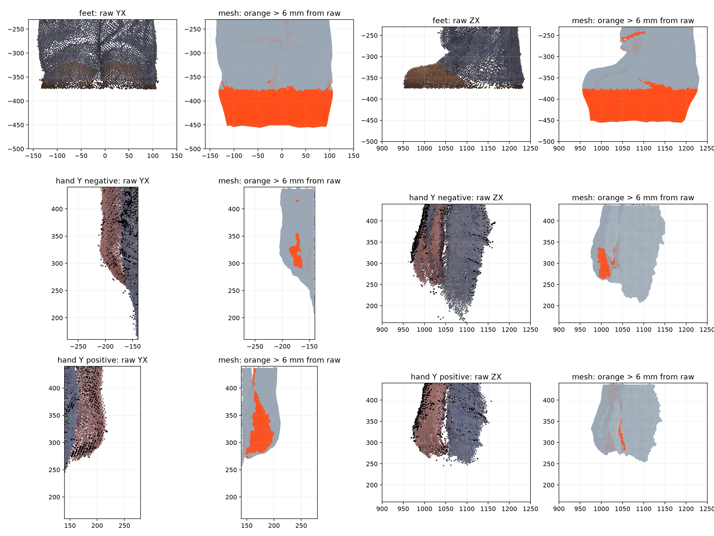
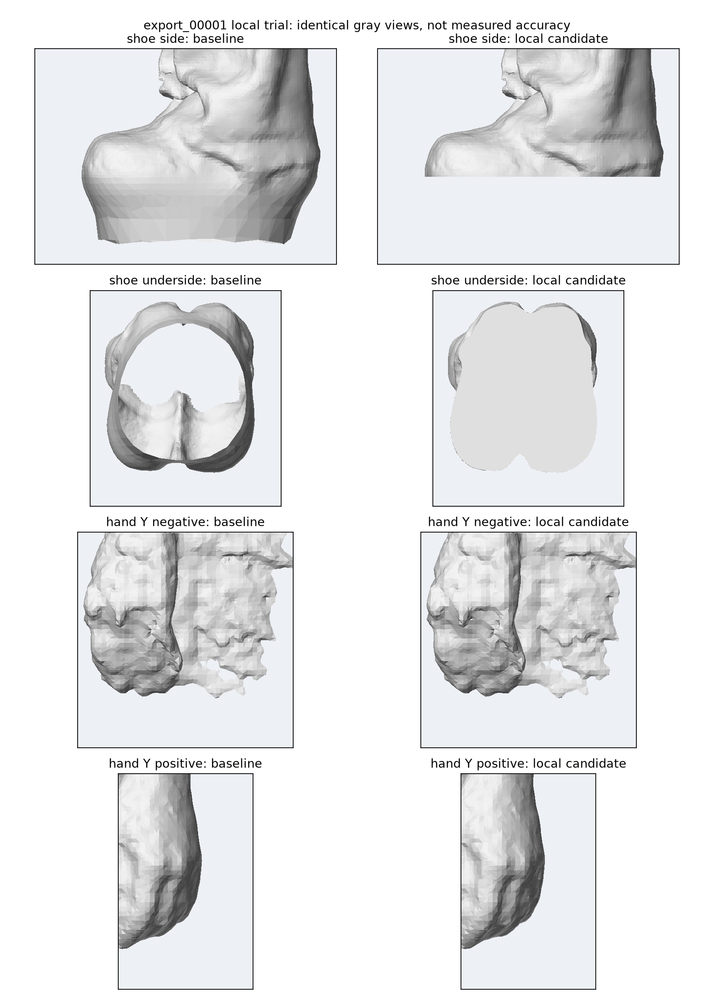

# 鞋底与手掌局部试验

以下是 export_00001 的 20261029_214717_112915 模型局部试验记录。用户确认鞋底效果后，仅鞋底截断补面已加入 run.py 正式流程，按原始数据哈希匹配；手掌调整仍未采用。全身重建参数、原始文件和旧模型保留，不将本次坐标配置套用到其他新数据。

当前正式结果：[0001 PLY](../outputs/models/export_00001/20261029_222508_510300/export_00001_mesh.ply)，同目录有 OBJ、报告和中间结果。以后直接 `python run.py 1` 即包含该鞋底方案；需要恢复未处理鞋底时加 `--no-shoe-repair`。

## 鞋底候选

原始主体观测最低 X 约为 -374.99 mm，模型向下到约 -456.35 mm，多延伸约 81.36 mm。这一范围明显缺乏观测支持。

候选在最低观测下方 3 mm，即 X 约 -377.99 mm 处截断，再沿切口轮廓做三角补面。相比上轮仅删除缺乏支持的面，这次补闭了切口。候选边界边与非流形边计数均为 0，但未做完整自交检查，不能据此宣称可打印。

平底是对缺失区域的人工几何近似，不是实际测得的鞋底厚度、纹理或弯曲形状。切口是一条共同轮廓，原模型两脚在这里已有连接；本轮保留该连接，没有根据不充分的数据强行分开两只鞋。因此这是消除厚块的候选，不是完整鞋部修复。

- [鞋底候选 PLY](../outputs/experiments/local_support/export_00001_feet_candidate.ply)
- [鞋底候选 OBJ](../outputs/experiments/local_support/export_00001_feet_candidate.obj)

鞋底之外的原网格顶点位置与颜色逐项核验保持一致，未增加全身平滑或翻面。原模型和原始 PLY 未覆盖。

## 手掌尚未可靠修好

两侧手部局部网格距最近原始观测的最大距离约为 13 和 21 mm，部分掌心和指缝缺少清楚的表面约束。最近点距离本身不能证明真实手掌应有的形状，也不能据此随意补出手指。

本轮在人工指定的两侧手部范围，尝试稳健邻域平面投影、边界冻结和三角面翻转保护，累计位移不超过 4 mm。实际只移动 276 个顶点，最大约 2.98 mm，局部距离 P95 仍约为 6.65 mm，没有明显改善连片结构。此结果不作为默认方案，也不将“更贴点”当作真实精度提升。

另保留脚部加手部调整候选用于研究，但建议先查看上面的鞋底单独候选，避免把两项效果混在一起。仅凭现有合成 PLY，本轮还不能可靠还原缺失的掌心、指缝或手指结构。

## 对比材料与复现

橙色表示局部三角面有顶点距最近主体原始点超过 6 mm，是诊断阈值，不是精度概率。颜色覆盖并不直接证明整片表面错误。

左列为原模型，右列为鞋底加温和手部调整候选，采用相同灰色视角。鞋底厚块减少较明显，手部整体变化很有限。底部图展示共同补面，不应解释为两只独立且真实的鞋底。

试验代码与统计放在 outputs/experiments/local_support。repair_trial.py 开头写明执行方法；手部框、竖直 X 轴与正向约定仅适用于本次姿态，不应直接套用其他 PLY。
